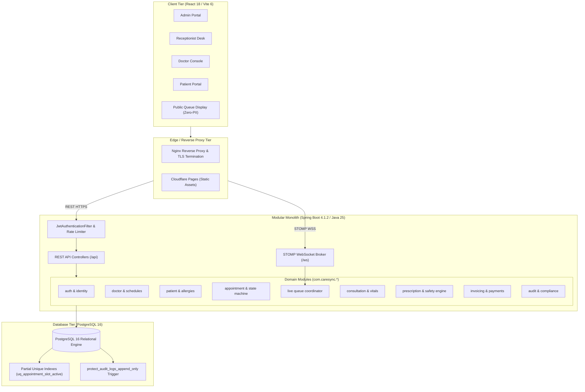
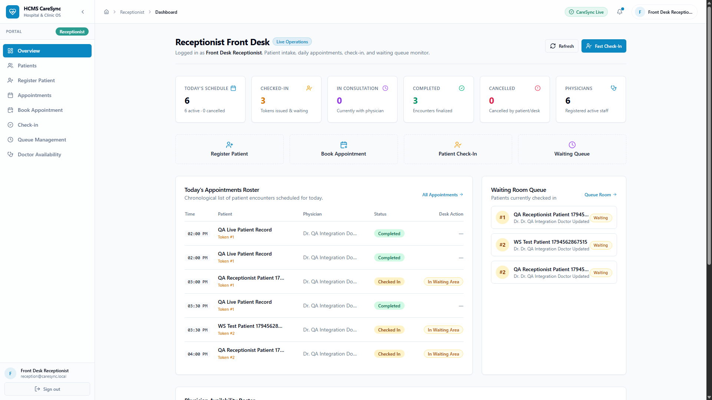
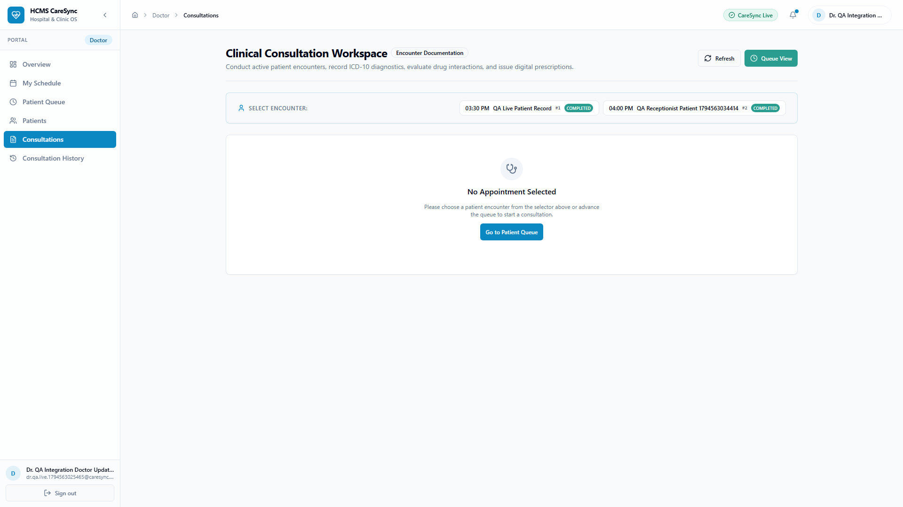
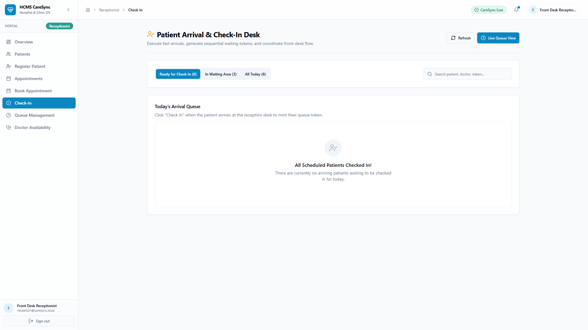
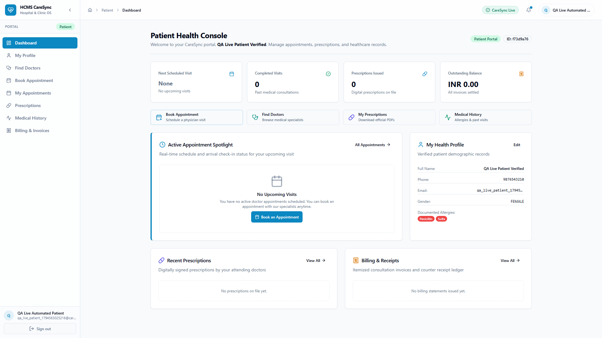

# CareSync — Hospital & Clinic Management System (HCMS)

[](https://openjdk.org/projects/jdk/25/)
[](https://spring.io/projects/spring-boot)
[](https://react.dev/)
[](https://vitejs.dev/)
[](https://www.postgresql.org/)
[](docs/TESTING.md)
[](LICENSE)

An enterprise-grade, high-concurrency outpatient healthcare platform designed to showcase modern **full-stack software engineering**, **resilient backend architecture**, and **secure domain-driven design**.

Built with **Java 25 (Virtual Threads)**, **Spring Boot 4.1.2**, **Spring Security 7**, **PostgreSQL 16**, **React 18**, and **STOMP WebSockets**.

---

## 1. Problem Statement & System Purpose

Outpatient clinics and multi-specialty hospitals face critical operational challenges:
- **Scheduling Conflicts & Race Conditions:** Concurrent slot bookings by patients and receptionists lead to double-booked doctors and clinic chaos.
- **Waiting Room Congestion & Privacy:** Crowded waiting rooms lack real-time visibility, while public monitors risk leaking Protected Health Information (PHI).
- **Prescription Errors & Adverse Drug Events:** Overlooked medication allergies and contraindications compromise patient safety.
- **Financial Leakage & Discrepancies:** Floating-point rounding errors and untracked cancellations lead to revenue discrepancies.
- **Regulatory Compliance:** Auditing requirements demand tamper-proof records of who accessed or modified patient data.

**CareSync** solves these challenges through a cohesive, high-performance **modular monolith** that provides end-to-end outpatient workflow automation across four authenticated role tiers, backed by database-level concurrency guards and an append-only audit trail.

---

## 2. Technology Stack

### Backend & Core Services
- **Runtime:** Java 25 with Virtual Threads enabled (`spring.threads.virtual.enabled: true`)
- **Framework:** Spring Boot 4.1.2
- **Security:** Spring Security 7, HMAC-SHA256 JWT, Single-Use Refresh Token Rotation (RTR)
- **Data Access:** Spring Data JPA with Hibernate 6.6 & HikariCP
- **Database:** PostgreSQL 16
- **Schema Migrations:** Flyway 10 (V1 through V12)
- **Real-Time Communication:** Spring WebSocket with STOMP message broker
- **Document Rendering:** OpenPDF 2.0 (Vector-quality prescriptions and invoice receipts)
- **Rate Limiting:** In-memory Token Bucket algorithm (Bucket4j pattern)

### Frontend & Client Applications
- **Framework:** React 18 (pure JavaScript ES6+ with JSX, no TypeScript)
- **Build System:** Vite 6 with lightning-fast HMR
- **Styling:** Tailwind CSS 3.4 with custom clinical HSL design tokens
- **Routing:** React Router 7 with role-based protected route guards
- **Server State & Caching:** TanStack Query 5 (React Query)
- **HTTP Client:** Axios 1.7 with concurrency-safe single-flight refresh token mutex
- **Forms & Validation:** React Hook Form 7 + Zod 3 runtime schema validation
- **Component Library:** Radix UI primitives & Lucide React icons (18 custom UI components)

### Infrastructure, Testing & DevOps
- **Containers:** Multi-stage Docker builds (`backend/Dockerfile`, `frontend/Dockerfile`)
- **Orchestration:** Docker Compose (local dev and production profiles)
- **Reverse Proxy & TLS:** Nginx 1.27 Alpine with automated Let's Encrypt Certbot renewal
- **Testing:** JUnit 5, Testcontainers (`postgres:16-alpine`), Vitest 2, React Testing Library, jsdom

---

## 3. High-Level System Architecture

CareSync is structured as a **modular monolith** that preserves strict ACID transaction boundaries across domain modules while scaling effortlessly on modern hardware via Java 25 Virtual Threads.



For complete technical specifications, see [docs/architecture/SYSTEM_ARCHITECTURE.md](docs/architecture/SYSTEM_ARCHITECTURE.md).

---

## 4. Role-Based Portals & Functional Capabilities

CareSync provides four dedicated, role-tailored portal experiences:

| Role Portal | Primary Responsibilities & Features |
| :--- | :--- |
| **Admin Portal** | System oversight, physician onboarding, department configuration, clinic revenue aggregations, doctor load distribution, appointment no-show rates, and tamper-proof compliance audit logging. |
| **Receptionist Desk** | Patient check-in desk, walk-in registration, doctor availability schedules, conflict-safe appointment booking, live waiting room queue management, and counter billing settlements (Cash, Card, UPI). |
| **Doctor Console** | Clinical workspace with real-time queue advancement (`call-next`), patient medical timeline review, vitals recording (BP, Pulse, Temp, SpO2), clinical notes, automated drug allergy/interaction screening, and digital prescription issuance. |
| **Patient Portal** | Self-service appointment booking with doctor schedule filters, upcoming appointment management, 2-hour cancellation rules, past medical consultation timeline, active prescriptions, and invoice receipts. |
| **Public Queue Display** | Zero-PII public waiting room screen showing real-time token progression (`Token #14 — In Consultation`, `Token #15 — Waiting`) via WebSockets without exposing patient identities. |

---

## 5. Engineering Highlights & Technical Deep Dives

### 5.1 Concurrency-Safe Slot Booking & Race Condition Elimination
Simultaneous booking attempts on the same doctor time slot are neutralized at the database engine level via a PostgreSQL **partial unique index** (Flyway `V9`):
```sql
CREATE UNIQUE INDEX uq_appointment_slot_active
ON appointments (doctor_id, slot_start)
WHERE status NOT IN ('CANCELLED');
```
If two clients click "Book" at the identical millisecond, the database serializes the transaction; exactly one succeeds (`HTTP 201 Created`), while the second receives an immediate `HTTP 409 Conflict` (`SLOT_ALREADY_BOOKED`), preventing double-booking without complex distributed locks.

### 5.2 Single-Flight Refresh Token Mutex on React Frontend
The Spring Boot backend enforces single-use Refresh Token Rotation (RTR). Replaying an already-consumed refresh token triggers replay detection and revokes the user's entire session family.
- To prevent parallel dashboard widgets from firing concurrent refresh calls when the access token expires, the frontend Axios interceptor (`frontend/src/services/api.js`) implements a **single-flight concurrency mutex**.
- The first `401 Unauthorized` acquires the mutex; all subsequent `401` requests are enqueued in a promise queue.
- A single refresh call is made; upon success, all queued requests are retried with the new access token.

### 5.3 Clinical Safety Engine (Allergy & Drug-Drug Interactions)
Before issuing prescriptions, `SafetyCheckService` cross-references:
1. The medication against the patient's recorded allergies (`patient.allergies TEXT[]`).
2. The medication against the patient's other active prescriptions via a symmetric interaction matrix (`medicines` + `drug_interactions`).
3. Severe warnings require an explicit, documented clinical acknowledgement flag before the prescription can be signed.

### 5.4 Exact Decimal Financial Arithmetic & Invoicing
- **Zero Floating-Point Drift:** Monetary values are modeled as `BigDecimal` with fixed scale of 2 (`RoundingMode.HALF_UP`) mapped to PostgreSQL `NUMERIC(12,2)`.
- **Automated Lifecycle Invoicing:** When an appointment transitions to `COMPLETED`, an event listener calls `AppointmentBillingPort` to generate the consultation invoice automatically.
- **Pessimistic Locking:** Payment recording acquires a `PESSIMISTIC_WRITE` lock on the invoice row to prevent concurrent double-charging.

### 5.5 Immutable Compliance Audit Logging
Healthcare compliance requires tamper-evident audit records. In Flyway `V12`, an append-only trigger is attached to `audit_logs`:
```sql
CREATE TRIGGER protect_audit_logs_append_only
BEFORE UPDATE OR DELETE ON audit_logs
FOR EACH ROW EXECUTE FUNCTION prevent_audit_log_modification();
```
*Even database administrators executing ad-hoc SQL cannot update or delete existing audit entries.*

---

## 6. Automated Testing & Verification Suite

CareSync maintains a **100% automated test pass rate** across all tiers:

```text
========================================================================================
Test Suite                                  Framework                   Tests   Verdict
========================================================================================
Backend Unit & Controller Slices            JUnit 5 / Surefire          110     PASS (0 fail)
Backend Integration (PostgreSQL 16)         Testcontainers / Failsafe    34     PASS (0 fail)
Frontend Component & Workflow Tests         Vitest 2 / RTL / jsdom      187     PASS (0 fail)
Security Attack Vectors (RBAC/IDOR/Auth)    Node.js Security Runner      23     PASS (0 fail)
========================================================================================
TOTAL AUTOMATED VERIFICATIONS                                           354     100% GREEN
========================================================================================
```

For detailed test suite breakdowns and reproduction commands, see [docs/TESTING.md](docs/TESTING.md).

---

## 7. Curated Visual Previews

A small selection of responsive UI captures from the test suite:

| Admin Executive Console | Doctor Clinical Console |
| :---: | :---: |
|  |  |
| *Real-time metrics, revenue charts, doctor load rankings* | *Live queue coordination, vitals entry, drug safety checks* |

| Receptionist Check-In Desk | Patient Self-Service Portal |
| :---: | :---: |
|  |  |
| *Patient arrival desk, token sequencing, queue management* | *Self-booking, appointment timeline, prescription records* |

---

## 8. Quickstart & Local Setup

Follow these steps to run the complete stack locally on Windows PowerShell:

### Prerequisites
- **Java 25** (`java -version`)
- **Node.js 20+ & npm** (`node -v`, `npm -v`)
- **Docker Desktop** (running for PostgreSQL 16)

### 1. Start Database
```powershell
docker compose up -d
```

### 2. Configure Environment
```powershell
Copy-Item .env.example .env
# Set SPRING_DATASOURCE_PASSWORD and CARESYNC_JWT_SECRET in .env
```

### 3. Start Spring Boot Backend
```powershell
cd backend
.\mvnw.cmd spring-boot:run
```
*Backend starts on `http://localhost:8080/api`.*

### 4. Start React Frontend
In a separate terminal:
```powershell
cd frontend
npm install
npm run dev
```
*Frontend opens on `http://localhost:5173/`.*

### 5. Running the Tests
```powershell
# Run backend unit tests:
cd backend; .\mvnw.cmd test

# Run backend PostgreSQL Testcontainers integration tests:
cd backend; .\mvnw.cmd verify

# Run frontend tests:
cd frontend; npm test -- --run
```

---

## 9. Demo Walkthrough Personas

Seeded demo accounts for testing all four roles:

| Role | Email Identifier | Password Configuration |
| :--- | :--- | :--- |
| **System Admin** | `admin@caresync.local` | Set via `CARESYNC_ADMIN_PASSWORD` or quick-fill button |
| **Receptionist** | `reception@caresync.local` | Set via `CARESYNC_RECEPTIONIST_PASSWORD` or quick-fill button |
| **Cardiologist** | `dr.jenkins@caresync.local` | Set via demo quick-fill button |
| **Pediatrician** | `dr.patel@caresync.local` | Set via demo quick-fill button |
| **Patient** | `john.doe@example.com` | Set via demo quick-fill button |

For a guided, step-by-step evaluation script, see [docs/PORTFOLIO_DEMO.md](docs/PORTFOLIO_DEMO.md).

---

## 10. Documentation Sitemap

- **Architecture:**
  - [System Architecture](docs/architecture/SYSTEM_ARCHITECTURE.md)
  - [Backend Architecture & Modules](docs/architecture/BACKEND_ARCHITECTURE.md)
  - [Frontend Architecture & State](docs/architecture/FRONTEND_ARCHITECTURE.md)
  - [Database Design & Schema](docs/architecture/DATABASE_DESIGN.md)
  - [Key Technical Decisions (ADRs)](docs/decisions/KEY_TECHNICAL_DECISIONS.md)
- **API & Domain:**
  - [OpenAPI 3.0.3 Contract](docs/openapi.yaml)
  - [Domain Specifications & Invariants](docs/domain.md)
- **Operations & Security:**
  - [Local Development Guide](docs/DEVELOPMENT.md)
  - [Testing & Quality Assurance](docs/TESTING.md)
  - [Security & Authorization](docs/SECURITY.md)
  - [Deployment & Cloud Runbooks](docs/DEPLOYMENT.md)
  - [Portfolio Demo Script](docs/PORTFOLIO_DEMO.md)
  - [Master Progress Log](docs/PROGRESS.md)

---

## 11. Project Status & Roadmap

- **Core Application Implementation:** **100% Complete** (Full-stack modular monolith, 4 role portals, STOMP queue, automated billing, PDF rendering).
- **Automated Verification:** **100% Passing** (354/354 tests green across backend, frontend, Testcontainers, and security vectors).
- **Deployment Hardening:** **Verified Locally** (Multi-stage Docker images, Cloudflare Pages headers, Nginx reverse proxy configs).
- **Cloud Provisioning:** **Prepared** (Targeted for Cloudflare Pages + Render + Neon; public cloud deployment pending external account provisioning).

---

## License

This project is licensed under the [MIT License](LICENSE).
