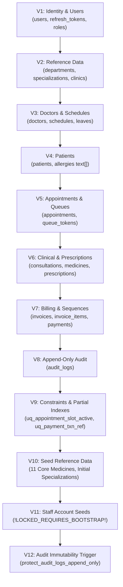

# CareSync Database — Neon Serverless PostgreSQL Setup Guide

## 1. Overview

This guide details the provisioning, configuration, and verification of the **Neon Serverless PostgreSQL** database for the **CareSync Hospital & Clinic Management System (HCMS)** portfolio deployment.

> [!NOTE]
> **Deployment Status:** PostgreSQL 16 compatibility has been locally verified. Actual Neon deployment verification remains pending.

[Neon](https://neon.tech/) provides a modern serverless PostgreSQL engine that separates compute and storage, offering instant provisioning, automated SSL/TLS encryption, automated point-in-time backups, and copy-on-write branching.

---

## 2. Neon Project Provisioning

### 2.1 Create Neon Account & Project
1. Navigate to [https://console.neon.tech/](https://console.neon.tech/) and sign in.
2. Click **Create Project**.
3. Configure project parameters:
   - **Project Name:** `caresync-hcms`
   - **Postgres Version:** `16` (Matches CareSync local development engine)
   - **Region:** Select the cloud region that matches or is closest to your Render backend deployment (e.g. `AWS US East (Ohio)` / `us-east-2`).
4. Click **Create Project**.

### 2.2 Create Database & Retrieve Credentials
1. Under **Databases**, verify or create a database named `caresync` (or use default `neondb`).
2. Neon displays your connection details in the dashboard. Note the following values:
   - **Host:** e.g. `ep-gentle-star-12345678.us-east-2.aws.neon.tech`
   - **Database:** `caresync`
   - **User:** e.g. `neondb_owner`
   - **Password:** `<neon-password>`
   - **Port:** `5432`

---

## 3. Connection String & Protocol Configuration

### 3.1 JDBC Connection String Structure
Spring Boot connects to Neon using the PostgreSQL JDBC driver. Neon requires SSL encryption for all external connections:

```
jdbc:postgresql://<neon-host>:5432/<database>?sslmode=require
```

**Real Example:**
```properties
SPRING_DATASOURCE_URL=jdbc:postgresql://ep-gentle-star-12345678.us-east-2.aws.neon.tech:5432/caresync?sslmode=require
SPRING_DATASOURCE_USERNAME=neondb_owner
SPRING_DATASOURCE_PASSWORD=your_secure_neon_password
```

> [!IMPORTANT]
> **Port 5432 (Direct Compute) vs. Port 6543 (PgBouncer Pooler):**
> Neon provides two connection modes:
> - **Port 5432 (Direct Connection):** Connects directly to the Postgres compute endpoint. Recommended for CareSync during application startup because Flyway executes transactional DDL schema migrations (`V1` through `V12`), advisory locks, and sequence alterations that require standard session-level connections.
> - **Port 6543 (PgBouncer Pooler):** Routes connections through Neon's built-in PgBouncer pooler for high-concurrency client multiplexing. While useful for ephemeral or serverless function workloads, transactional DDL or advisory locks can encounter transaction-pooling limitations unless carefully configured.

---

## 4. HikariCP Connection Pool Optimization for Serverless

In traditional always-on servers, HikariCP maintains 20–50 open persistent TCP connections. In a serverless database environment like Neon, maintaining excessive idle connections wastes resources and can cause connection resets when the compute instance scales or suspends.

CareSync defines cloud-friendly HikariCP parameters in `application-prod.yml` and `application.yml`:

```yaml
spring:
  datasource:
    hikari:
      maximum-pool-size: ${SPRING_DATASOURCE_HIKARI_MAXIMUM_POOL_SIZE:5}
      minimum-idle: ${SPRING_DATASOURCE_HIKARI_MINIMUM_IDLE:1}
      connection-timeout: ${SPRING_DATASOURCE_HIKARI_CONNECTION_TIMEOUT:30000}
      idle-timeout: ${SPRING_DATASOURCE_HIKARI_IDLE_TIMEOUT:600000}
      max-lifetime: ${SPRING_DATASOURCE_HIKARI_MAX_LIFETIME:1800000}
```

### Parameter Rationale for Neon
- **`maximum-pool-size: 5` (Render Free Tier):** Keeps pool usage well within Neon free-tier concurrency limits while comfortably handling multiple concurrent HTTP requests via virtual threads.
- **`minimum-idle: 1`:** Avoids keeping multiple dormant connections open when no traffic is active.
- **`connection-timeout: 30000` (30 seconds):** Allows sufficient time for Neon compute to resume from suspend state (which takes 1.0–1.5 seconds) without throwing SQL connection timeout exceptions.
- **`idle-timeout: 600000` (10 minutes):** Closes dormant connections after 10 minutes of inactivity.
- **`max-lifetime: 1800000` (30 minutes):** Automatically retires and refreshes connections to prevent stale TCP sockets.

---

## 5. Automated Flyway Migrations on First Boot

When the backend connects to a fresh Neon database for the first time, Spring Boot automatically detects unapplied migrations and runs Flyway sequentially.

### 5.1 Migration Execution Inventory



1. **`V1__create_identity_tables.sql`:** Creates `users` table with UUID primary keys and `refresh_tokens` table.
2. **`V2__create_reference_data.sql`:** Provisions `departments`, `specializations`, and `clinics`.
3. **`V3__create_doctor_tables.sql`:** Provisions `doctors`, `doctor_schedules`, and `doctor_leaves`.
4. **`V4__create_patient_tables.sql`:** Provisions `patients` table with native PostgreSQL array column (`allergies TEXT[]`).
5. **`V5__create_appointment_tables.sql`:** Provisions `appointments` table and `queue_tokens` table.
6. **`V6__create_clinical_tables.sql`:** Provisions `consultations`, `medicines`, and `prescriptions` / `prescription_items`.
7. **`V7__create_billing_tables.sql`:** Provisions `invoices`, `invoice_items`, `payments`, and serial sequences (`invoice_seq`).
8. **`V8__create_audit_table.sql`:** Provisions `audit_logs` table.
9. **`V9__create_indexes_and_constraints.sql`:** Applies PostgreSQL partial unique indexes to guarantee clinical invariants:
   - `uq_appointment_slot_active`: Prevents double-booking same doctor and slot.
   - `uq_appointment_doctor_in_consultation`: Guarantees a doctor can only have ONE patient in active consultation simultaneously.
   - `uq_payment_method_txn_ref`: Prevents duplicate transaction reference replays.
10. **`V10__seed_reference_data.sql`:** Seeds 11 essential medicines (Amoxicillin, Paracetamol, Metformin, Atorvastatin, Omeprazole, etc.) with stock levels, reorder thresholds, and active status.
11. **`V11__seed_staff_accounts.sql`:** Seeds base accounts for `admin@caresync.local` and `reception@caresync.local` with non-BCrypt sentinel `!LOCKED_REQUIRES_BOOTSTRAP!`.
12. **`V12__protect_audit_logs_append_only.sql`:** Installs a PostgreSQL trigger function that throws an exception if any query attempts `UPDATE` or `DELETE` on `audit_logs`.

---

## 6. Neon Branching & Backup Capabilities

Neon includes enterprise database features that are particularly valuable for portfolio and demonstration management:

### 6.1 Instant Database Branching
Neon allows you to create instant copy-on-write branches of your database without copying data:
- **`main` branch:** Clean, baseline demonstration database.
- **`test-demo` branch:** Isolated sandbox for recruiters or live testing.
- To create a branch via Neon console:
  1. Go to **Branches** $\rightarrow$ Click **Create Branch**.
  2. Enter branch name (e.g. `staging`).
  3. Neon instantly generates a dedicated connection string with an isolated copy of the data.

### 6.2 Point-in-Time Recovery (PITR)
- Neon maintains continuous Write-Ahead Log (WAL) archiving.
- If demonstration data becomes cluttered with messy test inputs during an evaluation, you can instantly restore the database to any past minute or reset from the root branch.

---

## 7. Direct Database Inspection via psql

To inspect or verify tables directly from your local terminal using the official PostgreSQL client:

```bash
psql "sslmode=require host=ep-gentle-star-12345678.us-east-2.aws.neon.tech dbname=caresync user=neondb_owner"
```

### Useful SQL Verification Queries:
```sql
-- 1. Verify Flyway migration history
SELECT installed_rank, version, description, execution_time, success 
FROM flyway_schema_history 
ORDER BY installed_rank;

-- 2. Verify seeded reference medicines
SELECT id, name, category, dosage_form, unit_price, stock_quantity 
FROM medicines 
ORDER BY name;

-- 3. Verify staff bootstrap status
SELECT id, email, full_name, role, 
       CASE WHEN password_hash LIKE '!LOCKED%' THEN 'LOCKED' ELSE 'ACTIVE' END as status
FROM users;

-- 4. Verify append-only audit trigger is installed
SELECT trigger_name, event_manipulation, action_statement 
FROM information_schema.triggers 
WHERE event_object_table = 'audit_logs';
```
