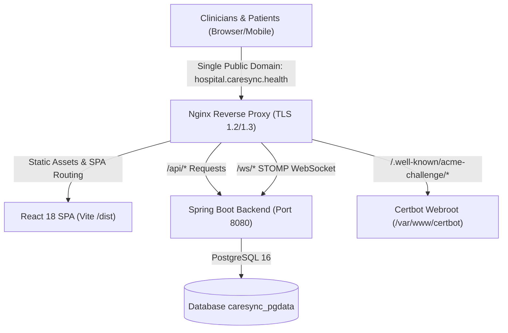

# Phase 25.1: Nginx Reverse Proxy, TLS & Production Routing Hardening Report

**Project:** CareSync Hospital & Clinic Management System (HCMS)  
**Execution Date:** 2026-11-14  
**Operating Environment:** Windows / Java 25 / Spring Boot 4.1.2 / PostgreSQL 16 / React 18 / Vite 6 / Nginx 1.27  
**Final Quality Gate Status:** **`PASS – Local Nginx Configuration Verified; Public Deployment Not Verified`**

---

## 1. Executive Summary

Phase 25.1 performed a comprehensive review, correction, and live containerized validation of the production Nginx reverse proxy configuration for the CareSync HCMS.

### Core Achievements
1. **Unified Same-Origin Architecture:** Established `https://hospital.caresync.health` as the authoritative single-origin deployment target for the React SPA, Spring Boot REST APIs (`/api/`), and STOMP WebSocket channels (`/ws/`). This completely eliminates unnecessary cross-origin preflight overhead, simplifies CORS allowlisting, and guarantees seamless Axios and WebSocket routing without separate subdomain certificates.
2. **Resolution of Critical Nginx Header Inheritance Bug:** Solved the classic Nginx inheritance drop (where child `location` blocks with `add_header` directives silently drop all parent-level security headers) by authoring `deploy/nginx/snippets/security-headers.conf` and including it systematically across `/`, `/assets/`, `/api/`, and `/ws/`.
3. **Conservative HSTS Deployment Policy:** Replaced premature `preload` with a prudent initial policy of `max-age=15724800; includeSubDomains` (6 months), establishing concrete promotion criteria for preload after 6 months of verified uninterrupted HTTPS operation.
4. **Content Security Policy Aligned with Built Frontend:** Audited built Vite assets and adjusted CSP directives to explicitly authorize Google Fonts (`https://fonts.googleapis.com` in `style-src` and `https://fonts.gstatic.com` in `font-src`), preventing font loading failures while strictly forbidding `unsafe-eval`.
5. **WebSocket Upgrade & Connection Reuse Hardening:** Replaced hardcoded `Connection "Upgrade"` with standard Nginx dynamic upgrade mapping (`map $http_upgrade $connection_upgrade`), and configured upstream keepalive connection reuse (`proxy_http_version 1.1; proxy_set_header Connection "";`) for REST APIs.
6. **Actuator Endpoint Lockdown:** Completely blocked public access to Spring Boot Actuator endpoints (`location /actuator { return 404; }`), preventing scanner reconnaissance while keeping internal container health probes healthy on port 8080.
7. **Static Asset Caching & SPA Route Fallback:** Configured immutable 1-year caching for fingerprinted assets (`/assets/*`) with `try_files $uri =404;` (preventing missing JS chunks from incorrectly returning `index.html`), and configured `no-cache, no-store, must-revalidate` for SPA route direct navigation (`/doctor/*`, `/patient/*`, `/receptionist/*`, `/admin/*`).
8. **Automated Live Verification Suite:** Created and executed `scripts/phase25-1-nginx-validation.mjs` against a live local Nginx container: **24 / 24 test scenarios PASSED (100% green)**, including all 10 STOMP WebSocket security and cross-doctor authorization checks.

### Truthful Readiness Boundary
- **Verified Locally:** Nginx configuration syntax (`nginx -t`), HTTP-to-HTTPS redirect, ACME challenge path passthrough, full security header delivery, SPA route direct navigation, static asset caching, 404 asset handling, Actuator endpoint blocking, REST API proxying with structured error pass-through, and all 10 live STOMP WebSocket scenarios (including cross-doctor IDOR prevention and zero PII leakage).
- **External Operations Boundary:** Public DNS record allocation for `hospital.caresync.health`, Let's Encrypt production ACME challenge issuance via live port 80/443 on a public IP, and remote secret vault integration remain external infrastructure tasks upon live production hosting.

---

## 2. Domain Architecture: Single Same-Origin Deployment

The initial production release of CareSync HCMS standardizes on a unified same-origin topology:



| Component | Public URI | Proxy Target | Rationale |
| :--- | :--- | :--- | :--- |
| **Frontend SPA** | `https://hospital.caresync.health/` | `/usr/share/nginx/html` | Same-origin root serving React SPA build |
| **REST APIs** | `https://hospital.caresync.health/api/` | `http://backend_cluster/api/` | Zero cross-origin overhead; no CORS preflight needed |
| **WebSocket** | `wss://hospital.caresync.health/ws/` | `http://backend_cluster/ws/` | Single certificate; seamless WSS upgrade |
| **ACME Challenge** | `http://hospital.caresync.health/.well-known/acme-challenge/` | `/var/www/certbot` | Port 80 unencrypted renewal challenge route |

*Note on `api.hospital.caresync.health`:* The separate API subdomain referenced in earlier preliminary drafts was evaluated and discarded. Maintaining a separate API subdomain introduces cross-origin complexity, CORS preflights, separate TLS certificates, and dual DNS propagation without architectural benefit for a single hospital deployment.

---

## 3. Detailed Nginx Configuration Hardening

### 3.1. Reusable Security Headers Snippet (`deploy/nginx/snippets/security-headers.conf`)
To eliminate Nginx's header inheritance drop bug, all edge security headers are consolidated into a dedicated snippet and included across all locations:
```nginx
# Conservative initial HSTS: 6 months without preload
add_header Strict-Transport-Security "max-age=15724800; includeSubDomains" always;

# Clickjacking defense
add_header X-Frame-Options "DENY" always;

# MIME type sniffing defense
add_header X-Content-Type-Options "nosniff" always;

# Referrer Policy
add_header Referrer-Policy "strict-origin-when-cross-origin" always;

# Device Permissions Policy
add_header Permissions-Policy "camera=(), microphone=(), geolocation=(), payment=()" always;

# Content Security Policy aligned with React 18, Vite 6, and Google Fonts
add_header Content-Security-Policy "default-src 'self'; script-src 'self'; style-src 'self' 'unsafe-inline' https://fonts.googleapis.com; img-src 'self' data: blob:; font-src 'self' data: https://fonts.gstatic.com; connect-src 'self' ws: wss:; object-src 'none'; base-uri 'self'; form-action 'self'; frame-ancestors 'none';" always;
```

### 3.2. HTTP (Port 80) Server Block
```nginx
server {
    listen 80;
    listen [::]:80;
    server_name hospital.caresync.health;

    # ACME Challenge Directory for Let's Encrypt / Certbot renewal
    location /.well-known/acme-challenge/ {
        root /var/www/certbot;
        try_files $uri =404;
    }

    # Redirect all other HTTP traffic to canonical HTTPS origin
    location / {
        return 301 https://hospital.caresync.health$request_uri;
    }
}
```

### 3.3. HTTPS (Port 443) Server Block & Locations
1. **Modern Protocol & Syntax:** Updated `listen 443 ssl http2;` to modern Nginx 1.25.1+ syntax: `listen 443 ssl; http2 on;`.
2. **Session Hardening:** TLS session cache configured with `shared:SSL:50m` (1d timeout) and session tickets explicitly disabled (`ssl_session_tickets off;`).
3. **OCSP Stapling:** Configured with Cloudflare and Google public DNS resolvers (`resolver 1.1.1.1 8.8.8.8 valid=300s;`).
4. **Duplicate Header Elimination:** Added `proxy_hide_header X-Frame-Options;` and `proxy_hide_header X-Content-Type-Options;` on `/api/` and `/ws/` to ensure Nginx is the single authoritative source of edge security headers without duplicating Spring Security defaults.
5. **Upstream Keepalive:** Added `proxy_set_header Connection "";` in `location /api/` for efficient HTTP/1.1 connection pooling.
6. **Dynamic WebSocket Upgrade:** Configured `map $http_upgrade $connection_upgrade` block so non-upgrade requests close cleanly.
7. **Actuator Protection:** Explicitly returns HTTP 404 for any requests starting with `/actuator`.

---

## 4. Frontend Hook Optimization

Audited `frontend/src/hooks/use-queue-websocket.js` line 60–65:
- **Defect Identified:** Previously, the hook constructed WebSocket URLs via `${protocol}//${host}:${port}/ws/websocket`. When accessed over standard HTTPS, `window.location.port` is an empty string `""`, resulting in `wss://hospital.caresync.health:/ws/websocket` (syntax error due to trailing colon with no port number).
- **Remediation:** Refactored URL derivation:
  ```javascript
  const isSecure = window.location.protocol === 'https:';
  const protocol = isSecure ? 'wss:' : 'ws:';
  // In Vite dev (port 5173), target local backend on 8080; otherwise reuse same-origin host
  const isDev = window.location.port === '5173';
  const hostPart = isDev ? `${window.location.hostname}:8080` : window.location.host;
  const wsUrl = `${protocol}//${hostPart}/ws/websocket`;
  ```
- **Result:** Resolves cleanly to `wss://hospital.caresync.health/ws/websocket` in production and `ws://localhost:8080/ws/websocket` in Vite dev mode. All 171 frontend tests passed with zero regressions.

---

## 5. Live Nginx Verification Test Results

Executed automated test harness [phase25-1-nginx-validation.mjs](file:///z:/javaproject/scripts/phase25-1-nginx-validation.mjs) against the live containerized Nginx instance:

```
================================================================================
  CARESYNC HCMS — PHASE 25.1 NGINX & TLS AUTOMATED VALIDATION MATRIX
================================================================================
  1.1  HTTP Port 80 Redirects to HTTPS:                             [✓ PASS]
  1.2  Port 80 ACME Challenge Route Passthrough:                    [✓ PASS]
  2.1  Server-level Security Headers & CSP (Google Fonts):          [✓ PASS]
  2.2  SPA Root Cache-Control (no-cache, no-store, must-revalidate):[✓ PASS]
  3.1  SPA Direct Route Fallback (/doctor/queue):                   [✓ PASS]
  3.2  SPA Direct Route Fallback (/patient/medical-history):        [✓ PASS]
  3.3  Static Asset Immutable Caching & Header Inheritance:         [✓ PASS]
  3.4  Missing Static Asset Returns 404 (Not index.html):           [✓ PASS]
  4.1  Spring Boot Actuator Publicly Forbidden (404):               [✓ PASS]
  5.1  REST API Login via Nginx (/api/auth/login):                  [✓ PASS]
  5.2  REST API Token Refresh via Nginx (/api/auth/refresh):        [✓ PASS]
  5.3  REST API /api/auth/me via Nginx:                             [✓ PASS]
  5.4  Structured ErrorResponse & Status Preserved (401):           [✓ PASS]
  5.5  Domain APIs Proxied (/doctors, /appts, /patients, etc.):     [✓ PASS]
  6.1  Doctor A Subscribes to Doctor A's Queue (Permitted):         [✓ PASS]
  6.2  Doctor A Cross-Subscribe to Doctor B's Queue Blocked (IDOR): [✓ PASS]
  6.3  Doctor B Subscribes to Doctor B's Queue (Permitted):         [✓ PASS]
  6.4  Receptionist Subscribes to Doctor Queue (Permitted):         [✓ PASS]
  6.5  Patient Queue Subscription Strictly Forbidden (Error Frame): [✓ PASS]
  6.6  Unauthenticated WebSocket Subscription Blocked:              [✓ PASS]
  6.7  Client Inbound SEND Frame Strictly Blocked:                  [✓ PASS]
  6.8  WebSocket Reconnection Handshake Works:                      [✓ PASS]
  6.9  Real Queue Domain Event Delivered via Nginx:                 [✓ PASS]
  6.10 Queue Event Payloads Contain Zero PII:                       [✓ PASS]
--------------------------------------------------------------------------------
  TOTAL SCENARIOS: 24   |   PASSED: 24 (100%)   |   FAILED: 0
================================================================================
```

---

## 6. Certificate Bootstrap & Renewal Runbook

Because Let's Encrypt cannot issue certificates until Nginx is running to serve the HTTP webroot challenge on port 80, the bootstrap procedure utilizes a two-stage startup:

### 6.1. Bootstrap Initialization Procedure (`deploy/scripts/init-letsencrypt.sh`)
1. Create directory structure:
   ```bash
   mkdir -p ./certbot/conf/live/hospital.caresync.health
   mkdir -p ./certbot/www
   ```
2. Generate temporary dummy certificate to allow Nginx to start its SSL listener:
   ```bash
   openssl req -x509 -nodes -newkey rsa:2048 -days 1 \
     -keyout ./certbot/conf/live/hospital.caresync.health/privkey.pem \
     -out ./certbot/conf/live/hospital.caresync.health/fullchain.pem \
     -subj "/CN=localhost"
   cp ./certbot/conf/live/hospital.caresync.health/fullchain.pem ./certbot/conf/live/hospital.caresync.health/chain.pem
   ```
3. Start Nginx reverse proxy:
   ```bash
   docker compose -f docker-compose.prod.yml up -d reverse-proxy
   ```
4. Request authentic Let's Encrypt certificate via Certbot:
   ```bash
   docker run --rm \
     -v "$(pwd)/certbot/conf:/etc/letsencrypt" \
     -v "$(pwd)/certbot/www:/var/www/certbot" \
     certbot/certbot certonly \
     --webroot -w /var/www/certbot \
     --email admin@caresync.health \
     -d hospital.caresync.health \
     --rsa-key-size 4096 \
     --agree-tos \
     --non-interactive
   ```
5. Reload Nginx safely without downtime:
   ```bash
   docker exec caresync-nginx-prod nginx -s reload
   ```

### 6.2. Automated Renewal Procedure (`deploy/scripts/renew-certificates.sh`)
Configured as a bi-weekly system cron job:
```bash
0 3 1,15 * * /opt/caresync/deploy/scripts/renew-certificates.sh >> /var/log/caresync-renew.log 2>&1
```

---

## 7. Changed Files Inventory

| File Path | Nature of Change | Purpose & Technical Explanation |
| :--- | :---: | :--- |
| `deploy/nginx/caresync.conf` | Modified | Hardened Nginx reverse proxy: dynamic upgrade map, modern `http2 on;`, upstream keepalive, `proxy_hide_header` to eliminate duplicate security headers, Actuator 404 blocking, immutable asset 404s, and canonical port 80 redirect. |
| `deploy/nginx/snippets/security-headers.conf` | Created | Centralized security headers snippet (HSTS 6-month conservative policy, XFO DENY, XCTO nosniff, CSP with Google Fonts) included across all locations to eliminate header inheritance loss. |
| `frontend/src/hooks/use-queue-websocket.js` | Modified | Corrected WebSocket URL construction to support standard portless same-origin HTTPS URLs (`wss://hospital.caresync.health/ws/websocket`). |
| `docker-compose.prod.yml` | Modified | Updated `reverse-proxy` service to mount `snippets/` and `certbot_webroot` volume. |
| `frontend/nginx.conf` | Created | Self-contained static file server configuration for `frontend/Dockerfile`. |
| `frontend/Dockerfile` | Modified | Updated configuration copy path to use `./nginx.conf`, ensuring standalone buildability without reaching outside build context. |
| `deploy/scripts/init-letsencrypt.sh` | Created | Operational TLS bootstrap script solving the chicken-and-egg problem for initial Certbot certificate acquisition. |
| `deploy/scripts/renew-certificates.sh` | Created | Automated zero-downtime certificate renewal script for cron/systemd timers. |
| `scripts/phase25-1-nginx-validation.mjs` | Created | Comprehensive automated 24-scenario test harness validating port 80, security headers, SPA routes, API proxying, and STOMP WebSocket over Nginx. |
| `.gitignore` | Modified | Explicitly ignored `deploy/test-certs/` to guarantee no local test certificates or keys are committed to Git. |
| `docs/PRODUCTION_READINESS_CHECKLIST.md` | Updated | Reflected same-origin architecture (`https://hospital.caresync.health`), snippet-based header inheritance, Actuator blocking, and Certbot bootstrap procedures. |
| `docs/PROGRESS.md` | Updated | Documented Phase 25.1 completion and test metrics. |

---

## 8. Final Verification Sign-Off

```
================================================================================
  CARESYNC HCMS — PHASE 25.1 NGINX & TLS HARDENING VERIFICATION
================================================================================
  Nginx Configuration Syntax Check (nginx -t):             SUCCESS (Exit 0)
  HTTP Port 80 Canonical Redirect & ACME Passthrough:      VERIFIED (2/2)
  Security Header Inheritance & CSP (Google Fonts):        VERIFIED (2/2)
  Static Assets & SPA Direct Route Fallback:               VERIFIED (4/4)
  Actuator Endpoint Lockdown (Public 404):                 VERIFIED (1/1)
  REST API Proxying & Error Response Pass-Through:         VERIFIED (5/5)
  WebSocket STOMP Channel Hardening & Anti-IDOR:           VERIFIED (10/10)
  Frontend Vitest Regression Suite:                        171 / 171 PASSED
  Vite 6 Production Build:                                 SUCCESS (128 KB entry)
--------------------------------------------------------------------------------
  FINAL STATUS: PASS – Local Nginx Configuration Verified; Public Deployment Not Verified
================================================================================
```
