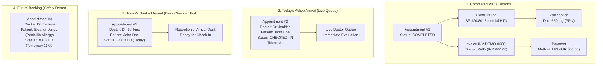

# Phase 26.1 — CareSync Synthetic Demonstration Data Strategy

## 1. Overview & Purpose

To provide a frictionless, comprehensive evaluation experience for technical recruiters and reviewers, CareSync includes a dedicated, repeatable synthetic data strategy.

The seed script is located at:
`deploy/demo-seed.sql`

This script populates an existing CareSync database with realistic clinical entities—including active doctors, clinical schedules, registered patients with medical allergies, a pre-completed consultation with an electronic prescription, a settled invoice, and a patient actively waiting in today's arrival queue.

---

## 2. Safety Invariants & Guardrails

The demo seed script adheres to strict architectural and security guardrails:

1. **Pure Synthetic Data:** All names, telephone numbers, addresses, and clinical scenarios are entirely synthetic. No real patient health information (PHI) or personally identifiable information (PII) is included.
2. **Deterministic UUID Allocation:** Every inserted entity uses a fixed, predictable synthetic UUID (e.g. `d0c70000-0000-4000-8000-000000000001`). This eliminates non-deterministic ID generation and ensures cross-table foreign key relationships remain stable.
3. **Idempotent Execution (`ON CONFLICT DO NOTHING`):** Every `INSERT` statement specifies `ON CONFLICT (id) DO NOTHING` or updates existing daily token counters safely. The script can be executed multiple times without throwing duplicate key errors or corrupting existing data.
4. **Transaction Boundary:** The entire script executes within a single `BEGIN; ... COMMIT;` transaction block, ensuring atomic all-or-nothing execution.
5. **No Migration Collisions:** The script operates strictly in user-space DML and does not alter Flyway version history (`flyway_schema_history`) or modify database schemas.

---

## 3. Seeded Personas & Clinical Scenarios

### 3.1 Staff & Doctor Accounts

| Persona | Email | Password | Role / Specialization | Clinic / Department |
| :--- | :--- | :--- | :--- | :--- |
| **Dr. Sarah Jenkins** | `dr.jenkins@caresync.local` | Configured via `CARESYNC_DEMO_DOCTOR_PASSWORD` | DOCTOR / Cardiology | CareSync Banjara Hills |
| **Dr. Raj Patel** | `dr.patel@caresync.local` | Configured via `CARESYNC_DEMO_DOCTOR_PASSWORD` | DOCTOR / Pediatrics | CareSync Jubilee Hills |
| **System Admin** | `admin@caresync.local` | Configured via `CARESYNC_ADMIN_PASSWORD` | ADMIN | Hospital-wide |
| **Receptionist** | `reception@caresync.local` | Configured via `CARESYNC_RECEPTIONIST_PASSWORD` | RECEPTIONIST | CareSync Banjara Hills |

*Note: All demo seed accounts use the non-BCrypt sentinel `!LOCKED_REQUIRES_BOOTSTRAP!` in `deploy/demo-seed.sql`. Passwords are encrypted on startup via environment variables or set dynamically in the application, ensuring zero plaintext credentials or predictable hashes are stored.*

### 3.2 Patient Accounts & Clinical Profiles

| Patient | Email | Password | Demographics | Allergies |
| :--- | :--- | :--- | :--- | :--- |
| **John Doe** | `john.doe@example.com` | Configured via `CARESYNC_DEMO_PATIENT_PASSWORD` | Age 41, Male | None (`{}`) |
| **Eleanor Vance** | `eleanor.vance@example.com` | Configured via `CARESYNC_DEMO_PATIENT_PASSWORD` | Age 34, Female | **`{"Penicillin"}`** |

*Note: Patient accounts also use `!LOCKED_REQUIRES_BOOTSTRAP!` sentinel and are unlocked via environment variable `CARESYNC_DEMO_PATIENT_PASSWORD` on startup.*

---

## 4. End-to-End Clinical Data Matrix

The script pre-populates four distinct stages of the clinical lifecycle:



### 4.1 Today's Active Queue Dynamic Timestamping
To ensure the doctor's queue page immediately shows a waiting patient upon initial login without requiring manual check-in steps regardless of the hour the demo is evaluated, Appointment #2 dynamically anchors to the current day and hour:
```sql
date_trunc('hour', NOW() AT TIME ZONE 'Asia/Kolkata')
```
The daily queue counter `doctor_day_counters` is automatically updated to `last_token = 1`, ensuring that subsequent receptionist check-ins issue Token `#2`. Appointment #3 is also scheduled for today in `BOOKED` status so the Receptionist Arrival Desk has a patient immediately ready to be checked in.

### 4.2 Clinical Allergy Safety Trigger
Patient Eleanor Vance is seeded with `allergies = '{"Penicillin"}'`. When a doctor conducts a consultation and attempts to prescribe `Augmentin 625` or `Amoxil 500` (Penicillin class drugs), CareSync's drug safety engine immediately fires a `SEVERE` allergy warning, demonstrating the safety system.

---

## 5. Execution & Verification

### 5.1 Manual Execution Against Neon PostgreSQL
The seed script can be applied using `psql`:
```bash
psql "jdbc:postgresql://<neon-host>:5432/caresync?sslmode=require" -f deploy/demo-seed.sql
```
Or via Render Shell / local terminal:
```powershell
docker exec -i caresync-postgres psql -U caresync_user -d caresync < deploy/demo-seed.sql
```

### 5.2 Automated Test Verification (`FlywayMigrationIT.java`)
The script's syntax, foreign key integrity, and idempotency are continuously verified by the automated integration test:
```java
@Test
void demoSeedScriptExecutesCleanlyAndIsIdempotent() throws Exception { ... }
```
In this test:
1. `deploy/demo-seed.sql` is executed against a fresh PostgreSQL 16 database.
2. Seeded doctors, patients, appointments, consultations, prescriptions, and invoices are verified.
3. The script is executed a second time against the same database, proving zero constraint violations.
