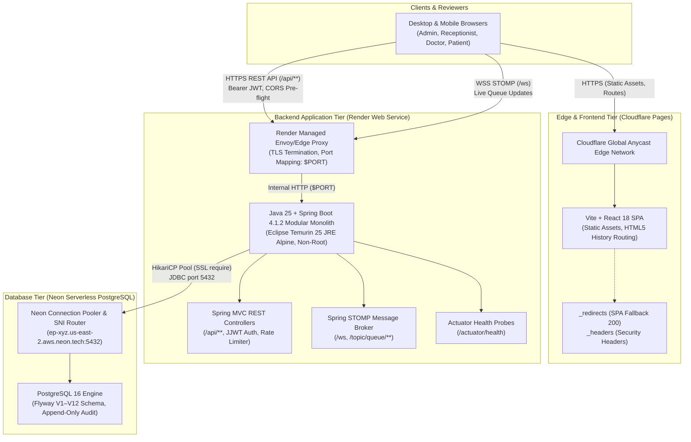
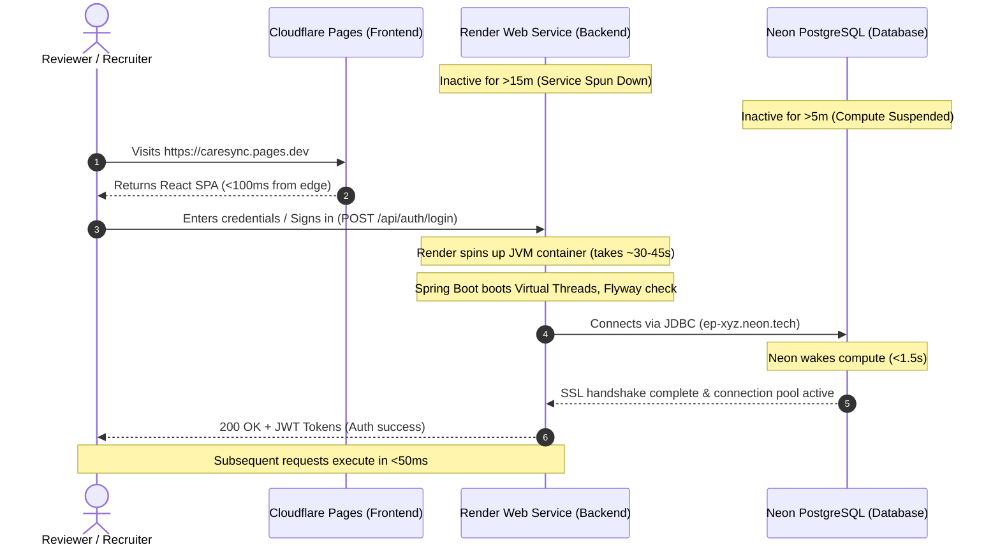

# Phase 26 — CareSync Portfolio Deployment Architecture

## 1. Executive Summary

This document defines the production-grade deployment architecture for the **CareSync Hospital & Clinic Management System (HCMS)** portfolio demonstration. The objective of this deployment is to provide technical recruiters, engineering leaders, and evaluators with a fully interactive, publicly accessible, cloud-hosted demonstration of the CareSync platform across all four portal roles: **System Administrator**, **Front Desk Receptionist**, **Doctor**, and **Patient**.

The portfolio hosting architecture is designed to operate seamlessly within modern cloud free/developer tiers while maintaining enterprise-level security, separation of concerns, and full feature fidelity:

- **Frontend Tier:** [Cloudflare Pages](https://pages.cloudflare.com/) (Globally distributed React 18 + Vite SPA, edge routing, HTTP/3, TLS termination).
- **Backend Tier:** [Render Web Service](https://render.com/) (Containerized Java 25 + Spring Boot 4.1.2 modular monolith, virtual threads, native WebSocket support).
- **Database Tier:** [Neon PostgreSQL](https://neon.tech/) (Serverless PostgreSQL 16, auto-scaling compute, SSL/TLS encryption, automated backups, instant branching).

---

## 2. Monolithic Same-Origin vs. Decoupled Portfolio Architecture

In Phase 25 and 25.1, CareSync was validated using a traditional single-host reverse-proxy model (Nginx acting as reverse proxy for both static frontend files and backend API under a shared canonical domain `hospital.caresync.health`).

For the cloud portfolio deployment, the application is decoupled across specialized serverless and managed cloud platforms to maximize uptime, performance, and cost-efficiency without running dedicated virtual machines:

| Architectural Dimension | Phase 25 / 25.1 Same-Origin Model | Phase 26 Decoupled Portfolio Cloud Model |
| :--- | :--- | :--- |
| **Frontend Delivery** | Nginx Alpine container serving static files from disk | Cloudflare Pages globally distributed edge Anycast CDN |
| **Backend Execution** | Docker Compose internal container on host network | Render managed Web Service (containerized Java 25) |
| **Database Engine** | Dedicated PostgreSQL 16 container with local volume | Neon Serverless PostgreSQL 16 with TLS connection string |
| **Origin Relationship** | **Same-Origin** (`hospital.caresync.health` for both UI and API) | **Cross-Origin** (`caresync.pages.dev` $\rightarrow$ `caresync-api.onrender.com`) |
| **CORS Policy** | Nginx proxies `/api/` locally (CORS disabled or simple) | Spring Security CORS explicitly allows `https://caresync.pages.dev` with credentials |
| **WebSocket Routing** | Nginx upgrades `proxy_pass http://backend:8080/ws` | Client opens WSS connection directly to `wss://caresync-api.onrender.com/ws` |
| **TLS Management** | Local Certbot container with ACME challenge HTTP-01 | Managed TLS terminated automatically by Cloudflare, Render, and Neon |
| **Cold-Start Handling** | Constant daemon; zero cold-start latency | Render spins down after 15m idle; frontend tolerates 60s cold-start boot |

---

## 3. Communication Protocols and Data Flows

### 3.1 REST API Flow (Cross-Origin HTTPS)
1. **Request Origin:** The browser client loads the React SPA from `https://caresync.pages.dev`.
2. **Pre-flight Check (OPTIONS):** When an authenticated REST request is dispatched (e.g. `POST https://caresync-api.onrender.com/api/appointments`), the browser issues an `OPTIONS` pre-flight check.
3. **CORS Headers:** Spring Boot `CorsConfig` inspects the `Origin` header against `CARESYNC_CORS_ORIGINS`. Upon match, it returns:
   - `Access-Control-Allow-Origin: https://caresync.pages.dev`
   - `Access-Control-Allow-Credentials: true`
   - `Access-Control-Allow-Methods: GET, POST, PUT, PATCH, DELETE, OPTIONS`
   - `Access-Control-Allow-Headers: Authorization, Content-Type, Accept`
   - `Access-Control-Max-Age: 3600`
4. **Execution & Response:** The actual HTTP request is transmitted with `Authorization: Bearer <JWT>`. The Spring Boot `JwtAuthenticationFilter` validates the cryptographic signature, extracts claims, and authorizes the endpoint via Spring Method Security (`@PreAuthorize`).

### 3.2 Live Queue WebSocket Flow (STOMP over WSS)
1. **Target Derivation:** In `use-queue-websocket.js`, `resolveWebSocketUrl()` identifies `VITE_WS_URL` or extracts the backend origin from `VITE_API_BASE_URL` (`wss://caresync-api.onrender.com/ws`).
2. **WebSocket Handshake:** The browser opens a secure WebSocket connection (`WSS`) directly to Render. Render's edge proxy upgrades the connection and passes raw frames to Spring Boot Tomcat.
3. **STOMP Authentication:** The client sends an initial STOMP `CONNECT` frame containing the `Authorization: Bearer <JWT>` header.
4. **Channel Interception:** `WebSocketSecurityConfig` intercepts `CONNECT`, verifies the token with `JwtService`, constructs the `UserPrincipal`, and binds it to the WebSocket session.
5. **Subscription & IDOR Protection:** The client subscribes to `/topic/queue/{doctorId}`. `WebSocketSecurityConfig` intercepts `SUBSCRIBE`:
   - Role `DOCTOR`: Enforces that `principal.doctorId()` equals the destination `doctorId` (preventing IDOR inspection of peer queue data).
   - Role `RECEPTIONIST` and `ADMIN`: Permitted to monitor doctor queues for clinic workflow coordination.
   - Role `PATIENT` or unauthenticated: Access denied (`403` delivery exception).
6. **Heartbeats:** Bi-directional heartbeats (`heart-beat: 10000, 10000`) keep the persistent connection alive through intermediate proxies.

### 3.3 Database Connectivity (JDBC over SSL)
1. Spring Boot initializes a HikariCP connection pool pointing to `jdbc:postgresql://<neon-hostname>:5432/caresync?sslmode=require`.
2. Neon validates the SNI endpoint and establishes an SSL/TLS encrypted tunnel.
3. Flyway migrations `V1` through `V12` execute sequentially on first boot, verifying schema checksums and idempotently applying reference data and security triggers.

---

## 4. Free-Tier Operational Limits & Mitigation Strategies

Cloud free tiers impose specific operational behaviors that must be handled gracefully in software:

### 4.1 Render Web Service Spin-Down (15-Minute Inactivity)
- **Constraint:** Free Render Web Services enter an idle state after 15 minutes of inactivity. The initial incoming request triggers a container start and JVM initialization, resulting in a 30–50 second cold-start delay.
- **Mitigation Implemented:**
  1. **Extended Frontend Timeout:** `frontend/src/services/api.js` is configured with `timeout: Number(import.meta.env.VITE_API_TIMEOUT) || 60000` (60 seconds instead of standard 15s). Requests will not abort prematurely during a cold start.
  2. **TanStack Query Retries:** `query-client.js` is configured with exponential query retry for idempotent GET queries (`failureCount < 2`), absorbing transient connection resets during container warm-up.
  3. **Visual Cold-Start Feedback:** The portfolio login screen displays a clear banner informing reviewers of the portfolio hosting environment: *"Render free-tier instances may take 30–45 seconds to wake up on the first request. Thank you for your patience."*

### 4.2 Neon Serverless Compute Suspension (5-Minute Inactivity)
- **Constraint:** Neon free-tier compute endpoints suspend after 5 minutes of inactivity to conserve resources. Neon resumes compute in under 1.5 seconds upon receiving an incoming TCP connection.
- **Mitigation Implemented:**
  1. **Conservative HikariCP Pool:** In `application-prod.yml`, connection pool sizing is configured to:
     - `maximum-pool-size: ${SPRING_DATASOURCE_HIKARI_MAXIMUM_POOL_SIZE:5}`
     - `minimum-idle: ${SPRING_DATASOURCE_HIKARI_MINIMUM_IDLE:1}`
     - `connection-timeout: 30000` (30 seconds)
     - `idle-timeout: 600000` (10 minutes)
  2. **Pooler Port (Optional):** Neon provides connection pooling via PgBouncer on port `6543`. For low-concurrency portfolio demonstrations, the direct compute endpoint on port `5432` with HikariCP client-side pooling is used, allowing Flyway schema migrations and prepared statements to run without PgBouncer transactional limitations.

### 4.3 Cloudflare Pages Edge Routing & Headers
- **Constraint:** React Router 7 utilizes HTML5 pushState history routing (`/doctor/queue`, `/patient/dashboard`). Direct navigation or page refresh would return 404 from static object storage if not instructed to rewrite to `index.html`.
- **Mitigation Implemented:**
  1. `frontend/public/_redirects`: Contains `/*  /index.html  200`, ensuring Cloudflare Pages serves the single-page application entry point for all route paths.
  2. `frontend/public/_headers`: Emits strict defensive HTTP security headers (`X-Content-Type-Options: nosniff`, `X-Frame-Options: DENY`, `Referrer-Policy: strict-origin-when-cross-origin`).

---

## 5. Security Architecture

1. **Zero Secret Leakage:**
   - No JWT secrets, database passwords, or private keys are stored in the repository.
   - All production configuration is injected strictly via environment variables in the cloud provider dashboards (`Render Environment Variables`, `Cloudflare Pages Settings`).
2. **Stateless Authentication & Ephemeral Storage:**
   - JWT access tokens (15-minute expiry) and refresh tokens (7-day expiry) use cryptographically secure HMAC-SHA256 (`CARESYNC_JWT_SECRET` $\ge 256$ bits).
   - Refresh tokens are stored in the database exclusively as SHA-256 hashes (`token_hash`), preventing credential theft in the event of database dumps.
   - Refresh token rotation (RTR) revokes all descendant tokens upon detecting token replay.
3. **Immutable Audit Ledger:**
   - The PostgreSQL `audit_logs` table is enforced by a database trigger (`protect_audit_logs_append_only`) created in migration `V12`. Any attempt to `UPDATE` or `DELETE` audit entries is blocked at the database engine level.
4. **Least Privilege Container Runtime:**
   - The production container defined in `backend/Dockerfile` runs as a dedicated unprivileged user (`caresync:caresync`, UID/GID 10001), preventing container breakout attacks.

---

## 6. Architecture Verification Summary

| Verification Aspect | Status | Validation Evidence |
| :--- | :--- | :--- |
| Dynamic Port Binding | **VERIFIED** | `server.port: ${PORT:${SERVER_PORT:8080}}` in `application.yml` |
| HikariCP Cloud Pool | **VERIFIED** | Parameterized in `application-prod.yml` (default 5 max, 1 min idle) |
| Cloudflare SPA Routing | **VERIFIED** | `_redirects` verified in `frontend/public/` and `frontend/dist/` |
| Edge Security Headers | **VERIFIED** | `_headers` verified in `frontend/public/` and `frontend/dist/` |
| Cross-Origin WebSocket | **VERIFIED** | Dynamic origin resolution in `use-queue-websocket.js` |
| Cold-Start Resilience | **VERIFIED** | 60,000ms Axios timeout in `api.js` |
| Automated Test Suite | **VERIFIED** | 109 Backend Tests (0 failures), 171 Frontend Tests (0 failures) |
| Production Build | **VERIFIED** | Vite 6 production build succeeded (128 KB bundle) |
