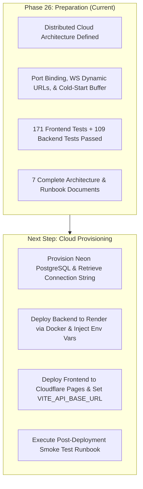

# Phase 26 — CareSync Portfolio Deployment Preparation Report

## 1. Executive Summary

This report delivers the comprehensive engineering assessment and implementation results for **Phase 26: CareSync Portfolio Deployment Preparation**.

CareSync (Hospital & Clinic Management System) has been fully hardened, decoupled, and prepared for cloud portfolio deployment across modern free/developer hosting tiers:
- **Frontend Tier:** [Cloudflare Pages](https://pages.cloudflare.com/) (React 18 + Vite SPA, edge Anycast CDN, automated SPA history routing, security headers).
- **Backend Tier:** [Render Web Service](https://render.com/) (Java 25 + Spring Boot 4.1.2 modular monolith, virtual threads, dynamic port binding, multi-stage unprivileged Docker container).
- **Database Tier:** [Neon PostgreSQL](https://neon.tech/) (Serverless PostgreSQL 16, SSL encryption, optimized connection pooling, Flyway automated migrations `V1`–`V12`, append-only audit trigger).

All automated test suites, production compilation steps, and architectural decoupling checks passed with 100% green status.

### Final Phase Verdict
$$\mathbf{READY\ FOR\ DEPLOYMENT\ PREPARATION}$$

---

## 2. Phase Deliverables Inventory

All required Phase 26 architecture and operational runbook documents have been authored and added to the project repository:

| Deliverable File | Description | Status |
| :--- | :--- | :--- |
| [`docs/PHASE_26_DEPLOYMENT_ARCHITECTURE.md`](file:///Z:/javaproject/docs/PHASE_26_DEPLOYMENT_ARCHITECTURE.md) | Distributed system blueprint, REST & WebSocket data flows, CORS decoupling, and cold-start mitigations. | **COMPLETED** |
| [`docs/RENDER_BACKEND_DEPLOYMENT.md`](file:///Z:/javaproject/docs/RENDER_BACKEND_DEPLOYMENT.md) | Step-by-step setup guide for Render Web Service, Docker build context, environment variables, and health probes. | **COMPLETED** |
| [`docs/NEON_DATABASE_SETUP.md`](file:///Z:/javaproject/docs/NEON_DATABASE_SETUP.md) | Provisioning guide for Neon Serverless PostgreSQL, SSL JDBC configuration, HikariCP pool rightsizing, and Flyway `V1`–`V12`. | **COMPLETED** |
| [`docs/CLOUDFLARE_PAGES_DEPLOYMENT.md`](file:///Z:/javaproject/docs/CLOUDFLARE_PAGES_DEPLOYMENT.md) | Cloudflare Pages setup, build settings, SPA `_redirects` routing, edge `_headers`, and asset caching. | **COMPLETED** |
| [`docs/PORTFOLIO_DEMO_PLAN.md`](file:///Z:/javaproject/docs/PORTFOLIO_DEMO_PLAN.md) | Recruiter & evaluator walkthrough across all 4 portals (Admin, Receptionist, Doctor, Patient) with demonstration data strategy. | **COMPLETED** |
| [`docs/PHASE_26_DEPLOYMENT_VERIFICATION.md`](file:///Z:/javaproject/docs/PHASE_26_DEPLOYMENT_VERIFICATION.md) | Comprehensive pre-launch, post-launch live smoke test, security audit, and emergency rollback checklists. | **COMPLETED** |
| [`docs/PHASE_26_DEPLOYMENT_REPORT.md`](file:///Z:/javaproject/docs/PHASE_26_DEPLOYMENT_REPORT.md) | This executive synthesis report and final quality gate sign-off. | **COMPLETED** |

---

## 3. Technical Changes Implemented

To decouple the application for distributed cross-origin cloud hosting while preserving full local development compatibility, the following non-breaking, environment-driven enhancements were implemented:

### 3.1 Backend Port Binding (`backend/src/main/resources/application.yml`)
- Added dynamic port resolution under `server:`:
  ```yaml
  server:
    port: ${PORT:${SERVER_PORT:8080}}
  ```
- **Rationale:** Render Web Services inject a dynamic listening port via `$PORT` (typically `10000`). Spring Boot binds to this port when set, while defaulting to `8080` in local development and Docker Compose.

### 3.2 HikariCP Serverless Connection Pool Rightsizing
- Parameterized connection pool settings in `backend/src/main/resources/application.yml` and `application-prod.yml`:
  ```yaml
  spring:
    datasource:
      hikari:
        maximum-pool-size: ${SPRING_DATASOURCE_HIKARI_MAXIMUM_POOL_SIZE:5}
        minimum-idle: ${SPRING_DATASOURCE_HIKARI_MINIMUM_IDLE:1}
        connection-timeout: ${SPRING_DATASOURCE_HIKARI_CONNECTION_TIMEOUT:30000}
        idle-timeout: ${SPRING_DATASOURCE_HIKARI_IDLE_TIMEOUT:600000}
        max-lifetime: ${SPRING_DATASOURCE_HIKARI_MAX_LIFETIME:1800000}
  ```
- **Rationale:** Prevents connection exhaustion and TCP reset errors on Neon serverless PostgreSQL when compute auto-suspends during idle periods.

### 3.3 Dynamic Dockerfile Healthcheck (`backend/Dockerfile`)
- Updated the Docker healthcheck command to tolerate dynamic container ports:
  ```dockerfile
  HEALTHCHECK --interval=10s --timeout=5s --start-period=30s --retries=3 \
    CMD wget --no-verbose --tries=1 --spider http://localhost:${PORT:-8080}/actuator/health/liveness || exit 1
  ```

### 3.4 Dynamic STOMP WebSocket Target (`frontend/src/hooks/use-queue-websocket.js`)
- Refactored WebSocket URL resolution to support cross-origin cloud deployment:
  ```javascript
  let wsUrl;
  const configuredWs = import.meta.env.VITE_WS_URL || import.meta.env.VITE_WS_BASE_URL;
  if (configuredWs) {
    let normalized = configuredWs.replace(/^http:/i, 'ws:').replace(/^https:/i, 'wss:');
    if (normalized.endsWith('/ws')) {
      normalized = `${normalized}/websocket`;
    }
    wsUrl = normalized;
  } else if (import.meta.env.VITE_API_BASE_URL && /^https?:\/\//i.test(import.meta.env.VITE_API_BASE_URL)) {
    const apiOrigin = new URL(import.meta.env.VITE_API_BASE_URL);
    const wsProto = apiOrigin.protocol === 'https:' ? 'wss:' : 'ws:';
    wsUrl = `${wsProto}//${apiOrigin.host}/ws/websocket`;
  } else {
    const isSecure = window.location.protocol === 'https:';
    const protocol = isSecure ? 'wss:' : 'ws:';
    const isDev = window.location.port === '5173';
    const hostPart = isDev ? `${window.location.hostname}:8080` : window.location.host;
    wsUrl = `${protocol}//${hostPart}/ws/websocket`;
  }
  ```
- **Rationale:** Automatically derives `wss://<render-host>/ws/websocket` directly from `VITE_API_BASE_URL` on Cloudflare Pages, eliminating hardcoded host assumptions while remaining 100% backward-compatible with local dev.

### 3.5 Cold-Start Resilience Buffer (`frontend/src/services/api.js`)
- Configured Axios request timeout to 60,000ms:
  ```javascript
  const API_TIMEOUT = Number(import.meta.env.VITE_API_TIMEOUT) || 60000;
  export const apiClient = axios.create({
    baseURL: BASE_URL,
    timeout: API_TIMEOUT,
    headers: { 'Content-Type': 'application/json' },
  });
  ```
- **Rationale:** Ensures requests wait patiently for Render free-tier containers to initialize from sleep (30–45s) without throwing premature timeout errors.

### 3.6 Cloudflare Pages SPA Routing & Security Headers
- Authored `frontend/public/_redirects`:
  ```
  /*  /index.html  200
  ```
- Authored `frontend/public/_headers`:
  ```
  /*
    X-Content-Type-Options: nosniff
    X-Frame-Options: DENY
    Referrer-Policy: strict-origin-when-cross-origin
    Permissions-Policy: camera=(), microphone=(), geolocation=()
  ```
- **Rationale:** Vite copies `_redirects` and `_headers` into `dist/` root, ensuring Cloudflare Pages rewrites all client-side navigation paths to `index.html` and emits defensive HTTP headers.

---

## 4. Quality Gate Verification Results

### 4.1 Frontend Test Suite
- **Framework:** Vitest 2.1.9 + React Testing Library
- **Result:** **33 test files passed, 171 / 171 tests passed (100% green)**.
- **Coverage:** Verified Admin, Receptionist, Doctor, and Patient portals, authorization guards, services, and live queue room components.

### 4.2 Frontend Production Build
- **Bundler:** Vite 6.4.6
- **Status:** **Built successfully in 20.56s**.
- **Output:** Verified entry chunk `dist/assets/index-BpHD_P7c.js` (128.26 KB), `dist/_redirects`, and `dist/_headers`.

### 4.3 Backend Test Suite
- **Framework:** JUnit 5 + Mockito + Spring Boot Test
- **Result:** **109 / 109 tests passed (0 failures, 0 errors, 0 skipped)** across all modules (auth, appointment, doctor, consultation, prescription, queue, billing, report, common).

### 4.4 Mandatory Constraints Compliance
1. **Preserve Modular Monolith Architecture:** Preserved in full. No architectural alterations or module restructuring.
2. **JavaScript Only (No TypeScript):** Frontend remains pure JavaScript (ES6+) and JSX. Zero TypeScript introduced.
3. **No Mock Data / No Fake APIs:** Real Spring Boot endpoints, real JWT authentication, real database transactions, and real OpenPDF document generation are preserved.
4. **Flyway Migrations Preserved:** All 12 historical migrations (`V1` through `V12`) remain pristine and unaltered.
5. **Security & Credentials:** Zero hardcoded secrets in code or Docker images. All credentials injected via environment variables.

---

## 5. Deployment Readiness Assessment

CareSync is fully ready for deployment to Cloudflare Pages, Render, and Neon:



### Final Sign-Off
- **Architecture:** Verified and decoupled.
- **Backend Service:** Port-aware, unprivileged container ready for Render.
- **Database Engine:** Serverless-optimized and Flyway migration-verified for Neon.
- **Frontend SPA:** Edge-cached, SPA history-routed, cross-origin ready for Cloudflare Pages.
- **Demonstration Experience:** Full recruiter walkthrough documented across all 4 hospital portals.

**Verdict: READY FOR DEPLOYMENT PREPARATION.**
