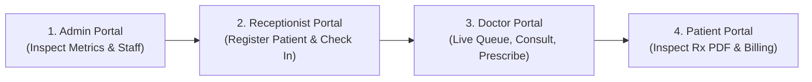

# CareSync Portfolio Demonstration & Recruiter Walkthrough Plan

## 1. Executive Summary

This document is the comprehensive **Demonstration Guide and Recruiter Walkthrough** for the **CareSync Hospital & Clinic Management System (HCMS)** portfolio deployment.

CareSync is a full-featured clinical and operational healthcare platform modeled after real-world hospital workflows. It provides four distinct, authenticated portal experiences tailored to hospital roles:

1. **System Administrator Portal:** Executive analytics, staff provisioning, clinical department management, billing configuration, and tamper-evident audit ledgers.
2. **Receptionist Portal:** Patient intake and registration, appointment scheduling, front-desk arrival check-in desk, live queue room management, and token issuance.
3. **Doctor Portal:** Real-time WebSocket queue monitoring, clinical consultations, allergy and drug-safety checks, electronic prescriptions, and medical history review.
4. **Patient Portal:** Self-service registration, doctor directory search, appointment booking, prescription PDF downloads, and invoice review.

---

## 2. Demonstration Credentials & Quick-Login Reference

| Role | Email Address | Password / Credentials | Initial Setup Requirement |
| :--- | :--- | :--- | :--- |
| **System Administrator** | `admin@caresync.local` | Set via `CARESYNC_ADMIN_PASSWORD` | Bootstrapped on initial backend startup |
| **Front Desk Receptionist** | `reception@caresync.local` | Set via `CARESYNC_RECEPTIONIST_PASSWORD` | Bootstrapped on initial backend startup |
| **Doctor (Cardiology)** | `dr.jenkins@caresync.local` | Set via `CARESYNC_DEMO_DOCTOR_PASSWORD` | Unlocked on startup or set via Admin Portal |
| **Doctor (Pediatrics)** | `dr.patel@caresync.local` | Set via `CARESYNC_DEMO_DOCTOR_PASSWORD` | Unlocked on startup or set via Admin Portal |
| **Patient (John Doe)** | `john.doe@example.com` | Set via `CARESYNC_DEMO_PATIENT_PASSWORD` | Unlocked on startup or registered in portal |
| **Patient (Eleanor Vance)** | `eleanor.vance@example.com` | Set via `CARESYNC_DEMO_PATIENT_PASSWORD` | Unlocked on startup (seeded with Penicillin allergy) |

> [!TIP]
> **One-Step Synthetic Seed Script:**
> Execute `psql "$DATABASE_URL" -f deploy/demo-seed.sql` to immediately seed all doctors, patients, schedules, a pre-completed visit with invoice, and today's active waiting queue. See [`docs/PHASE_26_1_DEMO_DATA_STRATEGY.md`](file:///Z:/javaproject/docs/PHASE_26_1_DEMO_DATA_STRATEGY.md) for complete details.

> [!NOTE]
> **Cold-Start Notice for Reviewers:**
> On the free hosting tier (Render), the backend web service spins down after 15 minutes of inactivity. The very first API call (e.g. initial login) may take 30–45 seconds while the JVM container initializes. Subsequent requests and WebSocket messages execute with sub-50ms latency.

---

## 3. Recommended 10-Minute Evaluator Walkthrough

To experience the full end-to-end clinical workflow, we recommend walking through the four portals in the following chronological sequence:

---

### Step 1: System Administrator Portal (`admin@caresync.local`)
**Target URL:** `https://caresync.pages.dev/login`

1. **Login:** Enter `admin@caresync.local` and your configured admin password.
2. **Executive Overview Dashboard (`/admin`):**
   - Review top KPI summary cards: Active Doctors, Total Patients, Today's Appointments, Monthly Revenue.
   - Inspect the interactive **30-Day Revenue Trend** chart powered by Recharts.
   - Inspect the **Department Distribution** and **Appointment Status Breakdown** visualizers.
3. **Department & Specialization Management (`/admin/departments`):**
   - View seeded hospital departments (Cardiology, Pediatrics, General Medicine, Orthopedics, Neurology).
   - Test adding a new sub-department or specialization (validates uniqueness and minimum length).
4. **Doctor Directory (`/admin/doctors`):**
   - Inspect registered doctors with their specialization, consultation fee, and active status.
5. **Billing & Invoices (`/admin/billing`):**
   - Review hospital-wide billing ledger with invoice statuses (`ISSUED`, `PAID`, `VOID`).
   - Test triggering an on-demand PDF invoice download.
6. **Executive Reports (`/admin/reports`):**
   - Filter revenue, no-show rates, and top-performing doctors across custom date ranges.
7. **Tamper-Evident Audit Ledger (`/admin/audit`):**
   - Inspect real-time audit logs recording every privileged action (timestamp, user principal, action, client IP).
   - Note: Audit records are enforced as strictly append-only by PostgreSQL trigger `protect_audit_logs_append_only`.

---

### Step 2: Front Desk Receptionist Portal (`reception@caresync.local`)
**Target URL:** `https://caresync.pages.dev/receptionist`

1. **Sign In:** Log in as `reception@caresync.local`.
2. **Front Desk Overview (`/receptionist`):**
   - Observe the live today's arrivals count, checked-in count, and queue room status.
3. **Register New Patient (`/receptionist/register-patient`):**
   - Register a new synthetic patient:
     - **Full Name:** `Eleanor Vance`
     - **Phone:** `+1-555-019-2834`
     - **Date of Birth:** `1992-05-14`
     - **Gender:** `FEMALE`
     - **Drug Allergies:** Enter `Penicillin` (critical for demonstrating the doctor's safety check in Step 3!).
   - Submit registration and observe immediate issuance of the permanent Patient UUID.
4. **Book Appointment (`/receptionist/book-appointment`):**
   - Select the newly registered patient (`Eleanor Vance`).
   - Select **Doctor:** `Dr. Sarah Jenkins` (Cardiology).
   - Select **Date:** Today's date.
   - Choose an available 15-minute slot (e.g. `10:00 - 10:15`).
   - Click **Confirm Booking**. The appointment is created in `BOOKED` status.
5. **Daily Arrival Desk & Check-In (`/receptionist/check-in`):**
   - Navigate to the Arrival Desk tab. Locate Eleanor Vance's scheduled appointment for today.
   - Click **Check-In**.
   - **Verification:** The appointment status transitions from `BOOKED` $\rightarrow$ `CHECKED_IN`, and a sequential daily Queue Token is issued (e.g. Token `#C-001`).
6. **Live Queue Room (`/receptionist/queue`):**
   - Observe Eleanor Vance listed in the waiting roster under Dr. Sarah Jenkins.

---

### Step 3: Doctor Portal (`dr.jenkins@caresync.local`)
**Target URL:** `https://caresync.pages.dev/doctor`

1. **Sign In:** Log in as `dr.jenkins@caresync.local`.
2. **Doctor Overview (`/doctor`):**
   - View Today's Schedule spotlight, showing Eleanor Vance in `CHECKED_IN` status.
3. **Live Queue Management (`/doctor/queue`):**
   - Notice the green **Connected** WebSocket badge (STOMP connection over `wss://`).
   - Eleanor Vance appears at the top of the waiting roster.
   - Click **Call Next Patient**.
   - Click **Start Consultation**.
   - **Verification:** The appointment status transitions to `IN_PROGRESS`. A PostgreSQL partial unique constraint (`uq_appointment_doctor_in_consultation`) guarantees that no two consultations can be active simultaneously for the same physician.
4. **Clinical Examination & Safety Checks (`/doctor/consultations`):**
   - In the consultation modal, enter clinical details:
     - **Chief Complaint:** *"Mild chest tightness and shortness of breath upon exertion for 3 days."*
     - **Vitals:** BP `135/85`, Heart Rate `82 bpm`, Temp `98.6°F`.
     - **Diagnosis (Mandatory):** *"Essential Hypertension (I10) and mild exertional dyspnea."*
5. **Drug Safety Check & Prescription:**
   - Under the Prescriptions section, search for `Amoxicillin 500mg`.
   - **Safety Trigger:** The system cross-references Eleanor Vance's recorded allergies (`Penicillin`) against the beta-lactam antibiotic class and triggers an immediate high-priority warning:
     > ⚠️ **DRUG ALLERGY WARNING:** Patient has a documented allergy to **Penicillin**. Amoxicillin presents cross-sensitivity risk.
   - Replace with a safe alternative: Select `Atorvastatin 20mg` (1 tablet daily, 30 days) and `Paracetamol 500mg` (as needed for discomfort).
6. **Complete Consultation:**
   - Click **Complete Consultation**.
   - **Verification:**
     - The appointment status transitions to `COMPLETED`.
     - The clinical consultation record is saved.
     - The electronic prescription is locked and published.
     - An itemized hospital invoice is automatically generated by the backend with the doctor's consultation fee.

---

### Step 4: Patient Portal (Self-Service)
**Target URL:** `https://caresync.pages.dev/patient`

1. **Sign In or Register:**
   - Log in as the patient (or click **Sign Up** to create a personal account).
2. **Patient Dashboard (`/patient`):**
   - Review the personal health spotlight: past visits, active prescriptions, and outstanding invoices.
3. **Find Doctors & Self-Booking (`/patient/doctors` / `/patient/book`):**
   - Search the doctor directory by specialization or department.
   - Inspect doctor consultation fees and bio details.
   - Select an available date and slot to book a future consultation.
4. **Electronic Prescriptions & PDF Generation (`/patient/prescriptions`):**
   - View the active prescription issued by Dr. Sarah Jenkins.
   - Click **Download Prescription PDF**.
   - **Verification:** OpenPDF generates and streams a production-grade clinical prescription PDF containing hospital headers, doctor credentials, patient demographics, allergies, itemized medications with instructions, and the doctor's digital signature block.
5. **Billing & Invoices (`/patient/billing`):**
   - Inspect the generated invoice for the consultation.
   - Review the hospital fee breakdown and hospital payment counter policy notice.
   - Download the official invoice PDF receipt.

---

## 4. Synthetic Data Seeding Strategy

To enable immediate demonstration without requiring manual setup on every deployment:

### 4.1 Seeded Reference Data (Flyway `V10`):
- **Departments (5):** Cardiology, Pediatrics, General Medicine, Orthopedics, Neurology.
- **Medicines (11):** Amoxicillin, Paracetamol, Metformin, Atorvastatin, Omeprazole, Amlodipine, Azithromycin, Losartan, Ciprofloxacin, Ibuprofen, Cetirizine.
- **Clinics (1):** CareSync Central Medical Center.

### 4.2 Seeded Staff Accounts (Flyway `V11`):
- `admin@caresync.local`: Activated on startup via `CARESYNC_ADMIN_PASSWORD`.
- `reception@caresync.local`: Activated on startup via `CARESYNC_RECEPTIONIST_PASSWORD`.

### 4.3 Doctor & Patient Seeding for Portfolio Demo:
For portfolio demonstration environments, the administrator can quickly create test doctors and patients directly via the Admin and Receptionist portals in under 2 minutes, ensuring all records pass realistic database validation and audit logging.

Alternatively, a lightweight SQL script (`deploy/demo-seed.sql`) can be executed against the Neon database using `psql` to pre-seed demonstration doctor accounts and appointment history if instant pre-populated data is preferred.

---

## 5. Demonstration Reset & Maintenance

If an evaluator wishes to return the database to a clean baseline after a demonstration:

1. **Option A: Neon Instant Branch Reset (Recommended)**
   - In Neon Dashboard $\rightarrow$ **Branches** $\rightarrow$ Delete the modified branch and recreate a fresh branch from the clean baseline in under 5 seconds.
2. **Option B: Soft Data Reset**
   - Appointments and consultations can be completed or archived naturally through the portal UIs.
   - Because `audit_logs` is protected by the append-only trigger (`V12`), historical audit records remain immutable, demonstrating healthcare compliance even across test runs.
