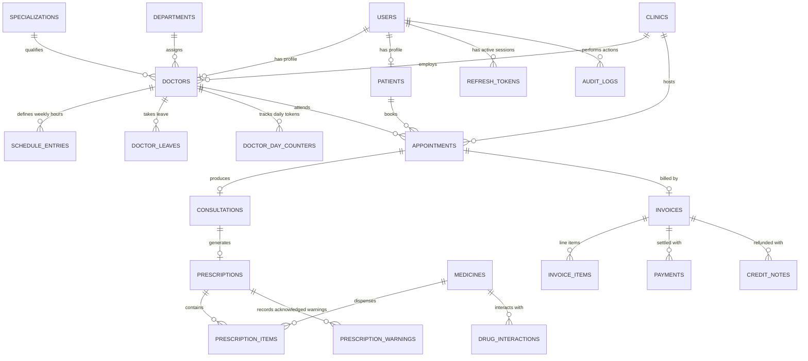

# CareSync HCMS — Database Design & Schema Architecture

## 1. Relational Database Overview

**CareSync** utilizes **PostgreSQL 16** as its primary persistence store. The database schema is designed around strong relational integrity, strict data types, automated migration versioning, and database-level concurrency controls.

- **Engine:** PostgreSQL 16.x
- **Schema Management:** Flyway 10 (Migrations V1 through V12)
- **Primary Keys:** UUID v4 across all tables
- **Financial Arithmetic:** `NUMERIC(12,2)`
- **Temporal Integrity:** `TIMESTAMPTZ` (UTC storage)
- **Immutability:** Database triggers preventing update or deletion of compliance audit logs

---

## 2. Entity-Relationship Model



---

## 3. Schema Modules & Tables

### 3.1 Identity & Authentication (Flyway `V1`)
- **`users`:** Core authentication entity.
  - Columns: `id (UUID PK)`, `email (VARCHAR UNIQUE)`, `password_hash (VARCHAR)`, `full_name (VARCHAR)`, `role (VARCHAR: ADMIN, DOCTOR, RECEPTIONIST, PATIENT)`, `created_at`, `updated_at`.
  - Passwords: Encrypted using BCrypt (cost factor 10) or non-BCrypt sentinel hash (`!LOCKED_REQUIRES_BOOTSTRAP!`) for seeded accounts.
- **`refresh_tokens`:** Secure session management.
  - Columns: `id (UUID PK)`, `user_id (UUID FK)`, `token_hash (VARCHAR(64) UNIQUE)`, `expires_at (TIMESTAMPTZ)`, `revoked (BOOLEAN)`, `revoked_at (TIMESTAMPTZ)`, `created_at (TIMESTAMPTZ)`.
  - Uses SHA-256 hash of the 64-char hex token string.

### 3.2 Reference Data (Flyway `V2`)
- **`clinics`:** Hospital branches and locations.
  - Columns: `id (UUID PK)`, `name (VARCHAR UNIQUE)`, `address (TEXT)`, `phone (VARCHAR)`, `time_zone (VARCHAR: e.g. Asia/Kolkata)`, `created_at`.
- **`specializations`:** Medical fields (e.g., Cardiology, Pediatrics, Neurology).
  - Columns: `id (UUID PK)`, `name (VARCHAR UNIQUE)`, `description (TEXT)`.
- **`departments`:** Administrative departments within the clinic.
  - Columns: `id (UUID PK)`, `name (VARCHAR UNIQUE)`, `description (TEXT)`.

### 3.3 Doctors & Scheduling (Flyway `V3`)
- **`doctors`:** Doctor medical profile.
  - Columns: `id (UUID PK)`, `user_id (UUID FK UNIQUE)`, `specialization_id (UUID FK)`, `clinic_id (UUID FK)`, `department_id (UUID FK)`, `phone (VARCHAR)`, `consultation_fee (NUMERIC(12,2))`, `slot_minutes (INT)`, `active (BOOLEAN)`.
- **`schedule_entries`:** Weekly recurring availability.
  - Columns: `id (UUID PK)`, `doctor_id (UUID FK)`, `day_of_week (VARCHAR)`, `start_time (TIME)`, `end_time (TIME)`.
- **`doctor_leaves`:** Out-of-office dates and emergency leaves.
  - Columns: `id (UUID PK)`, `doctor_id (UUID FK)`, `leave_date (DATE)`, `reason (VARCHAR)`.
  - Enforces `UNIQUE(doctor_id, leave_date)` to prevent duplicate leave declarations.

### 3.4 Patients & Medical Records (Flyway `V4`)
- **`patients`:** Patient demographics and clinical history.
  - Columns: `id (UUID PK)`, `user_id (UUID FK UNIQUE NULLABLE)`, `full_name (VARCHAR)`, `date_of_birth (DATE)`, `gender (VARCHAR)`, `phone (VARCHAR UNIQUE)`, `email (VARCHAR UNIQUE)`, `address (TEXT)`, `allergies (TEXT[])`, `created_at`, `updated_at`.
  - `allergies` stored as a PostgreSQL native text array with case-insensitive uniqueness enforcement in service logic.

### 3.5 Appointments & Live Queue (Flyway `V5`)
- **`appointments`:** Central outpatient scheduling entity.
  - Columns: `id (UUID PK)`, `doctor_id (UUID FK)`, `patient_id (UUID FK)`, `clinic_id (UUID FK)`, `slot_start (TIMESTAMPTZ)`, `slot_end (TIMESTAMPTZ)`, `status (VARCHAR: BOOKED, CHECKED_IN, IN_CONSULTATION, COMPLETED, CANCELLED, NO_SHOW)`, `reason (TEXT)`, `token_number (INT NULLABLE)`, `check_in_time (TIMESTAMPTZ)`, `created_at`, `updated_at`, `version (INT NOT NULL DEFAULT 0)`.
- **`doctor_day_counters`:** High-concurrency daily token sequencing.
  - Columns: `doctor_id (UUID)`, `counter_date (DATE)`, `last_token (INT)`.
  - Primary Key: `(doctor_id, counter_date)`.
  - Atomic increment via SQL: `UPDATE doctor_day_counters SET last_token = last_token + 1 WHERE ... RETURNING last_token`.

### 3.6 Clinical Consultations & Prescriptions (Flyway `V6`)
- **`consultations`:** Physician medical notes and clinical diagnosis.
  - Columns: `id (UUID PK)`, `appointment_id (UUID FK UNIQUE)`, `doctor_id (UUID FK)`, `patient_id (UUID FK)`, `chief_complaint (TEXT)`, `diagnosis (TEXT)`, `clinical_notes (TEXT)`, `vitals (JSONB: blood_pressure, pulse, temperature, spo2, weight)`, `created_at`.
- **`medicines`:** Formulary catalog.
  - Columns: `id (UUID PK)`, `name (VARCHAR UNIQUE)`, `generic_name (VARCHAR)`, `form (VARCHAR: TABLET, CAPSULE, SYRUP, INJECTION, OINTMENT)`, `strength (VARCHAR)`.
- **`drug_interactions`:** Symmetric interaction matrix.
  - Columns: `id (UUID PK)`, `medicine_a_id (UUID FK)`, `medicine_b_id (UUID FK)`, `severity (VARCHAR: MILD, MODERATE, SEVERE)`, `description (TEXT)`.
  - Enforces `UNIQUE(LEAST(medicine_a_id, medicine_b_id), GREATEST(medicine_a_id, medicine_b_id))`.
- **`prescriptions`:** Official prescription record.
  - Columns: `id (UUID PK)`, `consultation_id (UUID FK UNIQUE)`, `doctor_id (UUID FK)`, `patient_id (UUID FK)`, `notes (TEXT)`, `created_at`.
- **`prescription_items`:** Individual medication lines.
  - Columns: `id (UUID PK)`, `prescription_id (UUID FK)`, `medicine_id (UUID FK)`, `dosage (VARCHAR)`, `frequency (VARCHAR)`, `duration_days (INT)`, `instructions (TEXT)`.
- **`prescription_warnings`:** Documented doctor acknowledgements for severe drug interactions or allergy warnings.
  - Columns: `id (UUID PK)`, `prescription_id (UUID FK)`, `warning_type (VARCHAR)`, `severity (VARCHAR)`, `details (TEXT)`, `acknowledged (BOOLEAN)`.

### 3.7 Invoicing & Payments (Flyway `V7`)
- **`invoices`:** Financial billing records.
  - Columns: `id (UUID PK)`, `invoice_number (VARCHAR UNIQUE)`, `appointment_id (UUID FK UNIQUE)`, `patient_id (UUID FK)`, `doctor_id (UUID FK)`, `clinic_id (UUID FK)`, `status (VARCHAR: UNPAID, PARTIALLY_PAID, PAID, VOID)`, `currency (VARCHAR: INR)`, `subtotal (NUMERIC(12,2))`, `total_amount (NUMERIC(12,2))`, `paid_amount (NUMERIC(12,2))`, `balance_due (NUMERIC(12,2))`, `created_at`, `updated_at`.
- **`invoice_items`:** Itemized charges.
  - Columns: `id (UUID PK)`, `invoice_id (UUID FK)`, `description (VARCHAR)`, `quantity (INT)`, `unit_price (NUMERIC(12,2))`, `total_price (NUMERIC(12,2))`.
- **`payments`:** Receipt transactions.
  - Columns: `id (UUID PK)`, `invoice_id (UUID FK)`, `amount (NUMERIC(12,2))`, `method (VARCHAR: CASH, CARD, UPI, INSURANCE)`, `txn_ref (VARCHAR UNIQUE)`, `received_by (UUID)`, `received_by_name (VARCHAR)`, `created_at`.
- **`credit_notes`:** Adjustments and refunds.
  - Columns: `id (UUID PK)`, `credit_note_number (VARCHAR UNIQUE)`, `invoice_id (UUID FK)`, `amount (NUMERIC(12,2))`, `reason (TEXT)`, `issued_by (UUID)`, `created_at`.

### 3.8 Immutable Audit Trail (Flyway `V8` & `V12`)
- **`audit_logs`:** System-wide compliance and security log.
  - Columns: `id (UUID PK)`, `user_id (UUID NULLABLE)`, `user_role (VARCHAR NULLABLE)`, `action (VARCHAR)`, `entity_type (VARCHAR)`, `entity_id (VARCHAR NULLABLE)`, `details (JSONB)`, `ip_address (VARCHAR)`, `created_at (TIMESTAMPTZ)`.

---

## 4. Key Performance & Concurrency Indexes

Defined in Flyway `V9`:

### 4.1 Concurrency Guard Partial Unique Indexes
1. **Prevent Double Booking (`uq_appointment_slot_active`):**
   ```sql
   CREATE UNIQUE INDEX uq_appointment_slot_active
   ON appointments (doctor_id, slot_start)
   WHERE status NOT IN ('CANCELLED');
   ```
   *Guarantees at the database level that no two active appointments can ever be booked for the same doctor at the same slot, even under concurrent multi-client requests.*

2. **Prevent Multiple Active Consultations (`uq_appointment_doctor_in_consultation`):**
   ```sql
   CREATE UNIQUE INDEX uq_appointment_doctor_in_consultation
   ON appointments (doctor_id)
   WHERE status = 'IN_CONSULTATION';
   ```
   *Enforces that a doctor can have at most one patient in consultation at any single moment.*

### 4.2 Query Optimization Indexes
- **`idx_appointments_doctor_date`:** `(doctor_id, slot_start)` — Accelerates slot availability checks and doctor queue lookups.
- **`idx_appointments_patient`:** `(patient_id, slot_start)` — Accelerates patient appointment history and doctor-patient scoping queries.
- **`idx_audit_logs_created_at`:** `(created_at DESC)` — Powers admin audit log timeline pagination.
- **`idx_audit_logs_action`:** `(action)` — Filters audit logs by security events (e.g. `LOGIN_FAILED`, `ACCESS_DENIED`).
- **`idx_invoices_patient`:** `(patient_id, created_at DESC)` — Powers patient portal billing history.

---

## 5. Audit Log Tamper Protection Trigger (`V12`)

To ensure absolute compliance with healthcare audit logging requirements, Flyway migration `V12` attaches a trigger that blocks all update and delete statements:

```sql
CREATE OR REPLACE FUNCTION prevent_audit_log_modification()
RETURNS TRIGGER AS $$
BEGIN
    RAISE EXCEPTION 'audit_logs is append-only: UPDATE and DELETE operations are prohibited.';
END;
$$ LANGUAGE plpgsql;

CREATE TRIGGER protect_audit_logs_append_only
BEFORE UPDATE OR DELETE ON audit_logs
FOR EACH ROW
EXECUTE FUNCTION prevent_audit_log_modification();
```

Any attempt to execute `UPDATE audit_logs` or `DELETE FROM audit_logs` immediately raises an exception and rolls back the enclosing transaction.
