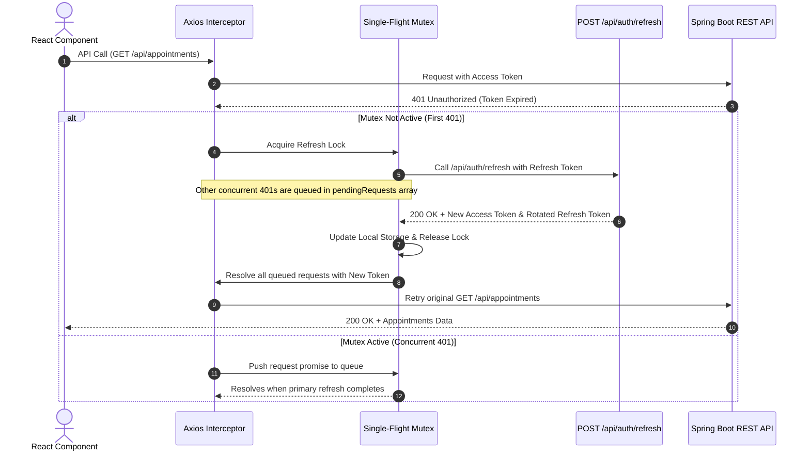

# CareSync HCMS — Frontend Architecture

## 1. Overview & Technology Stack

The **CareSync** frontend is a high-performance, single-page application (SPA) built with modern React:

- **Framework:** React 18 (ES6+ with JSX, strictly JavaScript, no TypeScript)
- **Build & Development Tool:** Vite 6
- **Styling & Design Tokens:** Tailwind CSS 3.4 with custom clinical HSL color variables
- **Routing:** React Router 7 with role-based route guards
- **Server State & Caching:** TanStack Query 5 (React Query)
- **HTTP Client:** Axios 1.7 with concurrency-safe single-flight refresh token mutex
- **Forms & Schema Validation:** React Hook Form 7 with Zod 3 runtime validation
- **Real-Time Queue:** Native browser WebSocket with STOMP client (`use-queue-websocket.js`)
- **Iconography:** Lucide React
- **Testing:** Vitest 2 + React Testing Library + jsdom (187 tests across 34 suites)

---

## 2. Directory & Component Organization

All frontend application source code is organized under `frontend/src/`:

```text
frontend/src/
├── main.jsx                       # React DOM mount point & global provider tree
├── App.jsx                        # Root application component
│
├── app/                           # Core application wiring
│   ├── layouts/
│   │   └── app-layout.jsx         # App shell (Sidebar, Header, Breadcrumbs, Outlet)
│   ├── providers/
│   │   ├── auth.context.jsx       # AuthContext definition & useAuth consumer hook
│   │   ├── auth.provider.jsx      # Authentication state, session hydration, login/logout
│   │   ├── query-client.js        # TanStack QueryClient with default caching & retry policies
│   │   └── query.provider.jsx     # QueryClientProvider wrapper
│   └── router/
│       ├── protected-route.jsx    # Guard requiring valid authenticated session
│       ├── root-redirect.jsx      # Landing redirector to role-specific dashboard
│       └── routes.jsx             # Declarative React Router route definitions
│
├── components/                    # Reusable UI building blocks
│   ├── common/                    # Page skeletons, 404, error boundaries
│   ├── layout/                    # Header, Sidebar, Breadcrumb navigation
│   └── ui/                        # 18 design-system components (shadcn pattern)
│       ├── alert.jsx              ├── badge.jsx              ├── button.jsx
│       ├── card.jsx               ├── confirmation-dialog.jsx├── dialog.jsx
│       ├── dropdown-menu.jsx      ├── empty-state.jsx        ├── error-state.jsx
│       ├── input.jsx              ├── pagination.jsx         ├── select.jsx
│       ├── skeleton.jsx           ├── table.jsx              ├── tabs.jsx
│       ├── textarea.jsx           ├── toast.jsx              └── tooltip.jsx
│
├── features/                      # Domain feature modules & role-based portals
│   ├── auth/                      # Login, Patient Registration, Unauthorized screens
│   ├── admin/                     # Admin Console, Doctors, Depts, Billing, Audit, Reports
│   ├── receptionist/              # Reception Desk, Check-In, Booking, Queue, Walk-In Reg
│   ├── doctor/                    # Clinical Console, Queue Management, Consultations, History
│   └── patient/                   # Patient Dashboard, Booking, Medical History, Invoices
│
├── hooks/                         # Custom React hooks
│   ├── use-appointments.js        ├── use-audit.js           ├── use-billing.js
│   ├── use-consultations.js       ├── use-departments.js     ├── use-doctors.js
│   ├── use-medicines.js           ├── use-patients.js        ├── use-prescriptions.js
│   ├── use-queue.js               ├── use-queue-websocket.js ├── use-reports.js
│   └── use-toast.js
│
├── services/                      # API client integration modules
│   ├── api.js                     # Axios instance with refresh token mutex interceptor
│   ├── auth.service.js            # Sign-in, sign-up, token refresh, session endpoints
│   ├── token.service.js           # Secure localStorage session persistence
│   └── *.service.js               # Domain services matching backend REST resources
│
├── constants/                     # Route definitions, user roles, storage keys
├── lib/utils.js                   # Class merging (clsx + twMerge), currency & date formatters
├── styles/globals.css             # Tailwind base directives & clinical color palettes
└── types/index.js                 # JSDoc typedefs & Zod schemas for runtime validation
```

---

## 3. Authentication & Concurrency-Safe Refresh Token Mutex



### 3.1 Single-Flight Refresh Token Mutex (`frontend/src/services/api.js`)
When a user's 15-minute access token expires, a dashboard rendering multiple widgets might fire 5 concurrent requests simultaneously. If each request attempted to refresh independently, the first would succeed, but the subsequent requests would present an already-consumed single-use refresh token, triggering backend replay-detection and forcibly logging the user out.

To solve this, CareSync implements a **single-flight concurrency mutex**:
1. When the first `401 Unauthorized` arrives, `isRefreshing` is set to `true`.
2. All subsequent `401` responses are added to a `failedQueue` array holding their promise `resolve`/`reject` callbacks.
3. The mutex initiates a single `POST /api/auth/refresh` call.
4. Upon successful refresh:
   - The new access token is stored in memory and `localStorage`.
   - The new rotated refresh token is stored.
   - All queued requests in `failedQueue` are retried with the new token.
5. If the refresh token itself is expired or invalid:
   - The queue is rejected.
   - Session storage is purged via `tokenService.clearTokens()`.
   - The user is redirected to `/login?session_expired=true`.

---

## 4. Role-Based Routing & Portal Isolation

Protected routes are enforced in `frontend/src/app/router/routes.jsx` using `ProtectedRoute`:

```jsx
// Example route definition
{
  path: '/doctor',
  element: (
    <ProtectedRoute allowedRoles={['DOCTOR']}>
      <AppLayout />
    </ProtectedRoute>
  ),
  children: [
    { index: true, element: <DoctorHome /> },
    { path: 'consultations', element: <DoctorConsultationsPage /> },
    { path: 'queue', element: <DoctorQueuePage /> },
    { path: 'schedules', element: <DoctorSchedulePage /> },
    { path: 'patients', element: <DoctorPatientsPage /> },
    { path: 'history', element: <DoctorHistoryPage /> }
  ]
}
```

- Unauthorized users attempting to navigate to another role's URL receive an immediate client-side block and are redirected to `/unauthorized` (`HTTP 403 Forbidden` screen).
- Unauthenticated users are redirected to `/login` with a `returnUrl` query parameter.

---

## 5. Real-Time STOMP Queue Integration (`use-queue-websocket.js`)

Real-time waiting room updates are managed via a custom React hook:

```javascript
export function useQueueWebSocket({ doctorId, onQueueUpdate }) {
  // 1. Establishes native WebSocket connection to /ws
  // 2. Transmits STOMP CONNECT frame with Authorization Bearer header
  // 3. Subscribes to /topic/queue/{doctorId}
  // 4. Dispatches incoming JSON payloads to React state & TanStack cache
  // 5. Handles network disconnection with automatic exponential backoff
  // 6. Cleans up subscription and closes socket on component unmount
}
```

- **Zero-PII Enforcement:** Payloads received on the queue topic contain only anonymous token counters, avoiding local client-side data leaks in shared waiting areas.
- **Cache Invalidation:** When a STOMP message is received, the hook automatically invokes `queryClient.invalidateQueries(['queue', doctorId])`, ensuring instant synchronization across all open tabs.

---

## 6. Server State & TanStack Query Strategy

Server state is separated from transient UI state:
- **Default Stale Time:** 30 seconds for standard queries; 5 minutes for reference data (clinics, specializations).
- **Automatic Refetching:** On window focus for time-sensitive queue operations.
- **Optimistic Updates:** Immediate UI response on patient check-in and queue token advancement, rolling back if backend responds with an error.

---

## 7. Form Management & Client Validation

- **Forms:** Handled via `react-hook-form` for zero-re-render performance.
- **Validation Schemas:** Defined via Zod in `frontend/src/types/index.js`.
- **Field Error Presentation:** Field errors from both client Zod validation and backend `ErrorResponse.fieldErrors` are cleanly rendered below inputs with accessibility attributes (`aria-invalid="true"`, `aria-describedby`).
