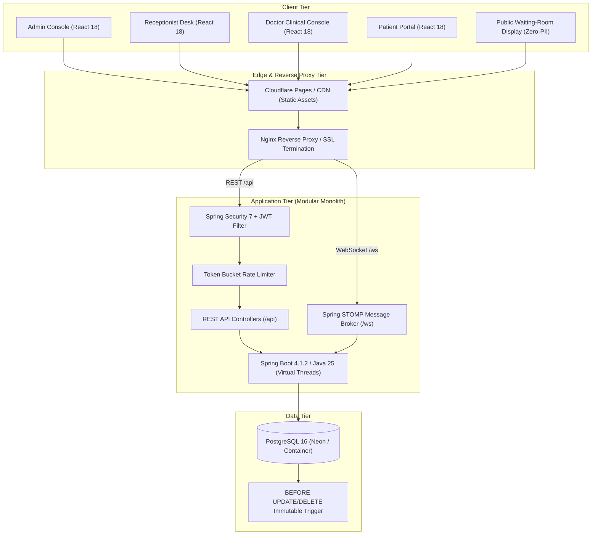
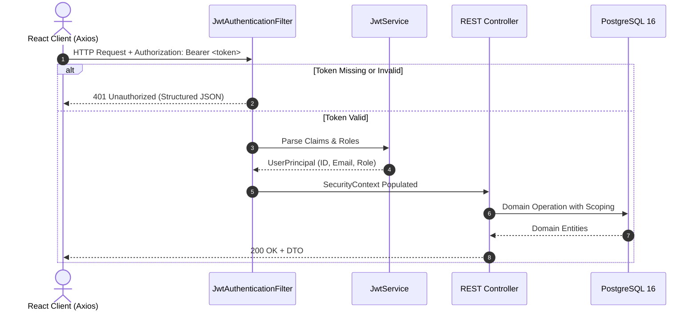

# CareSync HCMS — System Architecture

## 1. High-Level Architectural Overview

**CareSync** is an outpatient Hospital & Clinic Management System designed as a high-performance **modular monolith** backend coupled with a responsive single-page application (SPA) frontend.

The system is built to model core healthcare workflows: role-based access for four distinct user tiers, clinic-timezone-aware appointment scheduling, real-time waiting-room queue management, clinical consultations with drug interaction and allergy safety checks, exact-decimal billing with PDF invoice generation, and an append-only immutable audit trail.



---

## 2. Architectural Principles & Style

### 2.1 Why a Modular Monolith?
Instead of premature microservices distribution, CareSync implements a cohesive **modular monolith** architecture:
- **Zero Network Latency Between Domains:** Cross-module operations (e.g. appointment completion automatically triggering invoice creation) execute within the same process memory and JVM thread.
- **ACID Transaction Boundaries:** Critical business operations span modules transactionally (e.g., booking a slot atomically checks schedule validity, allocates an incremented daily token counter, and persists the appointment).
- **Loose Coupling via Explicit Interfaces:** Modules do not directly query another module's database tables or entities. Inter-module communication uses explicit Java interfaces and DTO adapters (e.g., `AppointmentBillingPort`, `ConsultationLifecyclePort`, `DoctorPatientScopePort`).
- **Unified Deployment & Operational Simplicity:** The entire backend runs as a single JAR inside a lightweight container, drastically lowering infrastructure overhead while scaling effortlessly via Java 25 Virtual Threads.

---

## 3. Communication Patterns

### 3.1 REST API (`/api/*`)
- **HTTP Version:** HTTP/1.1 and HTTP/2 over TLS.
- **Contract:** Defined authoritatively by [OpenAPI 3.0.3 Specification](../openapi.yaml).
- **Payload Format:** JSON (`application/json`).
- **Error Schema:** Uniform structured error response:
  ```json
  {
    "timestamp": "2026-11-14T14:30:00Z",
    "status": 409,
    "code": "SLOT_ALREADY_BOOKED",
    "message": "The requested appointment slot has already been reserved.",
    "path": "/api/appointments",
    "fieldErrors": []
  }
  ```

### 3.2 Real-Time Waiting Room Queues (`/ws`)
- **Protocol:** STOMP over WebSocket (with fallback to SockJS).
- **Channel Security:** Secured via `WebSocketSecurityConfig`:
  - Enforces JWT Bearer token authentication on STOMP `CONNECT` and `SUBSCRIBE`.
  - Blocks all client-originated `SEND` frames (read-only broadcast channel).
  - Enforces role-based channel subscription: Doctors can only subscribe to their own queue topic (`/topic/queue/{doctorId}`); Admins and Receptionists can monitor all doctor queues.
- **Zero-PII Public Queue Board:**
  - Public clinic waiting-room displays query `GET /api/queue/board?clinicId=` with `Cache-Control: no-store`.
  - Payloads expose **strictly anonymous token numbers** (e.g., `Token #12 - In Consultation`, `Token #13 - Waiting`), completely stripping patient names, phone numbers, and clinical details.
- **Post-Commit Event Broadcasting:** Queue change domain events (`QueueChangedDomainEvent`) are published via Spring's `TransactionalEventListener(phase = TransactionPhase.AFTER_COMMIT)`, ensuring clients only receive updates after database transactions successfully commit.

---

## 4. Security & Access Control



### 4.1 Authentication & Token Lifecycle
1. **Short-Lived Access Tokens:** Signed using HMAC-SHA256 (`HS256`), valid for 15 minutes (900 seconds).
2. **Single-Use Refresh Token Rotation (RTR):** Refresh tokens are 64-character cryptographically secure hex strings hashed with SHA-256 before database storage. Each refresh request issues a new refresh token and invalidates the previous one.
3. **Replay Detection & Family Revocation:** If a previously consumed refresh token is presented again (indicating token theft), the backend detects the replay and immediately revokes all tokens in that user's session family.
4. **Staff Account Security Sentinel:** Seeded staff accounts utilize a non-BCrypt sentinel hash (`!LOCKED_REQUIRES_BOOTSTRAP!`). Accounts remain cryptographically locked until initial passwords are provided via environment variables on startup.

### 4.2 Role-Based Access Control (RBAC) & IDOR Defense
- **ADMIN:** Complete system oversight, staff management, department management, financial revenue reports, and immutable audit log exploration.
- **RECEPTIONIST:** Clinic walk-in patient registration, doctor schedule availability inspection, appointment booking, patient check-in, and waiting queue coordination.
- **DOCTOR:** Access scoped strictly to assigned clinic and patients. Clinical consultation entry, vitals recording, safety-screened prescriptions, and queue advancement (`call-next`).
- **PATIENT:** Self-service portal strictly scoped to own identity (`UserPrincipal.id == Patient.userId`). Anti-IDOR guards prevent reading another patient's medical records, downloading invoices, or viewing unauthorized prescriptions.

---

## 5. Persistence & Data Integrity Architecture

### 5.1 Relational Storage (PostgreSQL 16)
- **Isolation Level:** `READ_COMMITTED` with selective `PESSIMISTIC_WRITE` locks for payment processing and invoice settlement.
- **Optimistic Locking:** Entities with concurrent update potential (`Appointment`, `DoctorDayCounter`) utilize JPA `@Version` columns to prevent lost updates.
- **Concurrency Guard Partial Indexes:**
  - `uq_appointment_slot_active`: Prevents double booking on the same doctor slot for active appointments (`status NOT IN ('CANCELLED')`).
  - `uq_appointment_doctor_in_consultation`: Guarantees a doctor cannot have more than one patient in consultation simultaneously.
- **Financial Precision:** Currency arithmetic uses `BigDecimal` mapped to PostgreSQL `NUMERIC(12,2)`. Floats and doubles are strictly forbidden.

### 5.2 Append-Only Audit Logging
All critical operations (authentication, profile access, appointment cancellations, clinical note authoring, prescription signing, invoice voiding, and credit notes) emit synchronous audit events.
- Audit records are stored in `audit_logs`.
- PostgreSQL trigger `protect_audit_logs_append_only` (`V12`) intercepts and raises exceptions on any `UPDATE` or `DELETE` statement against `audit_logs`, guaranteeing tamper-evident retention even against administrative SQL queries.

---

## 6. Deployment Topologies

### 6.1 Target Portfolio Cloud Deployment
Designed for cost-free, high-availability public portfolio demonstration:

```text
[ Cloudflare Pages ] ----(HTTPS / WSS)----> [ Render Web Service ] ----(TLS)----> [ Neon Serverless Postgres ]
  React 18 Frontend                           Spring Boot 4.1.2                       PostgreSQL 16
  Vite 6 SPA Build                            Docker Container (Java 25)              Auto-scaling Database
```

- **Frontend:** Cloudflare Pages global edge network serving static HTML/JS/CSS with pre-configured `_headers` (HSTS, CSP, X-Frame-Options) and `_redirects` (SPA history fallback).
- **Backend:** Render Web Service executing a multi-stage Docker build with OpenJDK 25 runtime.
- **Database:** Neon managed PostgreSQL 16 with SSL enabled (`sslmode=require`) and connection pooling.

### 6.2 On-Premises / Virtual Machine Deployment (Docker Compose)
Included in the repository (`docker-compose.prod.yml`) for self-hosted healthcare deployments:
- **Nginx Reverse Proxy:** Alpine-based Nginx container with TLS termination (Let's Encrypt automated ACME renewal), rate-limiting zones, security headers, and WebSocket reverse proxying.
- **Backend Container:** Multi-stage Spring Boot container running non-root.
- **PostgreSQL Container:** `postgres:16-alpine` with persistent host-mounted data volumes and automated backup directory mounts.
