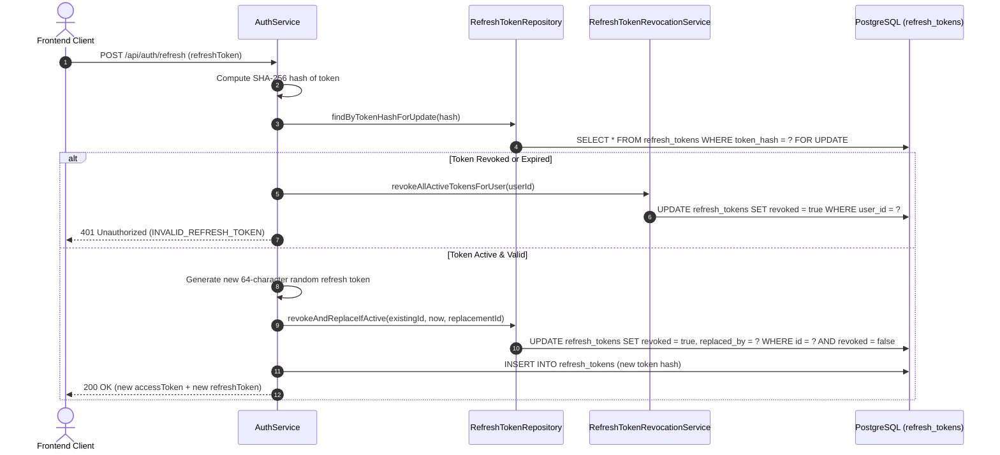

# CareSync HCMS — Backend Architecture

## 1. Overview & Technology Foundation

The **CareSync** backend is implemented as an enterprise-grade modular monolith built on Java 25 and Spring Boot 4.1.2. It leverages high-performance Virtual Threads, declarative transactional boundaries, Spring Data JPA with PostgreSQL 16, and stateless JWT security with single-use refresh token rotation.

- **JDK Version:** Java 25.0.1 (`<java.version>25</java.version>`)
- **Framework:** Spring Boot 4.1.2 (Spring Framework 7.x)
- **Virtual Threads:** Enabled via `spring.threads.virtual.enabled: true`
- **Security:** Spring Security 7.x with custom filter chain and rate limiting
- **Persistence:** Spring Data JPA with Hibernate 6.6 and HikariCP connection pooling
- **Migrations:** Flyway 10.x running migrations `V1` through `V12`
- **Document Generation:** OpenPDF 2.0.x for itemized receipts and clinical prescriptions
- **WebSocket Protocol:** Spring STOMP over SockJS and native WebSocket

---

## 2. Package & Class Organization

All Java source files reside under `backend/src/main/java/com/caresync/`:

```text
com.caresync
├── CareSyncApplication.java                     # Spring Boot entry point
│
├── common/                                      # Cross-cutting infrastructure
│   ├── config/
│   │   ├── CareSyncProperties.java              # Type-safe @ConfigurationProperties
│   │   ├── ClockConfig.java                     # Injectable java.time.Clock bean
│   │   ├── CorsConfig.java                      # Strict CORS source (disallows * with credentials)
│   │   ├── DotenvEnvironmentPostProcessor.java  # Dev .env file loader with lower precedence than OS env
│   │   ├── RateLimitingFilter.java              # In-memory token bucket rate limiting
│   │   ├── RequestLoggingFilter.java            # Sanitized URI and timing logging (zero PII/payloads)
│   │   └── RestTemplateConfig.java              # HTTP client beans
│   ├── dto/
│   │   ├── ErrorResponse.java                   # Standard RFC-compliant error contract
│   │   ├── FieldError.java                      # Validation error details
│   │   └── PageResponse.java                    # Paginated API response wrapper
│   ├── exception/
│   │   ├── CareSyncException.java               # Base unchecked domain exception
│   │   ├── ConflictException.java               # HTTP 409 mapping
│   │   ├── ErrorCode.java                       # Unified enum of all API error codes
│   │   ├── GlobalExceptionHandler.java          # @ControllerAdvice mapping exceptions to ErrorResponse
│   │   ├── NotFoundException.java               # HTTP 404 mapping
│   │   ├── UnauthorizedException.java           # HTTP 401 mapping
│   │   └── ValidationException.java             # HTTP 400 mapping
│   ├── security/
│   │   ├── JwtAuthenticationFilter.java         # Bearer token extractor & SecurityContext injector
│   │   ├── JwtService.java                      # HMAC-SHA256 signing, claims extraction, 256-bit validation
│   │   ├── SecurityConfig.java                  # SecurityFilterChain, stateless sessions, RBAC rules
│   │   ├── SecurityEventLogger.java             # Structured security event logger
│   │   └── UserPrincipal.java                   # Authenticated user representation
│   └── util/
│       ├── MoneyUtils.java                      # Fixed-scale BigDecimal financial helpers
│       ├── PdfHelper.java                       # OpenPDF formatting and layout utilities
│       ├── RequestIpUtils.java                  # X-Forwarded-For IP resolution
│       └── TimeZoneUtils.java                   # Clinic timezone calculations and boundaries
│
├── auth/                                        # User identity & sessions
│   ├── controller/AuthController.java           # /api/auth (register, login, refresh, me, logout)
│   ├── entity/User.java, RefreshToken.java      # JPA user & token entities
│   ├── repository/UserRepository.java           # Email lookups and role checks
│   ├── repository/RefreshTokenRepository.java   # Token hash lookups and atomic revocation
│   └── service/AuthService.java                 # Authentication, rotation, replay detection
│   └── service/StaffAccountBootstrapRunner.java # First-run admin/receptionist password bootstrap
│
├── reference/                                   # Clinics, Specializations, Departments
│   ├── controller/                              # ClinicController, DepartmentController, SpecializationController
│   ├── entity/                                  # Clinic, Department, Specialization
│   └── service/ReferenceDataService.java        # Read-only and admin catalog management
│
├── doctor/                                      # Doctors, Schedules & Leaves
│   ├── controller/                              # DoctorController, ScheduleController, LeaveController
│   ├── entity/                                  # Doctor, ScheduleEntry, Leave
│   └── service/                                 # DoctorService, ScheduleService, LeaveService
│
├── patient/                                     # Patient Demographics & Records
│   ├── controller/PatientController.java        # Demographics, allergies, and medical timeline
│   ├── entity/Patient.java, Gender.java         # Patient JPA entity with TEXT[] allergies
│   └── service/PatientService.java              # CRUD, timeline aggregation, scope validation
│
├── appointment/                                 # Scheduling & Lifecycle
│   ├── controller/                              # AppointmentController, SlotController
│   ├── entity/                                  # Appointment, DoctorDayCounter, AppointmentStatus
│   ├── event/                                   # QueueChangedDomainEvent
│   └── service/                                 # AppointmentService, SlotService, StatusTransitionService
│
├── queue/                                       # Live Queue & WebSocket STOMP
│   ├── broadcast/QueueMessagePublisher.java     # SimpMessagingTemplate broadcasting to /topic
│   ├── config/WebSocketConfig.java              # STOMP endpoint registration (/ws)
│   ├── config/WebSocketSecurityConfig.java      # ChannelInterceptor JWT validation & topic authorization
│   ├── controller/QueueController.java          # Doctor queue view, public board, call-next
│   └── service/QueueService.java                # Queue state computation and token advancement
│
├── consultation/                                # Clinical Notes & Vitals
│   ├── controller/ConsultationController.java   # Vitals and diagnosis recording
│   ├── entity/Consultation.java, VitalsDto.java # JSONB vitals and clinical notes
│   └── service/ConsultationService.java         # Clinical record lifecycle management
│
├── medicine/                                    # Formulary & Drug Interactions
│   ├── controller/MedicineController.java       # Formulary catalog & interaction queries
│   ├── entity/Medicine.java, DrugInteraction.java # Formulary and symmetric interaction matrix
│   └── service/MedicineService.java             # Interaction matrix checks
│
├── prescription/                                # Electronic Prescriptions
│   ├── controller/PrescriptionController.java   # Create, review, and download prescriptions
│   ├── entity/Prescription.java, PrescriptionItem.java # Prescription lines & safety warnings
│   └── service/                                 # PrescriptionService, SafetyCheckService, PrescriptionPdfService
│
├── billing/                                     # Invoices, Payments & Receipts
│   ├── controller/InvoiceController.java        # Invoices, payments, credit notes, PDF receipts
│   ├── entity/Invoice.java, Payment.java        # Financial entities with NUMERIC(12,2)
│   └── service/InvoiceService.java              # Settle balance, void invoices, generate OpenPDF receipt
│
├── report/                                      # Analytics & Dashboards
│   ├── controller/ReportController.java         # Operational KPIs, revenue, no-show analytics
│   ├── repository/ReportRepository.java         # Native SQL aggregations with timezone truncation
│   └── service/ReportService.java               # Asia/Kolkata date boundary reporting logic
│
└── audit/                                       # Immutable Compliance Logging
    ├── controller/AuditLogController.java       # Administrative audit explorer
    ├── entity/AuditLog.java, AuditAction.java   # Audit event entity and action catalog
    └── service/AuditService.java                # Asynchronous/synchronous append-only event recording
```

---

## 3. Spring Security & JWT Authentication

### 3.1 Security Filter Chain Configuration (`SecurityConfig.java`)
- **Stateless Sessions:** `SessionCreationPolicy.STATELESS` ensures no HTTP sessions are stored on the server.
- **CSRF Protection:** Disabled for stateless REST APIs using Bearer tokens.
- **Exception Handling:** Custom `AuthenticationEntryPoint` returns uniform JSON `ErrorResponse` (HTTP 401) on missing or invalid tokens.
- **Access Rule Declarations:**
  - `POST /api/auth/register`, `POST /api/auth/login`, `POST /api/auth/refresh`: Public (`permitAll()`).
  - `GET /api/queue/board`: Public with zero-PII guarantee.
  - `/actuator/health/**`, `/actuator/info`: Public for container orchestration probes.
  - `/ws/**`: Handled by WebSocket security channel interceptor.
  - `/api/admin/**`: Restricted to role `ADMIN`.
  - All other `/api/**` endpoints: Authenticated.

### 3.2 JWT Token Lifecycle & Signature Validation (`JwtService.java`)
- **Signing Algorithm:** HMAC-SHA256 (`HS256`).
- **Key Length Enforcement:** Validates that `caresync.jwt.secret` is at least 32 bytes (256 bits). Rejects empty values or unexpanded `${...}` placeholders at application bootstrap.
- **Claims Extraction:** Claims payload encodes `sub` (User UUID), `email`, `fullName`, and `role`.
- **Token Validity:**
  - Access Token: 15 minutes (900 seconds).
  - Refresh Token: 7 days (604,800 seconds).

---

## 4. Single-Use Refresh Token Rotation & Replay Protection

The refresh token lifecycle implements strict rotation and replay defense in [AuthService.java](file:///z:/javaproject/backend/src/main/java/com/caresync/auth/service/AuthService.java#L168-L208):



### Key Security Defenses:
1. **Hash-Only Storage:** Refresh tokens are never stored in plaintext. Only SHA-256 hex digests are persisted in the `token_hash` column.
2. **Pessimistic Row Lock:** `findByTokenHashForUpdate` prevents race conditions when concurrent requests present the same token.
3. **Replay Detection:** If a previously revoked token is presented again (indicating token compromise), the system treats it as token theft and immediately revokes all active refresh tokens for that user.
4. **Staff Account Sentinel:** Seeded accounts in `V11` use `!LOCKED_REQUIRES_BOOTSTRAP!`. `StaffAccountBootstrapRunner` encodes the passwords supplied in environment variables on initial startup without overwriting existing accounts.

---

## 5. Role-Based Authorization & IDOR Defense

CareSync enforces granular authorization at the controller, service, and data layers:

| Role | Permitted Operations | Access Scoping & Anti-IDOR Guards |
| :--- | :--- | :--- |
| **`ADMIN`** | Complete system oversight, staff management, department management, financial revenue reports, and immutable audit log exploration. | Unrestricted administrative scope across all clinics and departments. |
| **`RECEPTIONIST`** | Patient registration, doctor schedule availability inspection, appointment booking, patient check-in, counter payments, and live queue monitoring. | Scoped to assigned clinic branch; can check in and manage queues across all doctors in that clinic. |
| **`DOCTOR`** | View today's schedule, call next patient from queue, author clinical notes and vitals, screen drug contraindications, write prescriptions. | Scoped strictly to assigned clinic and patients who have appointments with this doctor via `DoctorPatientScopePort`. |
| **`PATIENT`** | View own medical timeline, book available outpatient slots, review own prescriptions, view and download own invoice receipts. | Strictly scoped to own identity (`UserPrincipal.id == Patient.userId`). Anti-IDOR checks reject any attempt to read another patient's medical records. |

---

## 6. Appointment & Live Queue Workflows

### 6.1 Slot Calculation Engine (`SlotService.java`)
- Consults the doctor's recurring weekly availability in `schedule_entries` (e.g. Monday 09:00–13:00).
- Verifies the doctor has no approved `doctor_leaves` for the requested calendar date.
- Divides the working hours into discrete intervals based on `doctor.slot_minutes` (e.g. 15 or 30 minutes).
- Checks booked appointments in `appointments` and marks conflicting slots as unavailable.

### 6.2 Concurrency-Guarded Booking (`AppointmentService.java`)
- Enforces database-level mutual exclusion using partial unique index `uq_appointment_slot_active` on `(doctor_id, slot_start) WHERE status NOT IN ('CANCELLED')`.
- If two users submit concurrent bookings for the exact same slot, one commits and the second receives a `DataIntegrityViolationException`, which the service translates to HTTP 409 `SLOT_ALREADY_BOOKED`.

### 6.3 Daily Token Counters (`DoctorDayCounter.java`)
- When a patient arrives, the receptionist transitions the appointment to `CHECKED_IN`.
- A daily sequential token is issued by atomically incrementing `doctor_day_counters` for the doctor and current clinic date:
  ```sql
  INSERT INTO doctor_day_counters (doctor_id, counter_date, last_token)
  VALUES (:doctorId, :counterDate, 1)
  ON CONFLICT (doctor_id, counter_date)
  DO UPDATE SET last_token = doctor_day_counters.last_token + 1
  RETURNING last_token;
  ```
- This token number is assigned to `appointment.token_number`.

---

## 7. WebSocket / STOMP Implementation

### 7.1 Broker Architecture & Topic Structure
- **Endpoint:** `/ws` (with SockJS fallback enabled).
- **In-Memory Simple Broker:** Handles destinations prefixed with `/topic`.
- **Application Destination Prefix:** `/app`.
- **Primary Queue Topic:** `/topic/queue/{doctorId}`.

### 7.2 Channel Security Interceptor (`WebSocketSecurityConfig.java`)
- Implements Spring's `ChannelInterceptor` on `clientInboundChannel`.
- On `CONNECT` frame: Extracts `Authorization: Bearer <token>` from native headers, validates the JWT via `JwtService`, and populates the WebSocket session's `Principal`.
- On `SUBSCRIBE` frame: Enforces topic authorization:
  - Doctors may only subscribe to `/topic/queue/{doctorId}` where `{doctorId}` matches their authenticated doctor profile ID.
  - Admins and Receptionists may subscribe to any doctor's queue topic.
  - Patients cannot subscribe to doctor clinical queue topics.
- On `SEND` frame: Client-originated messages are rejected; the broker is strictly a server-to-client broadcast pipeline.

---

## 8. Exception Handling & Structured Validation

### 8.1 Unified Error Contract (`GlobalExceptionHandler.java`)
All uncaught exceptions, validation failures, and domain rejections produce a standardized RFC-compliant error body:

```java
public record ErrorResponse(
    Instant timestamp,
    int status,
    ErrorCode code,
    String message,
    String path,
    List<FieldError> fieldErrors
) {}
```

### 8.2 Error Code Mapping
| Exception Class | HTTP Status | Example `ErrorCode` | Scenarios |
| :--- | :---: | :--- | :--- |
| `ValidationException` | 400 | `INVALID_INPUT`, `PASSWORD_TOO_SHORT` | Malformed inputs, failed regex, out-of-range parameters |
| `UnauthorizedException` | 401 | `INVALID_CREDENTIALS`, `INVALID_REFRESH_TOKEN` | Expired tokens, bad passwords, revoked refresh tokens |
| `AccessDeniedException` | 403 | `ACCESS_DENIED`, `UNAUTHORIZED_ROLE` | Attempting to access an administrative or other user's resource |
| `NotFoundException` | 404 | `PATIENT_NOT_FOUND`, `SLOT_NOT_FOUND` | Querying non-existent entity UUIDs |
| `ConflictException` | 409 | `SLOT_ALREADY_BOOKED`, `EMAIL_ALREADY_EXISTS` | Concurrency collisions, unique constraint violations |
| `RateLimitException` | 429 | `RATE_LIMIT_EXCEEDED` | Exceeding IP or user token bucket limit |
