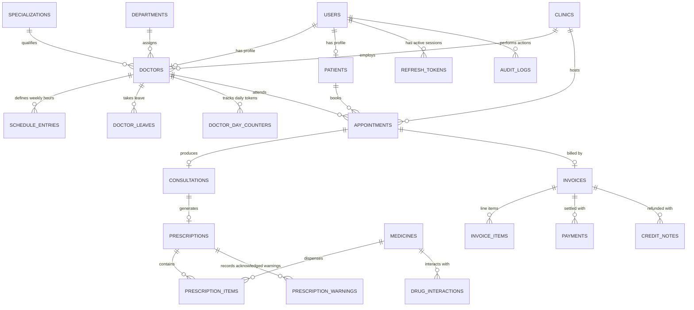

# CareSync HCMS — Database Architecture & Schema Design

## 1. Relational Database Overview

**CareSync** employs **PostgreSQL 16** as its primary ACID-compliant persistence store. The schema is architected around strong relational integrity, strict numeric precision for financial auditing, automated versioned schema migrations via Flyway, and database-level concurrency controls.

- **Engine:** PostgreSQL 16.x (Neon Serverless with Connection Pooling)
- **Schema Management:** Flyway 10.x running migrations `V1` through `V12`
- **Identifier Strategy:** UUID v4 across all tables (generated via `gen_random_uuid()`)
- **Temporal Integrity:** `TIMESTAMPTZ` (stored strictly in UTC; converted to clinic timezones at service layer)
- **Financial Precision:** Currency fields use `NUMERIC(12,2)` (prohibiting floating-point types)
- **Immutability:** PostgreSQL database trigger (`V12`) enforcing append-only security on `audit_logs`

---

## 2. Entity-Relationship Model



---

## 3. Flyway Migration Version History (`V1`–`V12`)

Every migration in CareSync is strictly additive. There are **zero** `DROP TABLE`, `TRUNCATE`, or `DELETE FROM` statements across all migrations:

| Version | Migration Script | Scope & Managed Tables |
| :---: | :--- | :--- |
| **`V1`** | `V1__create_identity_tables.sql` | `users`, `refresh_tokens` |
| **`V2`** | `V2__create_reference_data.sql` | `clinics`, `specializations`, `departments` |
| **`V3`** | `V3__create_doctor_tables.sql` | `doctors`, `schedule_entries`, `doctor_leaves` |
| **`V4`** | `V4__create_patient_tables.sql` | `patients` (with `allergies TEXT[]`) |
| **`V5`** | `V5__create_appointment_tables.sql` | `appointments`, `doctor_day_counters` |
| **`V6`** | `V6__create_clinical_tables.sql` | `consultations` (vitals `JSONB`), `medicines`, `drug_interactions`, `prescriptions`, `prescription_items`, `prescription_warnings` |
| **`V7`** | `V7__create_billing_tables.sql` | `invoices`, `invoice_items`, `payments`, `credit_notes` |
| **`V8`** | `V8__create_audit_table.sql` | `audit_logs` |
| **`V9`** | `V9__create_indexes_and_constraints.sql` | Partial unique indexes, performance indexes, and foreign keys |
| **`V10`** | `V10__seed_reference_data.sql` | Clinics, specializations, baseline formulary medicines, and drug interactions |
| **`V11`** | `V11__seed_staff_accounts.sql` | Seeded `ADMIN` and `RECEPTIONIST` accounts with `!LOCKED_REQUIRES_BOOTSTRAP!` sentinel |
| **`V12`** | `V12__protect_audit_logs_append_only.sql` | PostgreSQL trigger preventing `UPDATE` and `DELETE` on `audit_logs` |

---

## 4. Key Entities & Database Schemas

### 4.1 Identity & Sessions (`users`, `refresh_tokens`)
* **`users`:** Stores login identities.
  - `password_hash`: BCrypt hash (cost factor 10) or non-BCrypt sentinel `!LOCKED_REQUIRES_BOOTSTRAP!`.
  - `role`: Enum check constraint (`ADMIN`, `RECEPTIONIST`, `DOCTOR`, `PATIENT`).
* **`refresh_tokens`:** Stores active session tokens.
  - `token_hash`: SHA-256 hex digest of the 64-character token (`VARCHAR(64) UNIQUE`).
  - `replaced_by`: Foreign key to next token in rotation chain.

### 4.2 Doctors, Availability & Leaves (`doctors`, `schedule_entries`, `doctor_leaves`)
* **`doctors`:** Clinical profile linked to `users(id)`.
  - `slot_minutes`: Appointment granularity (default 15 or 30 minutes).
  - `consultation_fee`: `NUMERIC(12,2)`.
* **`schedule_entries`:** Recurring weekly working hours (`day_of_week`, `start_time`, `end_time`).
* **`doctor_leaves`:** Out-of-office dates (`leave_date DATE`). Unique constraint on `(doctor_id, leave_date)` prevents duplicate leaves.

### 4.3 Patients & Medical Demographics (`patients`)
* Stores clinical demographics and contact details.
* `allergies`: PostgreSQL native `TEXT[]` array, allowing fast array containment queries (`allergies @> ARRAY['penicillin']`).

### 4.4 Outpatient Scheduling & Token Sequencing (`appointments`, `doctor_day_counters`)
* **`appointments`:** Central visit scheduling record.
  - `status`: `BOOKED`, `CHECKED_IN`, `IN_CONSULTATION`, `COMPLETED`, `CANCELLED`, `NO_SHOW`.
  - `version`: Optimistic locking integer (`@Version`).
  - `token_number`: Sequential daily token assigned upon arrival check-in.
* **`doctor_day_counters`:** Daily token generator.
  - Primary Key: `(doctor_id, counter_date)`.
  - Incremented atomically via SQL `ON CONFLICT DO UPDATE SET last_token = last_token + 1 RETURNING last_token`.

### 4.5 Clinical Consultations & Formularies (`consultations`, `medicines`, `prescriptions`)
* **`consultations`:** Physician medical notes.
  - `vitals`: PostgreSQL `JSONB` column storing blood pressure, pulse, temperature, oxygen saturation, and weight.
* **`drug_interactions`:** Symmetric interaction matrix.
  - Canonical ordering constraint: `medicine_a_id < medicine_b_id` prevents duplicate inverse entries.
* **`prescriptions`:** Medication orders with prescription numbers, dosages, durations, and recorded safety check flags.

### 4.6 Billing & Payments (`invoices`, `payments`, `credit_notes`)
* **`invoices`:** Financial billing records.
  - `status`: `PENDING`, `PARTIALLY_PAID`, `PAID`, `VOID`.
  - `total_amount`, `paid_amount`, `balance_amount`: `NUMERIC(12,2)` maintaining exact financial precision.
* **`payments`:** Financial transaction logs (`payment_method`: `CASH`, `CARD`, `UPI`).
* **`credit_notes`:** Formal accounting adjustments for refunded or voided invoices.

---

## 5. Constraints, Partial Unique Indexes & Concurrency Controls

CareSync uses the PostgreSQL database engine to enforce business rules and prevent race conditions:

### 5.1 Anti-Double-Booking Guard (`uq_appointment_slot_active`)
```sql
CREATE UNIQUE INDEX uq_appointment_slot_active
ON appointments (doctor_id, slot_start)
WHERE status NOT IN ('CANCELLED');
```
* **Guarantee:** Prevents two patients or staff from reserving the same doctor time slot concurrently.
* **Cancelled Slot Reusability:** When an appointment is cancelled, it is excluded by the `WHERE status NOT IN ('CANCELLED')` clause, allowing immediate re-booking without deleting historical cancelled records.

### 5.2 Single Active Consultation Guard (`uq_appointment_doctor_in_consultation`)
```sql
CREATE UNIQUE INDEX uq_appointment_doctor_in_consultation
ON appointments (doctor_id)
WHERE status = 'IN_CONSULTATION';
```
* **Guarantee:** Enforces that a doctor cannot have more than one patient actively `IN_CONSULTATION` at any given time.

### 5.3 Append-Only Compliance Trigger (`protect_audit_logs_append_only`)
```sql
CREATE OR REPLACE FUNCTION prevent_audit_log_modification()
RETURNS TRIGGER AS $$
BEGIN
    RAISE EXCEPTION 'Audit logs are immutable. UPDATE and DELETE operations are prohibited.';
END;
$$ LANGUAGE plpgsql;

CREATE TRIGGER protect_audit_logs_append_only
BEFORE UPDATE OR DELETE ON audit_logs
FOR EACH ROW EXECUTE FUNCTION prevent_audit_log_modification();
```
* **Guarantee:** Rejects any `UPDATE` or `DELETE` executed against `audit_logs`, preventing tampering even from privileged database administrator accounts.

---

## 6. Important Transactional Workflows

### 6.1 Patient Check-In & Token Generation
1. Receptionist initiates patient arrival.
2. Inside a `@Transactional` boundary, `StatusTransitionService`:
   - Validates that appointment status is `BOOKED`.
   - Generates next daily token via `DoctorDayCounter`.
   - Updates appointment status to `CHECKED_IN`, sets `check_in_time = now`, and assigns `token_number`.
   - Emits `QueueChangedDomainEvent`.
3. Upon transaction commit (`AFTER_COMMIT`), Spring STOMP broadcasts the update to `/topic/queue/{doctorId}`.

### 6.2 Visit Completion & Automated Invoicing
1. Attending physician finishes examination and calls `PATCH /api/appointments/{id}/status` with `COMPLETED`.
2. Inside the database transaction:
   - Appointment transitions to `COMPLETED`.
   - `AppointmentBillingPort` checks doctor's consultation fee.
   - Inserts row into `invoices` with `total_amount = consultationFee`, `balance_amount = consultationFee`, and `status = 'PENDING'`.
   - Inserts row into `invoice_items` with item description "Doctor Consultation Fee".
   - Audit log records visit completion and invoice initialization.
3. Transaction commits atomically. If invoice creation fails, visit completion rolls back cleanly.
