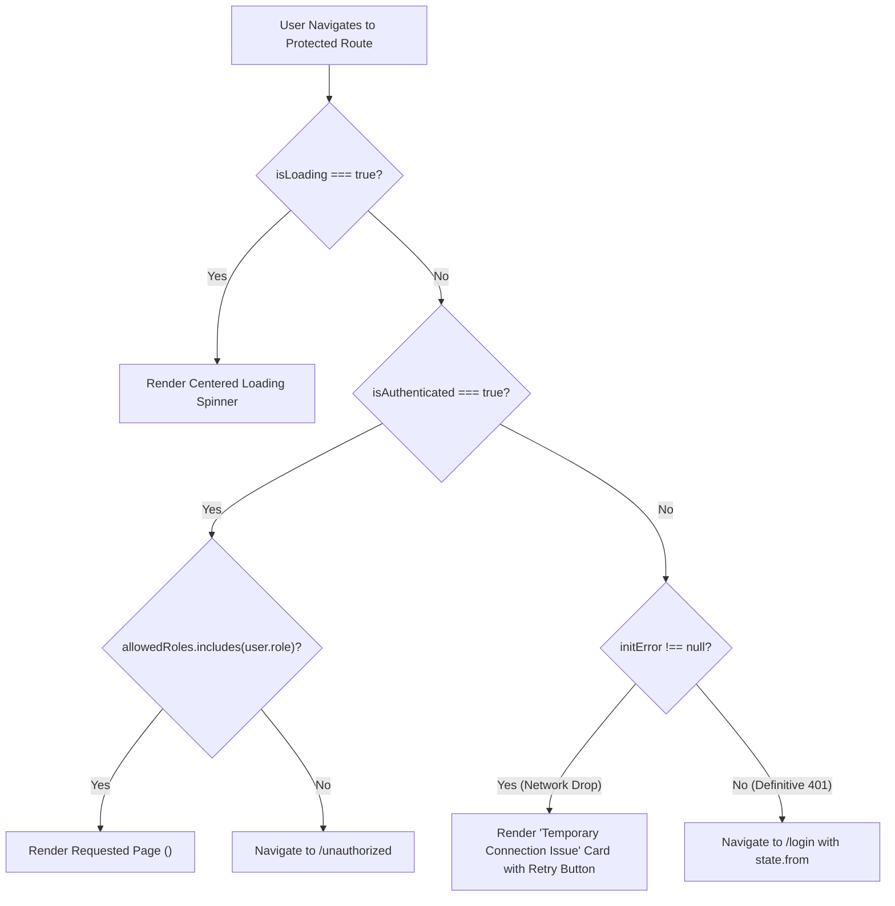

# CareSync HCMS — Frontend Architecture

## 1. Overview & Technology Foundation

The **CareSync** frontend is a high-performance, single-page application (SPA) built with pure ES6+ JavaScript and React 18. It integrates declarative client-side routing, server-state caching, resilient session restoration, multi-tab synchronization, and atomic design system components.

- **UI Framework:** React 18.3.1 (pure JavaScript / JSX, no TypeScript build latency)
- **Build & Development Tool:** Vite 6.4.6 with Rollup production code-splitting
- **Styling:** Tailwind CSS 3.4.x with clinical HSL color variables and semantic utility classes
- **Routing:** React Router 7.x with nested layouts and role-based route guards
- **Server State & Caching:** TanStack Query 5.x (React Query)
- **HTTP Client:** Axios 1.7.x with concurrency-safe single-flight token refresh mutex
- **Form Management:** React Hook Form 7.x with Zod 3.x runtime schema validation
- **Real-Time Client:** Native browser WebSocket with STOMP client (`use-queue-websocket.js`)
- **Iconography:** Lucide React
- **Testing Framework:** Vitest 2.1.9 + React Testing Library + jsdom (35 test files, 200 tests)

---

## 2. Directory & Component Organization

All frontend code is organized under `frontend/src/`:

```text
frontend/src/
├── main.jsx                       # React DOM mount point & global provider tree
├── App.jsx                        # Root router view & notification toast mount
│
├── app/                           # Core application wiring
│   ├── layouts/
│   │   └── app-layout.jsx         # App shell (Sidebar, Header, Breadcrumbs, Outlet)
│   ├── providers/
│   │   ├── auth.context.jsx       # AuthContext definition & useAuth consumer hook
│   │   ├── auth.provider.jsx      # Authentication state, session hydration, multi-tab sync
│   │   ├── query-client.js        # TanStack QueryClient with default caching & retry policies
│   │   └── query.provider.jsx     # QueryClientProvider wrapper
│   └── router/
│       ├── protected-route.jsx    # Session restoration barrier & RBAC guard
│       ├── root-redirect.jsx      # Landing redirector to role-specific home route
│       └── routes.jsx             # Declarative React Router route definitions
│
├── components/                    # Reusable UI building blocks
│   ├── common/                    # Page skeletons, 404, unauthorized error screens
│   ├── layout/                    # Header, Sidebar, Breadcrumb navigation
│   └── ui/                        # 18 design-system components (shadcn pattern)
│       ├── alert.jsx              ├── badge.jsx              ├── button.jsx
│       ├── card.jsx               ├── confirmation-dialog.jsx├── dialog.jsx
│       ├── dropdown-menu.jsx      ├── empty-state.jsx        ├── error-state.jsx
│       ├── input.jsx              ├── pagination.jsx         ├── select.jsx
│       ├── skeleton.jsx           ├── table.jsx              ├── tabs.jsx
│       ├── textarea.jsx           ├── toast.jsx              └── tooltip.jsx
│
├── features/                      # Domain feature modules & role-based portals
│   ├── auth/                      # Login, Patient Registration, Unauthorized screens
│   ├── admin/                     # Admin Dashboard, Doctors, Depts, Billing, Audit, Reports
│   ├── receptionist/              # Reception Desk, Check-In, Booking, Queue, Walk-In Reg
│   ├── doctor/                    # Clinical Console, Queue Management, Consultations, History
│   └── patient/                   # Patient Dashboard, Booking, Medical History, Invoices
│
├── hooks/                         # Custom React data & mutation hooks
│   ├── use-appointments.js        ├── use-audit.js           ├── use-billing.js
│   ├── use-consultations.js       ├── use-departments.js     ├── use-doctors.js
│   ├── use-medicines.js           ├── use-patients.js        ├── use-prescriptions.js
│   ├── use-queue.js               ├── use-queue-websocket.js ├── use-reports.js
│   └── use-toast.js
│
├── services/                      # API client integration modules
│   ├── api.js                     # Axios instance with refresh token mutex interceptor
│   ├── auth.service.js            # Sign-in, sign-up, token refresh, session restore
│   ├── auth-broadcast.js          # Cross-tab BroadcastChannel communication
│   ├── token.service.js           # In-memory access token + sessionStorage refresh token
│   └── *.service.js               # Domain services matching backend REST resources
│
├── constants/                     # Route definitions, user roles, storage keys
├── lib/utils.js                   # Class merging (clsx + twMerge), currency & clinic timezone helpers
├── styles/globals.css             # Tailwind base directives & clinical color palettes
└── types/index.js                 # JSDoc typedefs & Zod schemas for runtime validation
```

---

## 3. Routing & Protected Routes

### 3.1 Declarative Route Configuration (`routes.jsx`)
Routes are structured hierarchically:
- **Public Routes:** `/login`, `/register`, `/unauthorized`, `/404`.
- **Role-Based Protected Subtrees:**
  - `/admin/*` $\rightarrow$ Allowed Roles: `ADMIN`
  - `/receptionist/*` $\rightarrow$ Allowed Roles: `RECEPTIONIST`, `ADMIN`
  - `/doctor/*` $\rightarrow$ Allowed Roles: `DOCTOR`
  - `/patient/*` $\rightarrow$ Allowed Roles: `PATIENT`
- **Root Redirect (`root-redirect.jsx`):** Evaluates `user.role` and directs to role default (e.g. `ADMIN` $\rightarrow$ `/admin/dashboard`, `DOCTOR` $\rightarrow$ `/doctor/dashboard`).

### 3.2 Resilient Protected Route Guard (`protected-route.jsx`)
`ProtectedRoute` acts as a security barrier and session restoration gatekeeper:



---

## 4. Authentication, Session Restoration & Multi-Tab Synchronization

### 4.1 Token Storage Architecture (`token.service.js`)
CareSync enforces a defense-in-depth token storage strategy:
- **Access Token:** Held strictly **in-memory** (in a JavaScript module-scoped variable). Never written to `localStorage` or `sessionStorage`, completely shielding it from XSS extraction.
- **Refresh Token:** Stored in `sessionStorage`. Scoped strictly to the browser tab lifecycle; closed tabs purge the session.
- **User Profile:** Cached in `sessionStorage` to allow graceful offline state rendering during network degradation.

### 4.2 Concurrency-Safe Refresh Token Mutex (`api.js` & `auth.service.js`)
When an access token expires while browsing, multiple parallel queries may fail with HTTP 401. Without coordination, multiple refresh requests would invalidate each other and trigger backend replay detection.
- **Single-Flight Axios Interceptor:** `refreshPromise` in `api.js` captures the first 401 and issues `POST /api/auth/refresh`. Subsequent concurrent 401 requests wait for the same promise to resolve before retrying with the new token.
- **Restoration Mutex:** `restoreSessionPromise` in `auth.service.js` prevents duplicate calls to `restoreSession()` during React 18 StrictMode double-mounting or rapid browser reloads.

### 4.3 Multi-Tab Synchronization (`auth-broadcast.js`)
Cross-tab synchronization uses `BroadcastChannel('caresync_auth_sync')`:
- **`TOKENS_ROTATED`:** When Tab A rotates tokens, it broadcasts the new token pair to all open tabs. Tab B updates its local `tokenService` without making an unnecessary backend request, preventing stale-token submissions.
- **`SESSION_REQUEST` / `SESSION_RESPONSE`:** When a user opens CareSync in a new tab where `sessionStorage` is empty, the tab queries existing peer tabs. An open tab replies with active session credentials, eliminating redundant login prompts.
- **`LOGOUT`:** When a user logs out in any tab, `LOGOUT` is broadcast. All open tabs immediately execute `tokenService.clear()` and navigate to `/login`.

---

## 5. API Service Layer & URL Normalization

### 5.1 Robust URL Normalization (`api.js`)
To guarantee compatibility across local development, Docker, and Cloudflare Pages:
```javascript
export function normalizeApiBaseUrl(rawUrl) {
  if (!rawUrl || typeof rawUrl !== 'string' || !rawUrl.trim()) return '/api';
  let url = rawUrl.trim().split(/[?#]/)[0].replace(/\/+$/, '');
  if (url.endsWith('/api')) return url.replace(/(?:\/api)+$/, '/api');
  return `${url}/api`;
}
```
- Missing/empty `VITE_API_BASE_URL` $\rightarrow$ Defaults cleanly to `/api` (matching Vite proxy).
- Origin-only `https://caresync-api.onrender.com` $\rightarrow$ Normalizes to `https://caresync-api.onrender.com/api`.
- Trailing slashes, duplicate `/api/api`, and query strings are automatically stripped.

### 5.2 Domain Service Abstractions
The API service layer cleanly wraps REST operations into modular services:
- `auth.service.js`: Authentication, session restore, logout, current user profile.
- `appointments.service.js`: Outpatient slot querying, appointment booking, cancellation.
- `doctors.service.js`: Doctor profiles, availability schedules, leave management.
- `patients.service.js`: Patient demographics, allergies, medical history timeline.
- `consultations.service.js`: Clinical note authoring and vitals recording.
- `prescriptions.service.js`: Digital prescriptions and PDF receipt generation.
- `billing.service.js`: Invoices, line items, payment processing, PDF invoices.
- `reports.service.js`: Dashboard KPIs, revenue breakdowns, no-show rates.

---

## 6. State Management & Data Fetching

CareSync uses **TanStack Query 5** (React Query) for all server state management:
- **Automatic Caching & Stale-While-Revalidate:** Query keys follow a structured hierarchy (e.g. `['appointments', { doctorId, date }]`).
- **Cache Invalidation:** Mutations automatically trigger targeted invalidations (e.g. booking an appointment invalidates `['appointments']` and `['slots']`).
- **Optimistic Updates:** Critical queue actions (e.g. calling next patient) optimistically update waiting lists before server confirmation.
- **Automatic Retries:** Network requests retry with exponential backoff, while authentication errors (401/403) fail immediately without retry loops.

---

## 7. Main Application Modules

| Module | Primary Route | Role Access | Key Components & Features |
| :--- | :--- | :--- | :--- |
| **Admin Portal** | `/admin/dashboard` | `ADMIN` | • Overview KPI cards with live query filters<br>• Doctor roster and schedule management<br>• Department catalog CRUD<br>• Revenue and no-show rate analytics<br>• Tamper-evident compliance audit log viewer |
| **Receptionist Desk** | `/receptionist/dashboard` | `RECEPTIONIST`, `ADMIN` | • Patient arrival check-in desk with daily token counter<br>• Outpatient slot booking with instant availability verification<br>• Real-time waiting queue management<br>• Counter payment collection and PDF receipt printing |
| **Doctor Console** | `/doctor/dashboard` | `DOCTOR` | • Real-time patient waiting list with "Call Next Patient" trigger<br>• Clinical consultation form with vitals capture<br>• Electronic prescription authoring with drug interaction safety check<br>• Patient historical clinical encounter timeline |
| **Patient Portal** | `/patient/dashboard` | `PATIENT` | • Self-service outpatient slot booking<br>• Personal medical history and diagnosis notes review<br>• Digital prescription viewer and PDF download<br>• Billing summary and settled invoice receipts |
