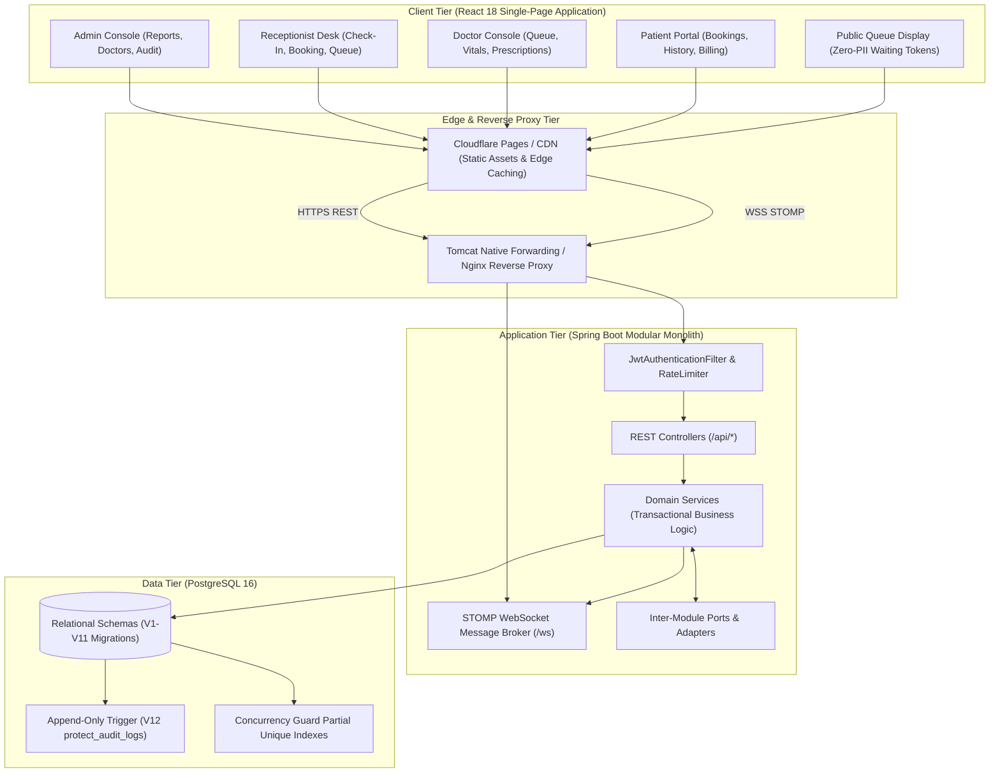
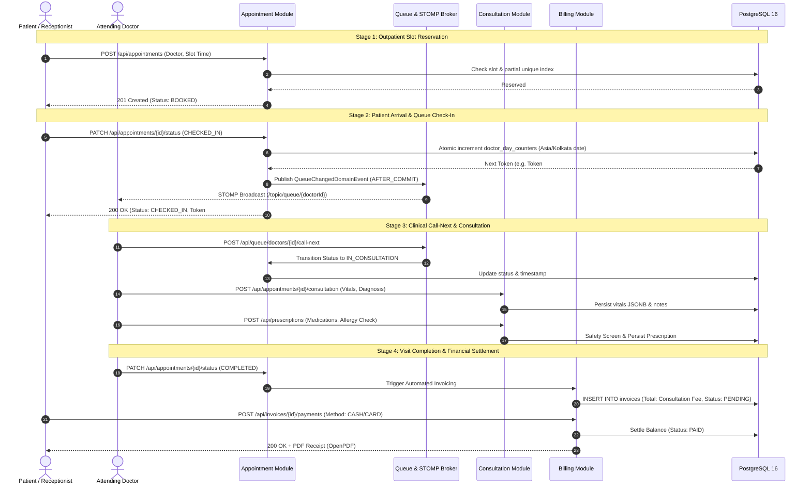

# CareSync HCMS — System Architecture

## 1. Project Overview

**CareSync** is an enterprise-grade outpatient Hospital & Clinic Management System (HCMS) engineered as a high-performance **modular monolith** backend coupled with a responsive single-page application (SPA) frontend.

The system automates the core patient care and administrative lifecycle of multi-specialty clinics:
- **Identity & Access Management:** Multi-tier role-based access control (RBAC) across four roles (System Administrator, Front Desk Receptionist, Attending Physician, and Registered Patient).
- **Outpatient Scheduling:** Clinic-timezone-aware slot calculation (Asia/Kolkata), recurring doctor availability schedules, emergency leaves, and anti-double-booking concurrency guards.
- **Real-Time Waiting-Room Queue:** Daily token counters, public zero-PII waiting room displays, and live WebSocket/STOMP queue notifications.
- **Clinical Encounters:** Structured patient vitals recording, ICD/clinical diagnoses, formulary management, drug-drug interaction matrix validation, and digital prescription generation.
- **Financial Accounting:** Exact fixed-scale decimal billing (`BigDecimal` / PostgreSQL `NUMERIC(12,2)`), automated invoice creation upon consultation completion, multi-tender payment settlement, credit notes, and downloadable PDF receipts.
- **Compliance & Auditability:** Append-only, database-trigger-protected audit trail capturing security and administrative events.

---

## 2. Technology Stack

| Layer | Technology | Version / Specification | Rationale & Capabilities |
| :--- | :--- | :--- | :--- |
| **Backend Runtime** | OpenJDK / Java | **25.0.1** | Modern language features, pattern matching, record classes, and native Virtual Threads. |
| **Application Framework** | Spring Boot | **4.1.2** (Spring Framework 7) | High-throughput web architecture, robust dependency injection, declarative transactions. |
| **Concurrency Model** | Java Virtual Threads | Enabled (`spring.threads.virtual.enabled: true`) | High-concurrency I/O throughput without reactive streaming complexity. |
| **Security Framework** | Spring Security | 7.x | Stateless JWT authentication, role-based method security, rate limiting. |
| **Persistence & ORM** | Hibernate / JPA | 6.6 / Spring Data JPA | Relational mapping, optimistic locking (`@Version`), row-level locking (`PESSIMISTIC_WRITE`). |
| **Database Engine** | PostgreSQL | **16.x** (Neon Serverless) | ACID transactions, partial unique indexes, native JSONB vitals, append-only triggers. |
| **Schema Migrations** | Flyway | 10.x (Migrations `V1`–`V12`) | Deterministic, version-controlled schema evolution with zero destructive operations. |
| **Real-Time Messaging** | Spring WebSocket | STOMP over SockJS / WebSocket | Real-time queue event broadcasting to doctor consoles and public waiting displays. |
| **Document Generation** | OpenPDF | 2.0.x | Direct programmatic PDF generation for itemized receipts and clinical prescriptions. |
| **Frontend Framework** | React | **18.3.1** (ES6+ JSX) | Component-driven UI, hooks architecture, declarative DOM rendering. |
| **Frontend Build Tool** | Vite | **6.4.6** | Sub-second HMR dev server, Rollup production bundling, code-splitting chunks. |
| **Routing** | React Router | 7.x | Declarative client-side routing, protected route wrappers, role redirection. |
| **State & Data Fetching**| TanStack Query | 5.x (React Query) | Server-state caching, background query revalidation, mutation side-effects. |
| **HTTP Client** | Axios | 1.7.x | Custom request interceptor, concurrency mutex for refresh token rotation. |
| **Styling & Design** | Tailwind CSS | 3.4.x + Lucide Icons | Utility-first clinical responsive design, accessibility tokens, semantic badges. |
| **Form Validation** | React Hook Form + Zod | 7.x / 3.x | Type-safe form binding with schema-enforced client-side input validation. |

---

## 3. High-Level Architecture

CareSync follows a tiered modular architecture with clear separation of concerns across client, edge, application, and data layers:



---

## 4. Major Domain Modules

The backend modular monolith is partitioned into 11 domain modules under `com.caresync`:

```text
com.caresync
├── common/        # Cross-cutting concerns: JWT, security, exceptions, rate limiting, logging
├── auth/          # User identity, BCrypt passwords, refresh token rotation, staff bootstrap
├── reference/     # Clinics (timezones), medical specializations, hospital departments
├── doctor/        # Physician profiles, recurring weekly schedules, emergency leaves
├── patient/       # Patient records, demographics, allergies text array, medical timeline
├── appointment/   # Outpatient booking, slot calculation, status transitions, daily tokens
├── queue/         # Live waiting room room state, STOMP broker publishing, public queue board
├── consultation/  # Clinical encounters, vitals JSONB, diagnostic notes, lifecycle adapters
├── medicine/      # Pharmaceutical formulary, symmetric drug-drug interaction matrix
├── prescription/  # Prescription creation, contraindication screening, OpenPDF export
├── billing/       # Exact-decimal invoices, payments, credit notes, OpenPDF invoice receipts
├── report/        # Operational KPI dashboards, revenue aggregation, no-show rate analytics
└── audit/         # Tamper-evident append-only compliance logging
```

### Module Boundaries & Port/Adapter Isolation
Direct cross-module entity relationships and foreign keys are minimized in favor of explicit port/adapter interfaces:
- **`ProfileLinkPort`:** Allows `auth` to discover associated patient or doctor profile IDs without coupling to doctor/patient entity internals.
- **`AppointmentBillingPort`:** Invoked asynchronously or upon completion of clinical visits to initialize billing without exposing invoice internals to scheduling.
- **`DoctorPatientScopePort`:** Enforces doctor-patient clinical access boundaries, ensuring attending physicians only inspect medical records of patients who hold active or historical appointments with them.

---

## 5. Frontend / Backend Communication

### 5.1 REST API Contracts (`/api/*`)
- **Protocol:** HTTP/1.1 and HTTP/2 over TLS.
- **Format:** Strict JSON (`application/json`) requests and responses.
- **Contract Specification:** Formally defined by the OpenAPI 3.0.3 specification ([openapi.yaml](openapi.yaml)), covering 40 paths and 55 operations.
- **Uniform Error Response Structure:**
  ```json
  {
    "timestamp": "2026-11-15T18:30:00Z",
    "status": 409,
    "code": "SLOT_ALREADY_BOOKED",
    "message": "The requested appointment slot has already been reserved.",
    "path": "/api/appointments",
    "fieldErrors": []
  }
  ```

### 5.2 Real-Time Waiting Room Queue Broker (`/ws`)
- **Protocol:** STOMP over WebSocket (with SockJS fallback support).
- **Broker Prefix:** `/topic` for public and role-scoped broadcasts; `/app` for application incoming messages.
- **Topic Naming:** `/topic/queue/{doctorId}` delivers live waiting list adjustments and `nowServing` updates.
- **Zero-PII Public Board:** Waiting rooms display an anonymous board (`GET /api/queue/board?clinicId=...`) exposing only numerical tokens (e.g. `Token #4 - In Consultation`, `Token #5 - Waiting`) with zero patient names, telephone numbers, or medical complaints.
- **Post-Commit Delivery:** Broadcast events (`QueueChangedDomainEvent`) are dispatched via Spring's `TransactionalEventListener(phase = TransactionPhase.AFTER_COMMIT)`, ensuring updates only fire when database transactions commit successfully.

---

## 6. End-to-End Clinical & Operational Workflows


