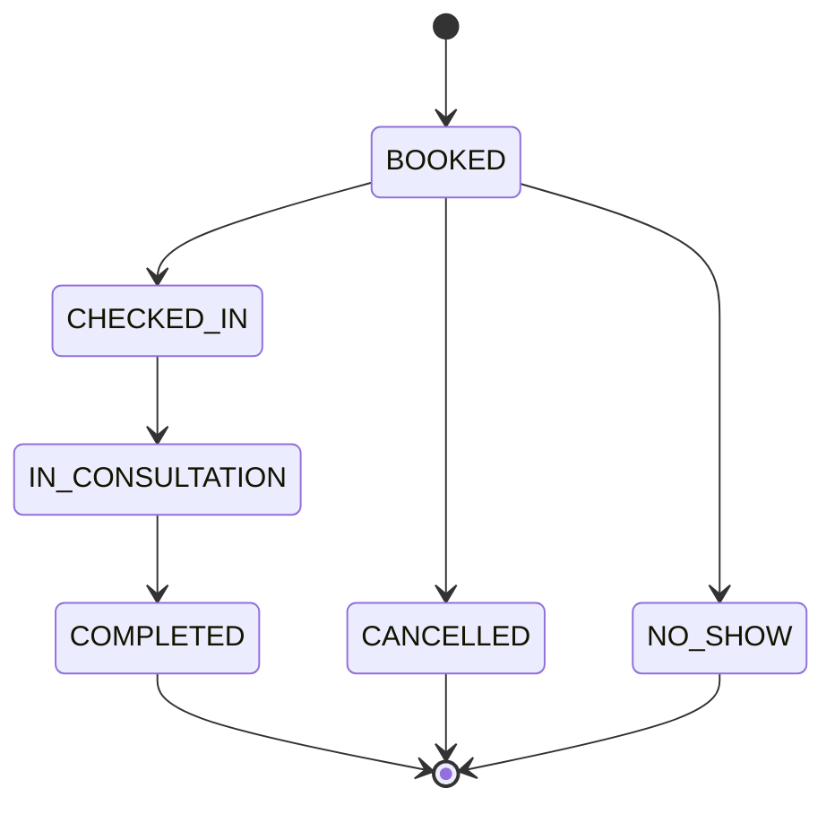

# Hospital & Clinic Management System (HCMS) domain rules

Source of truth for business rules (technical Java package namespace `com.caresync.*` is preserved for code compatibility). API shapes live in `openapi.yaml`;
if the two disagree, fix both in the same commit.

Matches `openapi.yaml` 0.1.0 after Phase 0 part 5b. Markers used below:

- **(pending 5d)**: decided, but not in the contract yet.
- **(assumption)**: a choice this file makes where the contract is silent. Confirm or change it.
- **(design)**: an implementation rule that is not visible in the API.

## 1. Modules and roles

Modules: auth, patients, doctors and reference data, schedules and leaves,
slots, appointments, live queue, consultations, prescriptions (safety check,
PDF), billing, reports, audit log.

| Role | Who | How the account is created |
|------|-----|----------------------------|
| PATIENT | A person receiving care | `POST /auth/register` (self-service). Walk-in patients get a Patient record with no account. |
| DOCTOR | A clinician | `POST /doctors` (ADMIN). The user and the doctor profile are created in one transaction. |
| RECEPTIONIST | Front desk staff | No endpoint yet. Seeded by a Flyway migration (see section 13, G3). |
| ADMIN | Administrator | No endpoint yet. Seeded by a Flyway migration (see section 13, G3). |

## 2. Conventions

### 2.1 Identifiers
- Every id is a UUID.
- A doctor profile id is not the user id, and a patient profile id is not the
  user id. `GET /auth/me` returns `patientId` or `doctorId` for the caller, and
  every API field called `doctorId` or `patientId` holds the profile id.
- Human-readable numbers (`invoiceNumber`, `creditNoteNumber`) are generated by
  the server, are unique, and look like `INV-2026-000123` and `CN-2026-000007`.
  Gaps in the sequence are allowed.

### 2.2 Time and time zones
- **Instants** (`slotStart`, `slotEnd`, `createdAt`, `occurredAt`, ...) are UTC.
  Java `Instant`, PostgreSQL `timestamptz`, ISO-8601 with `Z` on the wire.
- **Local values** have no zone and are interpreted in the doctor's clinic time
  zone (`Clinic.timeZone`, an IANA id such as `Asia/Kolkata`): schedule
  `HH:mm`, leave dates, the `date` query of the slots endpoint, and
  `followUpDate`.
- **"Today"** means the current date in the doctor's clinic time zone for slots,
  the 30-day booking window, leaves, follow-up dates, check-in and the queue.
  For reports and the dashboard it is the clinic time zone when `clinicId` is
  given, and the server's reporting time zone (`Asia/Kolkata`) otherwise.
- **Filters:** list filters `from`/`to` on `date-time` fields are UTC instants,
  `from` inclusive and `to` exclusive. Report and leave filters `from`/`to` are
  calendar dates, both inclusive.
- **DST:** a local slot start that does not exist (spring-forward gap) is
  skipped. An ambiguous one (fall-back overlap) uses the earlier instant.
- The frontend never does time zone arithmetic. It formats the UTC value with the
  `timeZone` the API returned.
- A clinic's time zone is seeded and never changes (see section 12).

### 2.3 Money
- Every amount is a **decimal string with exactly two decimals**, for example
  `"1500.00"`, never a JSON number. Schema `Money`: up to 10 digits before the
  point, no sign.
- `SignedMoney` is the same but may be negative. It is used only for `net` in
  the revenue report.
- Currency is INR. Invoices, payments, credit notes and reports carry
  `currency: "INR"`. `consultationFee` has no currency field and is always INR.
- Java uses `BigDecimal` with scale 2, PostgreSQL uses `numeric(12,2)`. The
  frontend parses amounts with a decimal library, never `parseFloat`, and only
  formats them (`Intl.NumberFormat`).
- `lineTotal` is `quantity` times `unitPrice`, exact. No rounding is needed.
- The only rounding is `ratePercent` in the no-show report: half up, two
  decimals.
- Value rules that the pattern cannot express are checked by the server and fail
  with `400 VALIDATION_FAILED`: a payment `amount` and a credit note `amount`
  are greater than `0.00`, a staff-added `unitPrice` is greater than `0.00`. A
  `consultationFee` of `0.00` is allowed.

### 2.4 Lists
- Pages are zero-based. `page` defaults to 0, `size` to 20, maximum 100. Every
  paged response uses `PageResponse` narrowed with `allOf`.
- Small bounded lists are returned as plain arrays: departments,
  specializations, clinics, a doctor's leaves.
- Multi-value filters such as `status` are comma-separated.

### 2.5 Errors
- Every error is an `ErrorResponse`. Clients branch on `code`, never on
  `message`. `fieldErrors` is always present and is `[]` unless it is a
  validation error.
- Only `TOKEN_EXPIRED` triggers the refresh flow.
- 403 `ACCESS_DENIED` is used when the caller is authenticated but not allowed
  (wrong role, or another user's record). 404 `RESOURCE_NOT_FOUND` is used when
  the resource does not exist, or when a PATIENT asks for an inactive doctor.
- **Order of checks.** Each operation's description states its own order and
  that wins. The default is 400, then 404, then 403, then 409. Admin-only
  operations (reports, audit log) check the role first. State rules that depend
  on current values (`OVERPAYMENT`, `CREDIT_EXCEEDS_INVOICE`) come last. See G9
  in section 13.
- **400 versus 409.** 400 means a value in the request is unacceptable, even
  relative to the clock (a slot in the past, beyond 30 days). 409 means a valid
  request conflicts with the current state of a resource.

### 2.6 Public endpoints and rate limiting
Public (no bearer token): `POST /auth/register`, `POST /auth/login`,
`POST /auth/refresh`, `POST /auth/logout`, `GET /queue/board`, and the
WebSocket endpoint `/ws`. Register, login, refresh and the board return
`429 TOO_MANY_REQUESTS` with a `Retry-After` header when a client is limited.
The limits themselves are configuration, not contract. Logout has no 429.

## 3. Entities

Fields marked *(internal)* are not in the API.

### 3.1 Identity
**User**

| Field | Type | Notes |
|-------|------|-------|
| id | uuid | |
| email | text | Unique, case-insensitive, at most 254 characters |
| passwordHash | text | bcrypt, internal, never returned |
| fullName | text | 2 to 100 characters. For a doctor this is the display name |
| role | Role | ADMIN, RECEPTIONIST, DOCTOR, PATIENT |
| createdAt | timestamptz | |

**RefreshToken** *(internal)*

| Field | Type | Notes |
|-------|------|-------|
| id | uuid | |
| userId | uuid | |
| tokenHash | text | Hash of the opaque token. The plain token is never stored |
| expiresAt | timestamptz | |
| revokedAt | timestamptz, null | Set on rotation or logout |
| replacedById | uuid, null | The token issued in exchange |

### 3.2 Reference data (read-only, seeded)
**Clinic**: `id`, `name`, `address` (nullable), `timeZone` (IANA id).
**Specialization**: `id`, `name`.
**Department**: `id`, `name` (2 to 100, unique ignoring case), `description`
(nullable, at most 500). Departments are the only reference data an Admin can
create or change through the API.

### 3.3 People
**Patient**

| Field | Type | Notes |
|-------|------|-------|
| id | uuid | |
| userId | uuid, null | Unique when set. Null for walk-in patients |
| fullName | text | 2 to 100 |
| dateOfBirth | date, null | Not in the future |
| gender | Gender, null | MALE, FEMALE, OTHER |
| phone | text, null | Pattern `^\+?[0-9]{10,15}$`. Not unique: family members may share a number |
| email | text, null | A contact email. It does not change the login email |
| address | text, null | At most 500 |
| allergies | text[] | Up to 50 entries of 1 to 100 characters. The server trims entries and removes duplicates ignoring case |
| createdAt, updatedAt | timestamptz | |

**Doctor**

| Field | Type | Notes |
|-------|------|-------|
| id | uuid | Doctor profile id |
| userId | uuid | Unique. The display name is `User.fullName` |
| specializationId, clinicId, departmentId | uuid | All required |
| phone | text, null | Not returned by the API: patients can read doctors |
| consultationFee | Money | `0.00` allowed |
| slotMinutes | integer | 5 to 120, a multiple of 5 |
| active | boolean | See section 7.3 |

### 3.4 Scheduling
**ScheduleEntry**: `id`, `doctorId`, `dayOfWeek`, `startTime`, `endTime`
(`HH:mm`, local). At most 28 entries per doctor.

**Leave**: `id`, `doctorId`, `startDate`, `endDate` (inclusive, local dates),
`reason` (nullable, at most 255), `createdAt`.

**Appointment**

| Field | Type | Notes |
|-------|------|-------|
| id | uuid | |
| doctorId, patientId | uuid | |
| clinicId | uuid | Copied from the doctor at booking time **(assumption)** |
| slotStart, slotEnd | timestamptz | `slotEnd` is fixed at booking from `slotMinutes` |
| status | AppointmentStatus | See section 6 |
| reason | text, null | At most 500 |
| cancellationReason | text, null | Set when cancelled |
| tokenNumber | integer, null | Queue token, set at check-in |
| checkedInAt | timestamptz, null | Set at check-in |
| createdAt, updatedAt | timestamptz | |
| version | integer | *(internal)* optimistic lock |

**DoctorDayCounter** *(internal)*: `doctorId`, `date` (clinic-local),
`lastToken`. Incremented atomically at check-in.

### 3.5 Clinical
**Consultation** (one per appointment)

| Field | Type | Notes |
|-------|------|-------|
| id | uuid | |
| appointmentId | uuid | Unique. `patientId` and `doctorId` are copied from the appointment |
| vitals | object, null | `bloodPressure` (`120/80`), `pulse` (20 to 300), `temperature` (30 to 45 C), `weightKg` (0.5 to 500), `spo2` (0 to 100). All optional |
| symptoms, diagnosis | text, null | At most 2000 each |
| notes | text, null | At most 5000 |
| followUpDate | date, null | Local date, not before today |
| finalizedAt | timestamptz, null | Set when the appointment is COMPLETED. The API field `finalized` is `finalizedAt` is not null |
| createdAt, updatedAt | timestamptz | |

**Medicine** (read-only, seeded): `id`, `name`, `genericName`, `strength`,
`form` (TABLET, CAPSULE, SYRUP, INJECTION, CREAM, DROPS, INHALER, OTHER),
`drugClass` (nullable, used for allergy matching).

**DrugInteraction** *(internal, seeded)*: `medicineAId`, `medicineBId` (an
unordered pair stored with A before B), `severity`, `message`.

**Prescription** (one per consultation, immutable)

| Field | Type | Notes |
|-------|------|-------|
| id | uuid | |
| consultationId | uuid | Unique. `appointmentId`, `patientId`, `doctorId` are copied from it |
| items | PrescriptionItem[] | 1 to 20, each medicine at most once |
| warnings | PrescriptionWarning[] | The warnings found when it was created |
| severeWarningsAcknowledged | boolean | True only if a SEVERE warning existed and the doctor acknowledged it |
| createdAt | timestamptz | |

**PrescriptionItem**: `medicineId`, `dosage` (free text, 1 to 100), `frequency`
(free text, 1 to 100), `durationDays` (1 to 365), `instructions` (nullable, at
most 500).

### 3.6 Billing
**Invoice**

| Field | Type | Notes |
|-------|------|-------|
| id | uuid | |
| invoiceNumber | text | Server-generated |
| appointmentId, patientId, doctorId, clinicId | uuid | An appointment can have several invoices (section 7.10) |
| status | InvoiceStatus | PENDING, PARTIALLY_PAID, PAID, VOID |
| currency | Currency | INR |
| createdAt, updatedAt | timestamptz | |
| paidAt | timestamptz, null | Set when the status becomes PAID |
| voidReason | text, null | Set when the status is VOID |

Derived values (may be stored for speed, but must always equal the sums):
`total` = sum of item `lineTotal`; `amountPaid` = sum of payments;
`balance` = `total` minus `amountPaid`; `creditedTotal` = sum of credit notes;
`netTotal` = `total` minus `creditedTotal`.

Status is derived from the values: `PENDING` when `amountPaid` is `0.00` and
`total` is above `0.00`, `PARTIALLY_PAID` when `amountPaid` is above `0.00` and
below `total`, `PAID` when `amountPaid` equals `total`, `VOID` only through the
void operation.

**InvoiceItem**: `id`, `invoiceId`, `description` (1 to 200), `quantity` (1 to
100), `unitPrice`, `lineTotal`, `createdAt`.

**Payment**: `id`, `invoiceId`, `amount`, `method` (CASH, CARD, UPI,
NET_BANKING), `txnRef` (nullable, at most 100), `receivedBy` (the staff user),
`createdAt`. Unique on (`method`, `txnRef`) when `txnRef` is set and the method
is not CASH **(assumption)**.

**CreditNote**: `id`, `creditNoteNumber`, `invoiceId`, `amount`, `reason` (5 to
500), `createdBy` (the Admin), `createdAt`.

### 3.7 Audit
**AuditLog** (append-only): `id`, `occurredAt`, `userId`, `userName` (name at
the time), `userRole`, `action` (`AuditAction`), `entityType`, `entityId`,
`patientId` (nullable), `details` (at most 500), `ipAddress`.

### 3.8 Relationships
- User 1-1 Patient (self-registered only). User 1-1 Doctor.
- Doctor N-1 Specialization, N-1 Clinic, N-1 Department.
- Doctor 1-N ScheduleEntry, 1-N Leave, 1-N Appointment.
- Patient 1-N Appointment. Appointment N-1 Clinic through the doctor.
- Appointment 1-0..1 Consultation. Consultation 1-0..1 Prescription.
- Prescription 1-N PrescriptionItem N-1 Medicine.
- Appointment 1-N Invoice. Invoice 1-N InvoiceItem, 1-N Payment, 1-N CreditNote.

## 4. Who may do what

### 4.1 Definitions
- **own (PATIENT):** the resource's `patientId` equals the caller's `patientId`.
- **own (DOCTOR):** the resource's `doctorId` equals the caller's `doctorId`.
- **own patients (DOCTOR):** patients who have at least one non-cancelled
  appointment with that doctor. Used for the patient record, patient search and
  the prescription safety check.
- **treated (DOCTOR):** patients for whom that doctor has written at least one
  consultation. Used to read consultations and prescriptions written by other
  doctors. A doctor can always read their own consultations and prescriptions.
- The two doctor relations are different on purpose: seeing a record needs a
  booking, reading clinical history needs an actual consultation. See G5.

### 4.2 Public operations
`POST /auth/register`, `POST /auth/login`, `POST /auth/refresh`,
`POST /auth/logout`, `GET /queue/board`, WebSocket `/ws`.

### 4.3 Authenticated operations
`Y` allowed, `-` 403, `own` only own records, other text as defined above.

| Operation | ADMIN | RECEPTIONIST | DOCTOR | PATIENT |
|-----------|-------|--------------|--------|---------|
| GET /auth/me | Y | Y | Y | Y |
| GET /departments | Y | Y | Y | Y |
| POST /departments, PUT /departments/{id} | Y | - | - | - |
| GET /doctors, GET /doctors/{id} | Y | Y | Y | Y (active doctors only) |
| POST /doctors, PUT /doctors/{id} | Y | - | - | - |
| GET /doctors/{id}/schedules | Y | Y | own | - |
| PUT /doctors/{id}/schedules | Y | - | own | - |
| GET /doctors/{id}/leaves | Y | Y | own | - |
| POST /doctors/{id}/leaves, DELETE .../leaves/{leaveId} | Y | - | own | - |
| GET /doctors/{id}/slots | Y | Y | Y | Y (active doctors only) |
| GET /specializations, GET /clinics | Y | Y | Y | Y |
| GET /patients (search) | Y | Y | own patients | - |
| POST /patients | Y | Y | - | - |
| GET /patients/{id} | Y | Y | own patients | own |
| PUT /patients/{id} | Y | Y | - | own |
| GET /appointments | Y | Y | own (scoped) | own (scoped) |
| POST /appointments | Y | Y | - | own |
| GET /appointments/{id} | Y | Y | own | own |
| PATCH /appointments/{id}/status to CHECKED_IN | Y | Y | - | - |
| to IN_CONSULTATION | - | - | own | - |
| to COMPLETED | - | - | own | - |
| to CANCELLED | Y | Y | own | own |
| to NO_SHOW | Y | Y | - | - |
| GET /appointments/{id}/consultation | Y | - | own, or treated | own |
| POST /appointments/{id}/consultation | - | - | own | - |
| GET /consultations/{id} | Y | - | own, or treated | own |
| PUT /consultations/{id} | - | - | own | - |
| GET /medicines | Y | - | Y | - |
| POST /prescriptions/check | - | - | own patients | - |
| POST /prescriptions | - | - | own consultation | - |
| GET /prescriptions/{id}, GET /prescriptions/{id}/pdf | Y | - | own, or treated | own |
| GET /patients/{id}/prescriptions | Y | - | treated | own |
| GET /invoices | Y | Y | - | own (scoped) |
| GET /invoices/{id}, GET /invoices/{id}/pdf | Y | Y | - | own |
| GET /appointments/{id}/invoice | Y | Y | - | own |
| POST /appointments/{id}/invoices **(pending 5d)** | Y | Y | - | - |
| POST /invoices/{id}/items | Y | Y | - | - |
| POST /invoices/{id}/payments | Y | Y | - | - |
| POST /invoices/{id}/void | Y | Y | - | - |
| POST /invoices/{id}/credit-notes | Y | - | - | - |
| GET /queue/doctors/{id} | Y | Y | own | - |
| POST /queue/doctors/{id}/call-next | - | Y | own | - |
| GET /audit-logs | Y | - | - | - |
| GET /reports/* | Y | - | - | - |

Frontend route guards are UX only. The backend enforces every rule above.

## 5. Appointment state machine

COMPLETED, CANCELLED and NO_SHOW are terminal. Any transition not drawn above,
including to the current status or back to BOOKED, returns
`409 ILLEGAL_STATE_TRANSITION`.

| From | To | Who | Extra rule | Side effects |
|------|----|-----|-----------|--------------|
| BOOKED | CHECKED_IN | RECEPTIONIST, ADMIN | Not before the slot's clinic-local date, else `TRANSITION_TOO_EARLY` | Issue the next token, set `checkedInAt`, publish `TOKEN_ISSUED` |
| BOOKED | CANCELLED | PATIENT (own), DOCTOR (own), RECEPTIONIST, ADMIN | `slotStart` at least 2 hours from now, else `CANCELLATION_WINDOW_CLOSED` | Store `cancellationReason`, free the slot |
| BOOKED | NO_SHOW | RECEPTIONIST, ADMIN | Not before `slotStart`, else `TRANSITION_TOO_EARLY` | None |
| CHECKED_IN | IN_CONSULTATION | DOCTOR (own) by PATCH, DOCTOR (own) or RECEPTIONIST by `call-next` | The doctor has no other appointment IN_CONSULTATION, else `CONSULTATION_IN_PROGRESS` | Publish `PATIENT_CALLED` |
| IN_CONSULTATION | COMPLETED | DOCTOR (own) | A consultation with a non-blank `diagnosis` exists, else `CONSULTATION_INCOMPLETE` | One transaction: finalize the consultation, create the invoice, write audit entries, publish `CONSULTATION_COMPLETED` |

Order of checks: 404, 403 (role and ownership), legality, then the time and
state rules in the table. A DOCTOR using PATCH may call any of their CHECKED_IN
patients, not only the lowest token. `call-next` always takes the lowest token.

## 6. Business rules

### 6.1 Accounts and sessions
- Self-registration creates a User with role PATIENT and the linked Patient
  (`fullName`, `email`, `phone`) in one transaction, and logs the person in.
  A duplicate email returns `409 EMAIL_ALREADY_EXISTS`.
- Passwords are 8 to 72 characters and stored as a bcrypt hash.
- The access token is a JWT that lives 15 minutes (`expiresIn` 900). The
  refresh token is opaque and single-use. Every refresh returns a new pair and
  invalidates the old refresh token. Reusing it returns
  `401 INVALID_REFRESH_TOKEN`.
- Logout revokes a refresh token. It is public and idempotent.

### 6.2 Patients
- Staff create walk-in patients (no account). Self-registered patients get
  their record from registration.
- `PUT /patients/{id}` is a full replacement. `allergies` is replaced as a whole
  (`[]` clears it).
- Allergies are written by staff or by the patient. Doctors cannot change them
  yet (see G2).
- Search returns `PatientSummary` only (no allergies, no address). The full
  record is only available through the audited `GET /patients/{id}`.
- A DOCTOR sees only own patients in search and in `GET /patients/{id}`.

### 6.3 Doctors and reference data
- Creating a doctor creates the DOCTOR user and the doctor profile in one
  transaction. An unknown `specializationId`, `clinicId` or `departmentId`
  returns 404. A duplicate email returns `409 EMAIL_ALREADY_EXISTS`.
- `PUT /doctors/{id}` replaces everything, so the client must resend
  `departmentId`.
- Changing `slotMinutes` or the schedule only affects slots generated from then
  on. Existing appointments keep their stored `slotStart` and `slotEnd`.
- `active: false` hides the doctor from PATIENT callers (list shows active
  doctors only, get and slots return 404) and blocks new bookings with
  `DOCTOR_UNAVAILABLE`. Staff still see the doctor, and history is kept.
- `consultationFee` is copied into the first invoice item when an appointment is
  completed, so a later fee change never changes an old invoice.

### 6.4 Schedules and leaves
- `PUT /doctors/{id}/schedules` replaces the weekly schedule atomically. Rules:
  `startTime` is before `endTime`, ranges on the same day do not overlap, each
  range is at least `slotMinutes` long. Violations return
  `400 INVALID_SCHEDULE` with details in `fieldErrors`.
- A leave covers whole days, both ends inclusive. `startDate` is not before
  today in the clinic's time zone and `endDate` is not before `startDate`,
  otherwise `400 VALIDATION_FAILED`.
- A leave cannot overlap another leave of the same doctor
  (`409 LEAVE_OVERLAP`) and cannot cover a BOOKED or CHECKED_IN appointment
  (`409 LEAVE_HAS_BOOKED_APPOINTMENTS`). Staff reschedule by cancelling and
  rebooking. Deleting a leave reopens its slots.

### 6.5 Slots
`GET /doctors/{id}/slots?date=` for a clinic-local date:
1. Take the schedule entries for that weekday.
2. Walk each range from `startTime` in steps of `slotMinutes`. Keep a slot only
   if it ends by `endTime`.
3. Convert each local start and end to UTC.
4. `available` is false when a non-cancelled appointment holds that start
   instant, or the start is not in the future.
5. If the day has no slots, `closedReason` is the first that applies:
   `DOCTOR_INACTIVE`, `OUTSIDE_BOOKING_WINDOW`, `ON_LEAVE`, `NO_SCHEDULE`.

A date before today or more than 30 days after today is not an error. It
returns an empty list with `OUTSIDE_BOOKING_WINDOW`. Today itself is open, with
started slots marked unavailable.

### 6.6 Booking and cancellation
- Roles: PATIENT books for their own `patientId` only (another id returns 403),
  RECEPTIONIST and ADMIN book for any patient, DOCTOR cannot book.
- `slotStart` must equal the UTC `start` of a slot of the doctor's weekly
  schedule. The appointment is created BOOKED.
- Checks in order: `VALIDATION_FAILED`, `INVALID_SLOT`,
  `OUTSIDE_BOOKING_WINDOW` (the slot has started, or its clinic-local date is
  more than 30 days after today), `DOCTOR_UNAVAILABLE` (inactive or on leave),
  `SLOT_ALREADY_BOOKED`. Unknown ids return 404.
- **No double booking** is enforced by the database: a partial unique index on
  (`doctorId`, `slotStart`) where the status is not CANCELLED. When two requests
  race, exactly one succeeds and the other gets `409 SLOT_ALREADY_BOOKED`.
  Check-then-insert alone is not safe.
- Cancellation is only from BOOKED and at least 2 hours before `slotStart`. This
  applies to every role, including ADMIN and DOCTOR.
- There is no reschedule operation: cancel and book again.

### 6.7 Check-in and queue
- Check-in issues a token. Tokens are per doctor per clinic-local day, start at
  1, count up by 1, and are never reused. The counter increment and the status
  change happen in one transaction.
- The queue of a doctor for today is: **now serving** is the appointment
  IN_CONSULTATION (at most one), **waiting** are CHECKED_IN appointments whose
  `checkedInAt` falls on today's clinic-local date, served in token order.
- A doctor has at most one appointment IN_CONSULTATION. Starting another returns
  `409 CONSULTATION_IN_PROGRESS`, which also resolves two staff members pressing
  `call-next` at once.
- `call-next` returns `409 QUEUE_EMPTY` when nobody is waiting. It is the only way
  a RECEPTIONIST can start a consultation.
- The public board lists the active doctors of the clinic that have a schedule
  range today and no leave today, plus any doctor who has already issued a token
  today. It shows token numbers and doctor names only.

### 6.8 Consultations
- Only the appointment's own doctor writes a consultation.
- Create is allowed only while the appointment is IN_CONSULTATION
  (`409 APPOINTMENT_NOT_IN_CONSULTATION`), and at most one per appointment
  (`409 CONSULTATION_ALREADY_EXISTS`). Every body field is optional so a draft
  can be saved.
- `PUT` replaces all fields, so a field left out is cleared.
- The consultation is finalized when the appointment moves to COMPLETED. After
  that every update, and any new prescription for it, returns
  `409 CONSULTATION_FINALIZED`. Completing needs a non-blank `diagnosis`
  (`409 CONSULTATION_INCOMPLETE`).
- `followUpDate` is not before today in the clinic's time zone.

### 6.9 Prescriptions and the safety check
- A prescription is created by the consultation's doctor while the consultation
  is not finalized, so it is written before the appointment is completed. There
  is one per consultation (`409 PRESCRIPTION_ALREADY_EXISTS`) and it is
  immutable.
- A medicine appears at most once in `items`, otherwise `400 VALIDATION_FAILED`.
- **Safety check** (`POST /prescriptions/check`, read-only, not audited, allowed
  for a patient who is one of the doctor's own patients). It looks only at the
  patient's stored `allergies` and the listed medicines. Earlier prescriptions
  are not considered.
  - ALLERGY: an allergy entry equals, ignoring case, the medicine's `name`,
    `genericName` or `drugClass`.
  - INTERACTION: the pair of medicines is in the `DrugInteraction` table.
  - Each warning has a severity (MILD, MODERATE, SEVERE), the medicines involved
    (one for ALLERGY, two for INTERACTION) and a message. Warnings are sorted by
    severity (SEVERE first), then by type.
  - An empty list means nothing was found, not that the combination is safe.
- **Creating a prescription** recomputes the warnings on the server and never
  trusts the client. If any warning is SEVERE and `acknowledgeSevereWarnings` is
  not `true`, the request fails with `409 SEVERE_WARNING_NOT_ACKNOWLEDGED` and
  nothing is saved. MILD and MODERATE warnings never block. The warnings and
  `severeWarningsAcknowledged` are saved with the prescription.
- Prescription reads, creation and PDF downloads are audited.
- PDFs are fetched with the bearer token (`responseType: blob`) and sent with
  `Cache-Control: no-store`.

### 6.10 Billing
- **Creation.** The first invoice of an appointment is created automatically
  inside the COMPLETED transition. Its first item is the doctor's
  `consultationFee`, copied at that moment. The invoice is created PENDING.
- **Zero fee.** If `consultationFee` is `0.00`, the invoice has total `0.00` and
  is created PAID, with `paidAt` set to its creation time. The system-generated
  `0.00` item is allowed even though a staff-added `unitPrice` must be above
  `0.00`.
- **Items.** ADMIN and RECEPTIONIST can add a line item while the invoice is
  PENDING or PARTIALLY_PAID. `total` and `balance` rise, the status does not
  change. There is no remove or edit endpoint. PAID or VOID returns
  `409 INVOICE_IMMUTABLE`.
- **Payments.** ADMIN and RECEPTIONIST record payments taken at the counter.
  There is no online payment gateway.
  - Partial payments are allowed. After each payment the status is
    PARTIALLY_PAID while `amountPaid` is below `total`, and PAID once it equals
    `total`. One payment can go from PENDING straight to PAID. PAID sets
    `paidAt`.
  - `txnRef` is optional for CASH, and required and unique per method for CARD,
    UPI and NET_BANKING. A missing `txnRef` returns `400 VALIDATION_FAILED`, a
    reused one returns `409 DUPLICATE_TXN_REF`. CASH is never checked for
    duplicates.
  - Checks in order: validation, 404, 403, `INVOICE_IMMUTABLE` (PAID or VOID),
    `DUPLICATE_TXN_REF`, then `400 OVERPAYMENT` when `amount` is above the
    current `balance`.
- **PAID is immutable.** Items, payments and void are all rejected with
  `409 INVOICE_IMMUTABLE`. A PAID invoice is corrected only with a credit note.
- **Credit notes.** ADMIN only, only on a PAID invoice (`409 INVOICE_NOT_PAID`).
  The sum of credit notes cannot exceed `total` (`400 CREDIT_EXCEEDS_INVOICE`).
  The invoice stays PAID, and `creditedTotal` and `netTotal` change. Recording
  the refund itself is out of scope.
- **Void.** ADMIN and RECEPTIONIST, only while PENDING, with a `reason` (5 to 500
  characters). The status becomes VOID, which is final, and `voidReason` is saved
  and also written to the audit entry. A PARTIALLY_PAID invoice returns
  `409 INVOICE_HAS_PAYMENTS`. PAID or VOID returns `409 INVOICE_IMMUTABLE`.
- **More than one invoice per appointment (pending 5d).** After completion, staff
  can create additional invoices with `POST /appointments/{id}/invoices`.
  `GET /appointments/{id}/invoice` returns the latest invoice that is not VOID,
  and 404 when there is none. The request and response shapes are defined in 5d.
- **Audit.** Every billing write, every invoice PDF download and every
  single-invoice read is audited. List views are not.

### 6.11 Concurrency guards **(design)**
| Risk | Guard |
|------|-------|
| Two bookings for one slot | Partial unique index on (`doctorId`, `slotStart`) where status is not CANCELLED |
| Two patients in consultation with one doctor | Partial unique index on (`doctorId`) where status is IN_CONSULTATION |
| Two token numbers the same | Atomic increment of `DoctorDayCounter` in the check-in transaction |
| Double payment, overpayment, two credit notes, item added during payment | Row lock on the invoice (`SELECT ... FOR UPDATE`) for every invoice write, so each request sees the balance left by the previous one |
| Same payment submitted twice | Unique (`method`, `txnRef`) for non-cash payments |
| Refresh token used twice | Single atomic update of `revokedAt` where it is still null |
| Lost update on an appointment | `version` column (optimistic lock) |

WebSocket messages are sent after the database change has committed, never
inside the transaction.

## 7. Live queue and WebSocket

- Endpoint `/ws` at the server root (the only thing outside `/api`), SockJS
  fallback enabled. Subscribe to `/topic/queue/{doctorId}`.
- Public and read-only. The server rejects every `SEND` and every destination
  other than `/topic/queue/*`.
- Messages carry token numbers only, never patient names or ids. Staff screens
  treat a message as a signal and call `GET /queue/doctors/{doctorId}` for names.
- Every message is a full snapshot (`QueueUpdateMessage`): `type`
  (`QUEUE_UPDATED`), `event` (`TOKEN_ISSUED`, `PATIENT_CALLED`,
  `CONSULTATION_COMPLETED`), `doctorId`, `clinicId`, `date`, `nowServing`,
  `next` (up to 5), `waitingCount`, `lastTokenIssued`, `sentAt`. A client replaces
  its state with each message.
- Messages are not replayed. After every connect or reconnect the client calls
  the REST endpoint once.
- Events are published by check-in, by moving a patient to IN_CONSULTATION (PATCH
  or `call-next`), and by COMPLETED.

## 8. Audit trail

- Append-only. There is no API to create, change or delete entries, and the
  application's database role should have no UPDATE or DELETE permission on the
  table **(design)**.
- An entry stores the user's name and role at the time, so renaming a user never
  rewrites history.
- The exact operation-to-action list is the `AuditAction` schema in
  `openapi.yaml`. Rules: only successful operations are audited, list views and
  the safety check are not, reading the audit log is not audited, and patient
  record updates and walk-in creation are not audited yet (G13).
- The audit entry is written in the same transaction as the operation, so an
  operation cannot succeed without its entry **(design)**.

## 9. Reports (ADMIN only)

- Dates are calendar dates, both ends inclusive, in the report time zone (see
  2.2). A range may not be longer than 366 days, and `from` may not be after `to`
  (`400 VALIDATION_FAILED`). An unknown `clinicId` returns 404.
- Appointments are placed by the date of `slotStart`. Invoices, payments and
  credit notes are placed by the date of their own `createdAt`. VOID invoices are
  never counted.
- **Revenue:** buckets by DAY or MONTH, including empty ones. `invoiced` is the
  `total` of non-void invoices created, `collected` is payments recorded,
  `credited` is credit notes issued, `net` is `collected` minus `credited` and
  may be negative (`SignedMoney`).
- **Appointments by department:** counts by status for every department,
  including empty ones. A doctor belongs to exactly one department, so every
  appointment counts once.
- **No-show rate:** `eligible` is COMPLETED plus NO_SHOW. `ratePercent` is
  NO_SHOW divided by `eligible`, times 100, half up to two decimals, and `null`
  when `eligible` is 0. CANCELLED and unfinished appointments are left out. A
  past appointment that staff never marked NO_SHOW does not count against the
  rate.
- **Top doctors:** ranked by completed appointments (default) or collected
  revenue, ties by doctor name, at most `limit` (1 to 20, default 5). Doctors with
  no activity in the range are not listed.
- **Dashboard:** a snapshot as of now: appointments today by status, patients
  waiting now, collected today and this month, outstanding balance (PENDING and
  PARTIALLY_PAID invoices of any date), their count, active doctors.

## 10. Error codes

All errors use `ErrorResponse`. `fieldErrors` carries the details for
`VALIDATION_FAILED`, `INVALID_SCHEDULE` and the booking 400s.

| Code | HTTP | Meaning |
|------|------|---------|
| VALIDATION_FAILED | 400 | Field validation failed. Also invalid ranges (`from` after `to`, report range over 366 days), a leave starting in the past, a missing `txnRef` |
| MALFORMED_REQUEST | 400 | Unparseable body or wrong types |
| INVALID_SCHEDULE | 400 | Bad weekly schedule |
| INVALID_SLOT | 400 | `slotStart` is not the start of a slot |
| OUTSIDE_BOOKING_WINDOW | 400 | Slot has started, or is more than 30 days ahead |
| OVERPAYMENT | 400 | Payment is more than the invoice balance |
| CREDIT_EXCEEDS_INVOICE | 400 | Credit notes would exceed the invoice total |
| INVALID_CREDENTIALS | 401 | Wrong email or password |
| TOKEN_EXPIRED | 401 | Access token expired. The client should refresh |
| INVALID_REFRESH_TOKEN | 401 | Refresh token unknown, expired or already used |
| ACCESS_DENIED | 403 | Role or ownership rule |
| RESOURCE_NOT_FOUND | 404 | Missing, or not visible to the caller |
| EMAIL_ALREADY_EXISTS | 409 | Email already registered |
| DEPARTMENT_NAME_EXISTS | 409 | Duplicate department name |
| LEAVE_OVERLAP | 409 | Overlaps an existing leave |
| LEAVE_HAS_BOOKED_APPOINTMENTS | 409 | BOOKED or CHECKED_IN appointments in the leave range |
| SLOT_ALREADY_BOOKED | 409 | Slot taken |
| DOCTOR_UNAVAILABLE | 409 | Doctor inactive or on leave that day |
| ILLEGAL_STATE_TRANSITION | 409 | Appointment transition not allowed |
| CANCELLATION_WINDOW_CLOSED | 409 | Less than 2 hours before the slot |
| TRANSITION_TOO_EARLY | 409 | Check-in or no-show before its allowed time |
| CONSULTATION_INCOMPLETE | 409 | Completing needs a consultation with a diagnosis |
| CONSULTATION_IN_PROGRESS | 409 | The doctor already has a patient IN_CONSULTATION |
| QUEUE_EMPTY | 409 | `call-next` with nobody waiting |
| APPOINTMENT_NOT_IN_CONSULTATION | 409 | Consultation create needs IN_CONSULTATION |
| CONSULTATION_ALREADY_EXISTS | 409 | The appointment already has a consultation |
| CONSULTATION_FINALIZED | 409 | Consultation can no longer be changed |
| PRESCRIPTION_ALREADY_EXISTS | 409 | The consultation already has a prescription |
| SEVERE_WARNING_NOT_ACKNOWLEDGED | 409 | SEVERE warning found and not acknowledged |
| INVOICE_IMMUTABLE | 409 | Invoice is PAID or VOID |
| INVOICE_NOT_PAID | 409 | Credit note on an invoice that is not PAID |
| INVOICE_HAS_PAYMENTS | 409 | Void on a PARTIALLY_PAID invoice |
| DUPLICATE_TXN_REF | 409 | Payment reference already used for that method |
| TOO_MANY_REQUESTS | 429 | Rate limited. See `Retry-After` |

## 11. Out of scope

Notifications (email, SMS, push), online payment gateway, refund recording,
insurance and tax, file uploads, multi-language, appointment rescheduling,
patient merge, password reset and email verification.

## 12. Known limitations (accepted for now)

- **PARTIALLY_PAID has no correction path.** It cannot be voided, cannot take a
  credit note and has no remove-item endpoint. Staff can only add an item or
  collect the balance. A wrongly billed partial invoice needs a manual database
  fix. This is a decision, not an oversight.
- **A voided invoice leaves the appointment without an active invoice** until
  additional invoices exist (pending 5d).
- A prescription is immutable and has no void or correction operation.
- No refund tracking: a credit note records the correction only.
- No rescheduling. A walk-in patient cannot be linked to an account created
  later, so duplicates are possible.
- A clinic's time zone is seeded and never changes. Changing it would silently
  shift every schedule.
- Audit does not cover patient record updates, clinical writes other than
  consultations and prescriptions, or status changes.
- Rate limits are configuration and are not described in the contract.

## 13. Open gaps found while writing this file

Each item is checked again in part 5d. Delete an item once it is resolved in
`openapi.yaml`.

| # | Gap | Where |
|---|-----|-------|
| G1 | No error code for a missing, malformed or wrongly signed access token. The 401 response only defines `INVALID_CREDENTIALS`, `TOKEN_EXPIRED`, `INVALID_REFRESH_TOKEN` | `Unauthorized` response |
| G2 | Part 2 promises a doctor allergy-update endpoint "in the consultations part". It was never defined | `updatePatient` |
| G3 | Part 1 promises a staff endpoint for ADMIN and RECEPTIONIST accounts. It was never defined | `register` description |
| G4 | State machine dead ends: a patient who checks in and leaves stays CHECKED_IN forever, and a doctor who started the wrong patient cannot leave IN_CONSULTATION except by completing it with a diagnosis | `AppointmentStatus` |
| G5 | "Own patients" (booking based) and "treated" (consultation based) are two different definitions of a doctor's patients. Confirm both are intended | `Consultations` tag, `searchPatients` |
| G6 | `recordPayment` says a reused `txnRef` conflicts for "the same method", which would include CASH. The decision is that CASH is never checked | `recordPayment` |
| G7 | The Billing tag says there is no endpoint to create an invoice, and `AuditAction` has no value for an additional invoice | Billing tag, `AuditAction` (pending 5d) |
| G8 | Stale wording: the `getDoctorSchedule` text says slots are "defined in a later part", and `register` ends with a double period | Part 1 and 2 descriptions |
| G9 | The order of checks is not the same across operations (for example 403 first for reports, 404 first for status changes) | Many operations |
| G10 | Password limit says 72 characters, but bcrypt's limit is 72 bytes, so some non-ASCII passwords would be silently truncated | `RegisterRequest` |
| G11 | ALLERGY matching compares an allergy entry with a combined `genericName` such as "Amoxicillin + Clavulanic acid", so "Amoxicillin" would not match. It only matches through `drugClass` | Safety check |
| G12 | `PUT /doctors/{id}` can change `clinicId` (and so the time zone) while the doctor has a schedule and appointments | `updateDoctor` |
| G13 | "Normalized phone" for the patient search is not defined (country code handling). Patient record updates are not audited | `searchPatients`, audit |
| G14 | Whether an inactive doctor can still log in is not defined. Booking an inactive doctor returns `DOCTOR_UNAVAILABLE` for every role, while a PATIENT gets 404 on the same doctor elsewhere | Doctors |
| G15 | The 401 response lists only three examples, so the frontend has no code for "log in again" after a failed refresh other than `INVALID_REFRESH_TOKEN` | Frontend flow |

## 14. Pending contract changes (part 5d)

- `POST /appointments/{id}/invoices` (ADMIN, RECEPTIONIST) for additional
  invoices on COMPLETED appointments.
- `GET /appointments/{id}/invoice` returns the latest non-void invoice.
- A new `AuditAction` value for an additional invoice, and the Billing tag
  wording.
- Fixes for the gaps in section 13, and any endpoints the frontend needs that do
  not exist.